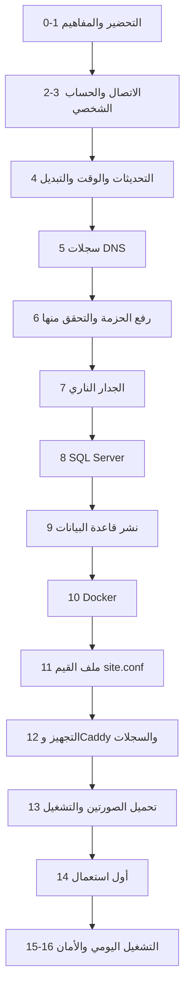

# دليل تثبيت BankFas على خادم Ubuntu للمبتدئين (الإصدار 1.0.6)

التاريخ: 2026-10-26. كتبه وكيل ذكاء اصطناعي.

## عن هذا الدليل

- **لمن:** لمن لم يتعامل مع خادم من قبل. لا يلزمك أن تعرف Linux أو SSH أو الأوامر.
- **ماذا يفعل:** يثبّت BankFas الإصدار 1.0.6 كاملًا على **خادم واحد** بنظام Ubuntu 24.04، **للتجربة ببيانات توضيحية فقط**.
- **المسار:** هو مسار `docs/58` (الخادم الواحد)، بترتيب خطوات `docs/54`، مع تحميل الصورتين من الحزمة كما في `docs/57`. وكل أمر هنا مأخوذ من هذه الوثائق ومن السكربتات نفسها.
- **كيف تقرأ:**
  - كل أمر في مربع رمادي. **انسخه كما هو** والصقه في الطرفية، ثم اضغط `Enter`.
  - قبل كل أمر سطر يشرح ما يفعله. وبعده «ما يجب أن تراه» عند الحاجة.
  - النصوص بين `<` و`>` أماكن لقيمك أنت. **احذف العلامتين** وضع قيمتك. مثال: `<DOMAIN>` تصير `treasury.mycompany.com`.
  - السطر الذي يبدأ بـ «تحقّق:» نقطة لم نستطع التأكد منها إلا على خادم حقيقي. وكلها مجموعة في آخر الدليل.

### القيم التي ستستعملها في كل الدليل

اكتبها الآن في ورقة أو في ملف على جهازك، وارجع إليها:

| المكان | معناه | مثال (لا تستعمله كما هو) |
|---|---|---|
| `<SERVER_IP>` | عنوان IPv4 العام لخادمك، من لوحة المزوّد | `203.0.113.25` |
| `<DOMAIN>` | النطاق الذي تملكه، أو نطاق فرعي منه للنظام | `treasury.mycompany.com` |
| `<YOUR_USER>` | اسم حسابك الشخصي على الخادم، بحروف إنجليزية صغيرة | `opsadmin` |
| `<YOUR_IP>` | عنوان IP العام لجهازك أنت (الجزء 7 يشرح كيف تعرفه) | `198.51.100.7` |
| `<YOUR_SQL_LOGIN>` | اسم حسابك الشخصي في SQL Server | `dba_admin1` |
| `<OPS_EMAIL>` | بريد تقرؤه لإشعارات الشهادات والتشغيل | `ops@mycompany.com` |
| `<SECURITY_EMAIL>` | بريد تقرؤه للتنبيهات الأمنية | `security@mycompany.com` |
| `<OPERATOR_EMAIL>` | بريد أول مشغّل للمنصة (غالبًا أنت) | `you@mycompany.com` |
| `<WINDOWS_USER>` | اسم مستخدمك في Windows (يظهر في `C:\Users\...`) | `Ahmad` |

## نظرة عامة



---

## الجزء 0: ما تحتاجه قبل أن تبدأ

### 0.1 قائمة التحضير

ضع علامة على كل بند قبل البدء. **لا تبدأ والبند الأول أو الثاني ناقص.**

- [ ] **جهاز Windows 10 أو 11** (أو Mac)، متصل بالإنترنت.
- [ ] **خادم افتراضي (VPS)** فيه:
  - نظام **Ubuntu 24.04 LTS**. الأدوات ترفض أي إصدار آخر.
  - معالجان، و8 غيغابايت ذاكرة، و150 غيغابايت قرص NVMe.
  - عنوان **IPv4 عام ثابت**.
  - كلمة مرور root، أو مفتاح SSH، من المزوّد.
  - **المنفذ 587 للخروج مفتوح.** اسأل المزوّد. كثير منهم يغلقه، وبدونه لا تصل رسائل الدعوة.
  - **لقطات (snapshots)** إن أمكن، للعودة إلى حالة سابقة.
- [ ] **نطاق تملكه**، مثل `mycompany.com`. ستستعمله أو نطاقًا فرعيًا منه.
- [ ] **حساب Cloudflare** يدير DNS لهذا النطاق، و**رمز API** له (الجزء 5 يشرح إنشاءه).
  - هذا لا يمكن تجنبه: النظام يحتاج شهادة شاملة `*.<DOMAIN>`، ولا تُصدر إلا بتحدي DNS عبر واجهة برمجية.
- [ ] **حساب SMTP** لإرسال البريد: اسم الخادم (مثل `smtp.office365.com`)، والمنفذ 587، واسم المستخدم، وكلمة المرور، وعنوان المرسل.
  - هذا أيضًا لا يمكن تجنبه: الدعوات وروابط الدخول تصل بالبريد.
- [ ] **حساب GitHub** له صلاحية على المستودع الخاص، لتنزيل الحزمة من صفحة الإصدار:
  `https://github.com/thawrasy/smartlines/releases/tag/bankfas-v1.0.6`
- [ ] **خزنة كلمات مرور** (برنامج إدارة كلمات المرور) أو قرص USB مشفّر، **خارج الخادم**. ستحفظ فيها المفاتيح وكلمات المرور. بدونها قد تضيع البيانات كلها.
- [ ] **تطبيق مصادقة** على هاتفك، مثل Microsoft Authenticator أو Google Authenticator.

### 0.2 الحزمة

من صفحة الإصدار نزّل ملفًا واحدًا:

- `bankfas-1.0.6-complete.tar`

في داخله مجلد `bankfas-1.0.6/` وفيه:

| الملف | ما هو |
|---|---|
| `bankfas-api-1.0.6.tar.gz` | صورة خادم التطبيق |
| `bankfas-worker-1.0.6.tar.gz` | صورة الخادم الخلفي (البريد والمهام) |
| `bankfas-source-1.0.6.tar.gz` | الأدوات والسكربتات والوثائق |
| `INSTALL-AR.md` و`INSTALL-AR.docx` | دليل الإصدار (`docs/57`) |
| `SHA256SUMS` | بصمة كل ملف، للتحقق من سلامته |
| `VERSION.txt` | رقم الإصدار ومعرّفا الصورتين |
| هذا الدليل | — |

### 0.3 كم يستغرق

| المرحلة | الوقت التقريبي |
|---|---|
| الأجزاء 2 إلى 7 | ساعتان إلى ثلاث |
| الجزءان 8 و9 (القاعدة) | ساعتان إلى ثلاث |
| الأجزاء 10 إلى 13 | ساعتان |
| **تنزيل قائمة كلمات المرور المسرّبة** | **عدة ساعات** (نحو 30 غيغابايت، ومليون ملف صغير). يعمل في الخلفية، ولا يبدأ التشغيل قبل اكتماله |
| الجزء 14 | نصف ساعة |

**نصيحة:** ابدأ تنزيل القائمة مبكرًا، بعد الجزء 7 مباشرة (الخطوة 12.1). فيعمل وأنت تكمل الباقي.

---

## الجزء 1: مفاهيم بكلمات بسيطة

### 1.1 الكلمات

- **الخادم:** حاسوب في مركز بيانات، يعمل دائمًا، بلا شاشة. تتحكم فيه من جهازك عبر الإنترنت.
- **SSH:** طريقة آمنة ومشفّرة للدخول إلى الخادم وكتابة الأوامر فيه.
- **الطرفية (Terminal):** نافذة نصية تكتب فيها الأوامر. في Windows اسمها PowerShell أو Windows Terminal. وفي Mac اسمها Terminal.
- **الأمر:** سطر نصي تكتبه ثم تضغط `Enter`، فينفّذه الحاسوب.
- **المحثّ (prompt):** النص الذي يظهر قبل مكان الكتابة. على الخادم يشبه:
  ```text
  opsadmin@server:~$
  ```
  - العلامة `$` تعني أنك مستخدم عادي.
  - العلامة `#` تعني أنك **root**، أي المدير الكامل. كن حذرًا حينها.
- **root:** الحساب الذي يملك كل شيء على الخادم.
- **sudo:** كلمة تكتبها قبل الأمر لتنفيذه بصلاحية root. يسألك أول مرة عن **كلمة مرور حسابك أنت**.
- **المسار:** مكان الملف. يبدأ بـ `/`، مثل `/opt/bankfas/site.conf`. والعلامة `~` تعني مجلدك الشخصي، مثل `/home/opsadmin`.

### 1.2 النسخ واللصق في الطرفية

| العمل | Windows Terminal / PowerShell | Mac Terminal |
|---|---|---|
| لصق | `Ctrl+V`، أو زر الفأرة الأيمن | `Cmd+V` |
| نسخ نص محدد | حدده بالفأرة ثم `Ctrl+C` | `Cmd+C` |
| إيقاف أمر يعمل | `Ctrl+C` **بلا نص محدد** | `Ctrl+C` |

- **تنبيه:** `Ctrl+C` بلا نص محدد لا ينسخ. بل يوقف الأمر الجاري.
- **كلمات المرور لا تظهر** حين تكتبها، ولا حتى نجوم. هذا طبيعي. اكتبها واضغط `Enter`.
- إذا ألصقت أمرًا من عدة أسطر، تأكد أنه نُفّذ كله، ثم اضغط `Enter` إن بقي ينتظر.

### 1.3 تعديل ملف بالمحرر nano

ستفتح بعض الملفات بالمحرر `nano`. هو محرر نصي بسيط داخل الطرفية.

| العمل | المفاتيح |
|---|---|
| التحرك | الأسهم |
| الحفظ | `Ctrl+O` ثم `Enter` |
| الخروج | `Ctrl+X` |
| البحث | `Ctrl+W` ثم الكلمة ثم `Enter` |
| حذف سطر كامل | `Ctrl+K` |
| لصق | زر الفأرة الأيمن، أو `Ctrl+V` في Windows Terminal |

- إذا خرجت بـ `Ctrl+X` قبل الحفظ، يسألك `Save modified buffer?`. اضغط `Y` ثم `Enter` للحفظ، أو `N` للخروج بلا حفظ.

---

## الجزء 2: الاتصال بالخادم

### 2.1 افتح الطرفية

- **Windows:** اضغط زر Start، واكتب `Terminal` أو `PowerShell`، وافتحه. في Windows 10 و11 برنامج `ssh` موجود مسبقًا.
- **Mac:** افتح `Applications` ثم `Utilities` ثم `Terminal`.

تأكد أن `ssh` موجود:

```powershell
ssh -V
```

ما يجب أن تراه: سطر يبدأ بـ `OpenSSH_`. إن ظهر «not recognized» في Windows، فافتح `Settings` ثم `Apps` ثم `Optional features`، وأضف `OpenSSH Client`.

### 2.2 الدخول أول مرة بحساب root

ادخل إلى الخادم بحساب root وعنوانه:

```powershell
ssh root@<SERVER_IP>
```

ستظهر رسالة مثل:

```text
The authenticity of host '203.0.113.25' can't be established.
ED25519 key fingerprint is SHA256:AbCdEf...
Are you sure you want to continue connecting (yes/no/[fingerprint])?
```

- هذه **بصمة الخادم**. هي هويته. انسخ سطر `SHA256:...` إلى ملاحظاتك.
- إن كانت لوحة المزوّد تعرض البصمة، فقارنها الآن. يجب أن تتطابق.
- اكتب `yes` ثم `Enter`.
- اكتب كلمة مرور root (لن تظهر) ثم `Enter`.

ما يجب أن تراه: محثّ ينتهي بـ `#`، مثل `root@server:~#`.

إذا فشل:
- `Connection timed out`: العنوان خطأ، أو جدار المزوّد يغلق المنفذ 22. افتحه من لوحة المزوّد.
- `Permission denied`: كلمة المرور خطأ. أعد المحاولة، أو أعد ضبطها من لوحة المزوّد.
- إن أعطاك المزوّد مستخدمًا آخر (مثل `ubuntu`) بدل root، فاستعمله: `ssh ubuntu@<SERVER_IP>`، واكتب `sudo` قبل أوامر هذا الجزء والجزء 3.

### 2.3 سجّل بصمة الخادم من داخله (B-01)

اعرض بصمة مفتاح الخادم من داخله:

```bash
ssh-keygen -lf /etc/ssh/ssh_host_ed25519_key.pub
```

ما يجب أن تراه: `256 SHA256:... root@... (ED25519)`. يجب أن يطابق ما ظهر لك في 2.2. احفظه في **سجل التجهيز** (ملف ملاحظات على جهازك).

### 2.4 غيّر كلمة مرور root

غيّر كلمة مرور root إلى كلمة قوية جديدة:

```bash
passwd
```

- اكتب الكلمة الجديدة مرتين. لن تظهر.
- ما يجب أن تراه: `passwd: password updated successfully`.
- احفظها في خزنة كلمات المرور. ستحتاجها فقط في طرفية الطوارئ في لوحة المزوّد.

---

## الجزء 3: حسابك الشخصي ومفتاح SSH وإغلاق دخول root

الهدف: تدخل بحسابك أنت وبمفتاح، لا بكلمة مرور، ولا يدخل أحد بحساب root (DOC-S10 §6.1 و§6.3).

### 3.1 أنشئ حسابك الشخصي (على الخادم، بحساب root)

أنشئ المستخدم:

```bash
adduser <YOUR_USER>
```

- يسألك كلمة مرور مرتين. اختر كلمة قوية **واحفظها**. ستحتاجها لـ `sudo`، وللدخول من طرفية المزوّد في الطوارئ.
- ثم يسأل عن الاسم والهاتف وغيرها. اضغط `Enter` لكل سؤال، ثم `Y`.

أنشئ مجموعة المسؤولين التي يسمح لها إعداد SSH بالدخول:

```bash
groupadd bankfas-admins
```

أضف حسابك إلى مجموعة المسؤولين ومجموعة `sudo`:

```bash
usermod -aG bankfas-admins,sudo <YOUR_USER>
```

تأكد من العضوية:

```bash
id <YOUR_USER>
```

ما يجب أن تراه: في آخر السطر `sudo` و`bankfas-admins`.

### 3.2 أنشئ مفتاح SSH على جهازك

افتح **نافذة طرفية جديدة على جهازك** (لا على الخادم). المفتاح يُنشأ على جهازك ويبقى فيه.

أنشئ مفتاحًا من نوع Ed25519 (الأمر نفسه في Windows وMac):

```powershell
ssh-keygen -t ed25519
```

- `Enter file in which to save the key`: اضغط `Enter` لقبول المكان الافتراضي.
- `Enter passphrase`: اكتب عبارة مرور للمفتاح. تحميه إن سُرق جهازك. اكتبها مرتين.
- ما يجب أن تراه: `Your public key has been saved in ...id_ed25519.pub`.

الملفان:
- `id_ed25519`: **المفتاح الخاص. لا تعطه لأحد أبدًا.**
- `id_ed25519.pub`: المفتاح العام. هذا الذي يوضع على الخادم.

### 3.3 انسخ المفتاح العام إلى الخادم

**في Windows (PowerShell)،** أرسل المفتاح العام إلى حسابك على الخادم:

```powershell
type $env:USERPROFILE\.ssh\id_ed25519.pub | ssh <YOUR_USER>@<SERVER_IP> "mkdir -p ~/.ssh && chmod 700 ~/.ssh && cat >> ~/.ssh/authorized_keys && chmod 600 ~/.ssh/authorized_keys"
```

**في Mac،** الأمر أبسط:

```bash
ssh-copy-id -i ~/.ssh/id_ed25519.pub <YOUR_USER>@<SERVER_IP>
```

- يسألك كلمة مرور **حسابك على الخادم** (من 3.1).
- ما يجب أن تراه: لا رسالة خطأ.

### 3.4 جرّب الدخول بالمفتاح

ادخل بحسابك الشخصي:

```powershell
ssh <YOUR_USER>@<SERVER_IP>
```

- يجب أن يسألك **عبارة مرور المفتاح** (من 3.2)، لا كلمة مرور الخادم.
- ما يجب أن تراه: محثّ مثل `opsadmin@server:~$`.

جرّب sudo:

```bash
sudo whoami
```

ما يجب أن تراه: يسألك كلمة مرور حسابك، ثم يطبع `root`.

**لا تكمل إن لم ينجح هذا.** وإن سألك كلمة مرور الخادم بدل عبارة المفتاح، فالمفتاح لم يُنسخ. أعد 3.3.

### 3.5 قاعدة sudo (DOC-S10 §6.3)

اكتب قاعدة sudo في ملف مؤقت أولًا:

```bash
printf 'Defaults use_pty\nDefaults timestamp_timeout=5\n' > /tmp/60-bankfas
```

افحص صحة الملف قبل وضعه. خطأ في ملفات sudo قد يمنعك من sudo:

```bash
sudo visudo -cf /tmp/60-bankfas
```

ما يجب أن تراه: `/tmp/60-bankfas: parsed OK`.

ضعه في مكانه:

```bash
sudo install -m 440 /tmp/60-bankfas /etc/sudoers.d/60-bankfas && rm /tmp/60-bankfas
```

### 3.6 أغلق دخول root ودخول كلمات المرور (B-02)

**قاعدة ذهبية:** أبقِ نافذة SSH الحالية مفتوحة طوال هذه الخطوة. لا تغلقها حتى تنجح نافذة ثانية.

اكتب إعداد SSH من DOC-S10 §6.1 (أمر واحد من عدة أسطر، انسخه كله):

```bash
sudo tee /etc/ssh/sshd_config.d/10-bankfas.conf >/dev/null <<'EOF'
PasswordAuthentication no
KbdInteractiveAuthentication no
PermitRootLogin no
PubkeyAuthentication yes
AllowGroups bankfas-admins
MaxAuthTries 3
LoginGraceTime 30
ClientAliveInterval 300
ClientAliveCountMax 2
X11Forwarding no
AllowAgentForwarding no
AllowTcpForwarding local
PermitTunnel no
EOF
```

- اسم الملف يبدأ بـ `10`، فيُقرأ قبل ملف المزوّد (مثل `50-cloud-init.conf`) الذي قد يسمح بكلمات المرور. وفي SSH أول قيمة تُقرأ هي التي تسري.

افحص الإعداد، ثم أعد تحميل SSH:

```bash
sudo sshd -t && sudo systemctl reload ssh
```

ما يجب أن تراه: لا شيء. لا رسالة تعني النجاح.

تأكد من القيم الفعلية:

```bash
sudo sshd -T | grep -E '^(passwordauthentication|permitrootlogin|allowgroups)'
```

ما يجب أن تراه:

```text
passwordauthentication no
permitrootlogin no
allowgroups bankfas-admins
```

**الآن افتح نافذة طرفية ثانية على جهازك**، وادخل:

```powershell
ssh <YOUR_USER>@<SERVER_IP>
```

- إن نجح: ممتاز. يمكنك إغلاق النافذة الأولى.
- إن فشل: **لا تغلق النافذة الأولى.** منها احذف الملف وأعد التحميل، ثم راجع 3.1 إلى 3.4:

```bash
sudo rm /etc/ssh/sshd_config.d/10-bankfas.conf && sudo systemctl reload ssh
```

وتأكد أن root لا يدخل. من جهازك:

```powershell
ssh root@<SERVER_IP>
```

ما يجب أن تراه: `Permission denied`. هذا المطلوب.

- تحقّق: في Ubuntu 24.04 قد تُدار SSH عبر المقبس (`ssh.socket`). إعادة التحميل تكفي لهذه الإعدادات. أما تغيير المنفذ فيلزمه تعديل وحدة المقبس (DOC-S10 §6.1)، ولا نغيّره في هذا الدليل.
- إن أعطاك المزوّد مستخدمًا افتراضيًا (مثل `ubuntu`)، فاقفله بعد أن ينجح حسابك: `sudo usermod -L ubuntu`.

**من الآن، كل الدليل بحسابك الشخصي:** `ssh <YOUR_USER>@<SERVER_IP>`.

---

## الجزء 4: التحديثات والوقت وذاكرة التبديل

### 4.1 تحديث النظام

حدّث قائمة الحزم وثبّت التحديثات:

```bash
sudo apt-get update && sudo apt-get -y upgrade
```

- يستغرق دقائق. قد تظهر نافذة زرقاء تسأل عن الخدمات التي تُعاد. اضغط `Enter` لقبول الافتراضي.

إن طلب النظام إعادة التشغيل، يظهر هذا الملف. افحصه:

```bash
ls /var/run/reboot-required
```

- إن ظهر الملف: أعد التشغيل بـ `sudo reboot`، وانتظر دقيقتين، ثم ادخل من جديد.
- إن ظهر `No such file or directory`: لا حاجة.

### 4.2 التحديثات الأمنية الآلية (DOC-S10 §6.4)

ثبّت أداة التحديث الآلي (غالبًا موجودة):

```bash
sudo apt-get install -y unattended-upgrades
```

اكتب إعدادها: الأمن فقط، وحزم Microsoft مستثناة، ولا إعادة تشغيل آلية:

```bash
sudo tee /etc/apt/apt.conf.d/52bankfas-unattended >/dev/null <<'EOF'
Unattended-Upgrade::Allowed-Origins { "${distro_id}:${distro_codename}-security"; };
Unattended-Upgrade::Package-Blacklist { "mssql-server"; "mssql-tools18"; "msodbcsql18"; };
Unattended-Upgrade::Automatic-Reboot "false";
Unattended-Upgrade::Remove-Unused-Kernel-Packages "true";
EOF
```

جرّبها دون تثبيت شيء:

```bash
sudo unattended-upgrade --dry-run --debug | tail -20
```

ما يجب أن تراه: أسطر بلا `ERROR`.

تأكد أنها مفعّلة:

```bash
systemctl is-enabled unattended-upgrades
```

ما يجب أن تراه: `enabled`.

### 4.3 الوقت (DOC-S10 §6.5)

اضبط المنطقة الزمنية على UTC:

```bash
sudo timedatectl set-timezone Etc/UTC
```

ثبّت خدمة الوقت chrony:

```bash
sudo apt-get install -y chrony
```

افحص المزامنة:

```bash
chronyc tracking
```

ما يجب أن تراه: سطر `System time` بفارق أقل من ثانية، و`Leap status : Normal`.

```bash
timedatectl
```

ما يجب أن تراه: `System clock synchronized: yes` و`Time zone: Etc/UTC`.

### 4.4 ذاكرة التبديل 4 غيغابايت (docs/58 الخطوة 2)

لماذا: SQL Server وClamAV وطابعة PDF معًا يصلون إلى نحو 8.5 غيغابايت في الذروة. ذاكرة التبديل جزء من القرص يُستعمل حين تمتلئ الذاكرة.

أنشئ ملف التبديل:

```bash
sudo fallocate -l 4G /swapfile && sudo chmod 600 /swapfile
```

فعّله:

```bash
sudo mkswap /swapfile && sudo swapon /swapfile
```

اجعله يبقى بعد إعادة التشغيل:

```bash
echo '/swapfile none swap sw 0 0' | sudo tee -a /etc/fstab
```

قلّل لجوء النظام إليه:

```bash
echo 'vm.swappiness=10' | sudo tee /etc/sysctl.d/61-bankfas-swap.conf && sudo sysctl --system
```

افحص:

```bash
free -h
```

ما يجب أن تراه: سطر `Swap:` فيه `4.0Gi`.

- نفّذ أمر `fstab` **مرة واحدة فقط**. وإن نفّذته مرتين، فاحذف السطر المكرر بـ `sudo nano /etc/fstab`.

---

## الجزء 5: سجلات DNS في Cloudflare

### 5.1 أضف النطاق إلى Cloudflare (إن لم يكن فيه)

1. ادخل إلى `dash.cloudflare.com`.
2. اضغط `Add a domain` (أو `Add site`)، واكتب نطاقك الأساسي (مثل `mycompany.com`)، واختر الخطة المجانية `Free`.
3. يعطيك Cloudflare اسمي خادمين (nameservers)، مثل `xxx.ns.cloudflare.com`.
4. ادخل إلى موقع الشركة التي اشتريت منها النطاق، وضع الاسمين بدل القديمين.
5. انتظر حتى يصير النطاق في Cloudflare `Active`. قد يستغرق من دقائق إلى ساعات.

### 5.2 سجلا الخادم (A-08 وdocs/58)

في Cloudflare: اختر النطاق، ثم من القائمة اليسرى `DNS` ثم `Records`، ثم `Add record`.

**السجل الأول، للنطاق نفسه:**

| الحقل | القيمة |
|---|---|
| `Type` | `A` |
| `Name` | الجزء الذي قبل نطاقك الأساسي. إن كان `<DOMAIN>` هو `treasury.mycompany.com` فاكتب `treasury`. وإن كان النطاق الأساسي نفسه فاكتب `@` |
| `IPv4 address` | `<SERVER_IP>` |
| `Proxy status` | **أطفئه**: السحابة رمادية، ومكتوب `DNS only` |
| `TTL` | `Auto` |

ثم `Save`.

**السجل الثاني، الشامل لكل البوابات:**

| الحقل | القيمة |
|---|---|
| `Type` | `A` |
| `Name` | `*.treasury` في المثال، أو `*` إن كان `<DOMAIN>` هو النطاق الأساسي |
| `IPv4 address` | `<SERVER_IP>` |
| `Proxy status` | `DNS only` (رمادية) |

ثم `Save`.

- **لماذا `DNS only`:** النظام مصمم بلا حافة Cloudflare. Caddy على الخادم هو الواجهة الوحيدة، والحظر الآلي يعتمد على عنوان الزائر الحقيقي.
- **لا تضف سجلًا لـ `db.<DOMAIN>`.** القاعدة على الخادم نفسه، والخادم يصل إليها داخليًا. وشهادتها تُصدر بتحدي DNS بلا سجل (docs/58).

### 5.3 رمز API لـ Cloudflare

يحتاجه certbot (شهادة القاعدة) وCaddy (الشهادة الشاملة).

1. في Cloudflare اضغط صورة حسابك أعلى اليمين، ثم `My Profile`، ثم `API Tokens`.
2. اضغط `Create Token`، ثم بجانب القالب `Edit zone DNS` اضغط `Use template`.
3. في `Permissions` يجب أن يظهر `Zone` - `DNS` - `Edit`. أضف سطرًا بـ `+ Add more`: `Zone` - `Zone` - `Read`.
4. في `Zone Resources`: `Include` - `Specific zone` - نطاقك.
5. اضغط `Continue to summary` ثم `Create Token`.
6. **انسخ الرمز فورًا** إلى خزنة كلمات المرور. لا يظهر مرة ثانية.

- تحقّق: صلاحية `Zone:Read` تطلبها وحدة Caddy لـ Cloudflare في وثائقها. إن رفض Caddy أو certbot الرمز، فراجع صلاحياته.

### 5.4 تحقّق من السجلات

من جهازك، في PowerShell أو Terminal، اسأل عن العنوان:

```powershell
nslookup <DOMAIN>
```

ما يجب أن تراه: `Address: <SERVER_IP>`.

واسأل عن اسم تحت النطاق، أي اسم:

```powershell
nslookup test123.<DOMAIN>
```

ما يجب أن تراه: العنوان نفسه. هذا يثبت أن السجل الشامل يعمل.

---

## الجزء 6: رفع الحزمة إلى الخادم والتحقق منها

### 6.1 نزّل الحزمة على جهازك

1. سجّل الدخول إلى GitHub بحساب له صلاحية على المستودع.
2. افتح `https://github.com/thawrasy/smartlines/releases/tag/bankfas-v1.0.6`.
3. في قسم `Assets` اضغط `bankfas-1.0.6-complete.tar`. يُحفظ غالبًا في مجلد التنزيلات.

### 6.2 ارفعها إلى الخادم

**الطريقة الأولى: scp من الطرفية.**

في Windows (PowerShell على جهازك):

```powershell
scp C:\Users\<WINDOWS_USER>\Downloads\bankfas-1.0.6-complete.tar <YOUR_USER>@<SERVER_IP>:~/
```

في Mac:

```bash
scp ~/Downloads/bankfas-1.0.6-complete.tar <YOUR_USER>@<SERVER_IP>:~/
```

ما يجب أن تراه: سطر بالنسبة المئوية حتى `100%`. الملف كبير، فقد يأخذ دقائق.

**الطريقة الثانية، برنامج بواجهة رسومية: WinSCP (Windows).**
1. نزّله من موقعه الرسمي `winscp.net` وثبّته.
2. `New Site`: `File protocol` = `SFTP`، و`Host name` = `<SERVER_IP>`، و`User name` = `<YOUR_USER>`.
3. اضغط `Advanced...` ثم `SSH` ثم `Authentication`، واختر ملف مفتاحك الخاص `C:\Users\<WINDOWS_USER>\.ssh\id_ed25519`. يعرض WinSCP تحويله إلى صيغته `.ppk`، فوافق.
4. `Login`، ثم اسحب الملف من اليسار (جهازك) إلى اليمين (مجلدك على الخادم `/home/<YOUR_USER>`).

### 6.3 استخرج الحزمة الخارجية (على الخادم)

ادخل إلى الخادم، ثم تأكد أن الملف وصل:

```bash
ls -lh ~/bankfas-1.0.6-complete.tar
```

ما يجب أن تراه: الملف بحجمه.

استخرجه في مجلدك:

```bash
cd ~ && tar -xf bankfas-1.0.6-complete.tar
```

ادخل المجلد واعرض محتواه:

```bash
cd ~/bankfas-1.0.6 && ls -l
```

ما يجب أن تراه: الملفات الثلاثة `.tar.gz` و`SHA256SUMS` و`VERSION.txt` و`INSTALL-AR.md` وغيرها.

### 6.4 تحقّق من سلامة الملفات (docs/57 القسم 4)

قارن بصمة كل ملف بما في `SHA256SUMS`:

```bash
sha256sum -c SHA256SUMS
```

ما يجب أن تراه: كل سطر ينتهي بـ `OK`، مثل:

```text
bankfas-api-1.0.6.tar.gz: OK
bankfas-source-1.0.6.tar.gz: OK
bankfas-worker-1.0.6.tar.gz: OK
```

- إن ظهر `FAILED` لأي ملف: **توقف.** الملف تالف أو معدّل. نزّل الحزمة من جديد.
- تحقّق: `SHA256SUMS` يُصنع مع ملفات الإصدار. فإن أُضيف هذا الدليل إلى المجلد بعده، فقد لا يكون له سطر فيه. هذا لا يضر، المهم أن تنجح أسطر الملفات الموجودة كلها.

اعرض رقم الإصدار:

```bash
cat VERSION.txt
```

ما يجب أن تراه: `BankFas 1.0.6`، ثم رقم الحفظة ومعرّفا الصورتين.

### 6.5 استخرج الأدوات

استخرج مصدر الإصدار:

```bash
tar -xzf bankfas-source-1.0.6.tar.gz
```

ادخل مجلد الأدوات:

```bash
cd ~/bankfas-1.0.6/treasury-platform && ls
```

ما يجب أن تراه: مجلدات منها `tools` و`db` و`docs`، والملف `versions.json`.

- **مهم:** كل أوامر `tools/...` في هذا الدليل تُنفّذ من هذا المجلد: `~/bankfas-1.0.6/treasury-platform`. إن دخلت من جديد إلى الخادم، فارجع إليه أولًا:

```bash
cd ~/bankfas-1.0.6/treasury-platform
```

---

## الجزء 7: الجدار الناري وإعدادات النواة

### 7.1 اعرف عنوانك العام

أسهل طريقة: اسأل الخادم من أين تتصل به. على الخادم:

```bash
echo $SSH_CLIENT
```

ما يجب أن تراه: ثلاث قيم، مثل `198.51.100.7 52344 22`. **الأولى هي `<YOUR_IP>`.**

- يمكنك أيضًا فتح `https://ifconfig.me` في متصفح جهازك.
- إن كان فيه نقطتان `:` فهو IPv6. اكتبه بعده `/128` بدل `/32` في الأمر التالي.
- **إن كان عنوانك يتغير** (إنترنت منزلي عادي)، فسيُغلق عليك SSH حين يتغير. الحل: اطلب عنوانًا ثابتًا من مزوّد الإنترنت، أو استعمل VPN بعنوان ثابت. والعلاج إن حدث في جدول الأعطال (الجزء 15).

### 7.2 شغّل سكربت الجدار (docs/58 الخطوة 3)

ماذا يفعل `tools/host/ufw.sh`:
- يمنع كل دخول، إلا:
  - SSH من عناوينك وحدها.
  - 80 و443 للجميع (الموقع).
  - 1433 (SQL Server) من شبكة الحاويات الداخلية `172.30.0.0/24` وحدها، بسبب `DB_ON_THIS_HOST=1`.
- يحدّ ping والاتصالات الكثيرة من عنوان واحد.

**تأكد من `<YOUR_IP>` مرتين قبل التشغيل.** عنوان خطأ يغلق عليك SSH.

من مجلد الأدوات، شغّل السكربت:

```bash
cd ~/bankfas-1.0.6/treasury-platform
```

```bash
sudo ADMIN_CIDRS="<YOUR_IP>/32" DB_ON_THIS_HOST=1 bash tools/host/ufw.sh
```

- لأكثر من عنوان، افصل بمسافة: `ADMIN_CIDRS="198.51.100.7/32 192.0.2.44/32"`.

ما يجب أن تراه في آخر الناتج:

```text
Status: active
...
22/tcp      ALLOW IN    <YOUR_IP>      # SSH from the admins
80/tcp      ALLOW IN    Anywhere
443/tcp     ALLOW IN    Anywhere
443/udp     ALLOW IN    Anywhere
1433/tcp    ALLOW IN    172.30.0.0/24  # SQL Server from the containers (docs/58)
```

**افتح نافذة ثانية وجرّب الدخول** `ssh <YOUR_USER>@<SERVER_IP>`. إن نجح، فالجدار سليم.

- إن كان للمزوّد جدار في لوحته، فافتح فيه 22 (من عنوانك) و80 و443 فقط. لا تفتح 1433.

احفظ الناتج في سجل التجهيز:

```bash
sudo ufw status verbose
```

### 7.3 إعدادات النواة الدفاعية (H-02)

انسخ ملف إعدادات النواة، ثم حمّله:

```bash
sudo cp tools/host/sysctl-bankfas.conf /etc/sysctl.d/60-bankfas.conf && sudo sysctl --system
```

ما يجب أن تراه: قائمة إعدادات، منها `net.ipv4.tcp_syncookies = 1`.

**الآن وقت مناسب لبدء تنزيل قائمة كلمات المرور المسرّبة** (الخطوة 12.1). يعمل ساعات في الخلفية.

---

## الجزء 8: SQL Server

هذا الجزء هو الجزء B من `docs/54` (الخطوات B-05 إلى B-13)، بفروق `docs/58`. ومصدر الأوامر DOC-S10 وDOC-S05 وDOC-S08 وDOC-S02.

- **[تحقق MS]:** أوامر تثبيت SQL Server وإعدادات `mssql-conf` موسومة في DOC-S10 بأنها مأخوذة من المعرفة العامة، ويجب مطابقتها مع وثائق Microsoft الرسمية للإصدار المثبّت. أبقينا الوسم عند كل منها.

### 8.1 الإصدار المطلوب

الأدوات تقارن الخادم بملف `versions.json`. اعرض ما فيه:

```bash
cat versions.json | grep -E '"(os_release|release|update|product_version)"'
```

ما يجب أن تراه:

```text
"os_release": "24.04",
"release": "SQL Server 2025",
"update": "CU9 GDR1",
"product_version": "17.0.5015.4"
```

**يجب أن تثبّت `17.0.5015.4` بالضبط.** النشر يرفض غيره.

### 8.2 أضف مستودع Microsoft (B-06، DOC-S10 §5.1) [تحقق MS]

نزّل مفتاح توقيع Microsoft:

```bash
curl -fsSL https://packages.microsoft.com/keys/microsoft.asc | sudo gpg --dearmor -o /usr/share/keyrings/microsoft-prod.gpg
```

أضف مستودع SQL Server 2025 لـ Ubuntu 24.04:

```bash
curl -fsSL https://packages.microsoft.com/config/ubuntu/24.04/mssql-server-2025.list | sudo tee /etc/apt/sources.list.d/mssql-server-2025.list
```

ما يجب أن تراه: سطر يبدأ بـ `deb`.

أضف مستودع أدوات sqlcmd (كما في CI):

```bash
echo "deb [arch=amd64 signed-by=/usr/share/keyrings/microsoft-prod.gpg] https://packages.microsoft.com/ubuntu/24.04/prod noble main" | sudo tee /etc/apt/sources.list.d/mssql-release.list
```

حدّث قائمة الحزم:

```bash
sudo apt-get update
```

ما يجب أن تراه: أسطر `Get:` من `packages.microsoft.com`، بلا `NO_PUBKEY`.

- تحقّق: اسم ملف المستودع `mssql-server-2025.list` من DOC-S10، ويُطابَق مع وثائق Microsoft. إن أعاد `curl` خطأ 404، فخذ الرابط الصحيح من صفحة Microsoft «Install SQL Server on Ubuntu».

### 8.3 ثبّت الإصدار المسجّل بعينه

اعرض الإصدارات المتاحة:

```bash
apt-cache policy mssql-server
```

ما يجب أن تراه: قائمة `Version table:`. **ابحث عن سطر يبدأ بـ `17.0.5015.4`**، مثل `17.0.5015.4-1`. انسخ القيمة كاملة. سنسميها `<MSSQL_PKG_VERSION>`.

- إن لم تجد سطرًا يبدأ بـ `17.0.5015.4`: **توقف.** لا تثبّت غيره. راجع المستودع.

ثبّت هذا الإصدار بالضبط:

```bash
sudo apt-get install -y mssql-server=<MSSQL_PKG_VERSION>
```

جمّده حتى لا يُرقّى وحده:

```bash
sudo apt-mark hold mssql-server
```

ما يجب أن تراه: `mssql-server set on hold.`

### 8.4 الإعداد الأول: إصدار Developer (docs/58)

ولّد كلمة مرور عشوائية لحساب `sa`. ستستعملها مرتين فقط ثم يُعطَّل الحساب:

```bash
openssl rand -base64 24
```

انسخ الناتج إلى خزنة كلمات المرور مؤقتًا، باسم «sa مؤقت».

شغّل الإعداد [تحقق MS]:

```bash
sudo /opt/mssql/bin/mssql-conf setup
```

- `Choose an edition of SQL Server`: اختر رقم **Developer**. وإن ظهر خياران `Enterprise Developer` و`Standard Developer` فاختر `Enterprise Developer`.
- اقبل شروط الترخيص بكتابة `Yes`.
- `Enter the SQL Server system administrator password`: الصق كلمة `sa` المولّدة، ثم أكّدها.
- ما يجب أن تراه في الآخر: `Setup has completed successfully. SQL Server is now starting.`

- **إصدار Developer مجاني وكامل المزايا، ومنها التدقيق وTDE، لكن ترخيصه للتطوير والتجربة فقط.** لا تضع فيه بيانات حقيقية.
- تحقّق: أسماء الإصدارات وأرقامها في قائمة SQL Server 2025 [تحقق MS]. اقرأ القائمة على الشاشة واختر ما فيه كلمة Developer.

تأكد أن الخدمة تعمل ومفعّلة عند الإقلاع:

```bash
systemctl status mssql-server --no-pager
```

ما يجب أن تراه: `Active: active (running)` و`enabled`.

ثبّت أدوات sqlcmd:

```bash
sudo ACCEPT_EULA=Y apt-get install -y mssql-tools18 unixodbc-dev
```

تأكد من وجودها:

```bash
/opt/mssql-tools18/bin/sqlcmd -?
```

ما يجب أن تراه: قائمة خيارات sqlcmd.

### 8.5 المجلدات (B-05 بفرق docs/58)

قرص واحد، فتُنشأ المجلدات الأربعة عليه بملكية المستخدم `mssql`. (المستخدم `mssql` أنشأه التثبيت، لذلك تأتي هذه الخطوة بعده.)

```bash
sudo install -d -o mssql -g mssql -m 0750 /var/opt/mssql/{data,tlog,backup,audit}
```

افحص:

```bash
ls -ld /var/opt/mssql/{data,tlog,backup,audit}
```

ما يجب أن تراه: أربعة أسطر، في كل منها `mssql mssql`.

- لأن النسخ الاحتياطية على القرص نفسه، **يجب أن تنسخها خارج الخادم** (الخطوة 9.9). وإلا ضاعت مع الخادم.

### 8.6 إعدادات mssql-conf والذاكرة (B-07) [تحقق MS]

مسار ملفات البيانات:

```bash
sudo /opt/mssql/bin/mssql-conf set filelocation.defaultdatadir /var/opt/mssql/data
```

مسار سجل المعاملات:

```bash
sudo /opt/mssql/bin/mssql-conf set filelocation.defaultlogdir /var/opt/mssql/tlog
```

مسار النسخ الاحتياطية:

```bash
sudo /opt/mssql/bin/mssql-conf set filelocation.defaultbackupdir /var/opt/mssql/backup
```

فرض التشفير على كل اتصال:

```bash
sudo /opt/mssql/bin/mssql-conf set network.forceencryption 1
```

سقف الذاكرة 3072 ميغابايت (docs/58):

```bash
sudo /opt/mssql/bin/mssql-conf set memory.memorylimitmb 3072
```

اختياري، من DOC-S10 §5.2: إيقاف إرسال بيانات الاستعمال إلى Microsoft [تحقق MS]:

```bash
sudo /opt/mssql/bin/mssql-conf set telemetry.customerfeedback false
```

أعد تشغيل الخدمة:

```bash
sudo systemctl restart mssql-server
```

اعرض الإعدادات واحفظها في سجل التجهيز:

```bash
sudo /opt/mssql/bin/mssql-conf list
```

- إن رفض `mssql-conf` أي إعداد بخطأ «not supported»، فاكتب الخطأ وراجع وثائق Microsoft [تحقق MS].

### 8.7 شهادة TLS لاسم `db.<DOMAIN>` (B-08، DOC-S05 §5)

لماذا: القاعدة تفرض التشفير، والأدوات والحاويات تتحقق من الشهادة واسمها. لذلك يُستعمل الاسم `db.<DOMAIN>` لا `localhost`.

ثبّت certbot ووحدة Cloudflare:

```bash
sudo apt-get install -y certbot python3-certbot-dns-cloudflare
```

أنشئ مجلدًا خاصًا لرمز Cloudflare:

```bash
sudo install -d -m 700 /root/.secrets
```

افتح ملف الرمز بالمحرر:

```bash
sudo nano /root/.secrets/cloudflare.ini
```

اكتب فيه سطرًا واحدًا، بالرمز من 5.3، ثم احفظ واخرج (`Ctrl+O` و`Enter` و`Ctrl+X`):

```ini
dns_cloudflare_api_token = <CLOUDFLARE_API_TOKEN>
```

اجعل الملف لـ root وحده:

```bash
sudo chmod 600 /root/.secrets/cloudflare.ini
```

اطلب الشهادة بتحدي DNS (لا يلزم سجل A لـ `db`):

```bash
sudo certbot certonly --dns-cloudflare --dns-cloudflare-credentials /root/.secrets/cloudflare.ini --dns-cloudflare-propagation-seconds 60 --key-type rsa --rsa-key-size 2048 -d db.<DOMAIN> -m <OPS_EMAIL> --agree-tos --no-eff-email
```

ما يجب أن تراه بعد دقيقة أو اثنتين:

```text
Successfully received certificate.
Certificate is saved at: /etc/letsencrypt/live/db.<DOMAIN>/fullchain.pem
Key is saved at:         /etc/letsencrypt/live/db.<DOMAIN>/privkey.pem
```

- إن ظهر خطأ عن الرمز (`Invalid request headers` أو `Authentication error`): الرمز خطأ أو ينقصه صلاحية. راجع 5.3.
- تحقّق: طلبنا مفتاح RSA لأن دعم SQL Server على Linux لمفاتيح ECDSA (افتراض certbot الحديث) لم نتأكد منه [تحقق MS].

انسخ الشهادة ومفتاحها إلى مكان يملكه `mssql`. أنشئ المجلد:

```bash
sudo install -d -o mssql -g mssql -m 0750 /var/opt/mssql/certs
```

انسخ الشهادة:

```bash
sudo install -o mssql -g mssql -m 0644 /etc/letsencrypt/live/db.<DOMAIN>/fullchain.pem /var/opt/mssql/certs/db.pem
```

انسخ المفتاح بصلاحية 600 (يفحصها `check_db_host.sh`):

```bash
sudo install -o mssql -g mssql -m 0600 /etc/letsencrypt/live/db.<DOMAIN>/privkey.pem /var/opt/mssql/certs/db.key
```

عرّف SQL Server بالشهادة والمفتاح [تحقق MS]:

```bash
sudo /opt/mssql/bin/mssql-conf set network.tlscert /var/opt/mssql/certs/db.pem
```

```bash
sudo /opt/mssql/bin/mssql-conf set network.tlskey /var/opt/mssql/certs/db.key
```

أعد التشغيل:

```bash
sudo systemctl restart mssql-server
```

اربط الاسم بالخادم نفسه (docs/58):

```bash
echo "127.0.0.1 db.<DOMAIN>" | sudo tee -a /etc/hosts
```

**تجديد الشهادة آليًا.** شهادة Let's Encrypt صالحة 90 يومًا، وcertbot يجددها وحده. لكن SQL Server يقرأ النسخة في `/var/opt/mssql/certs`، فيلزم نصّ يُشغَّل بعد كل تجديد. افتح ملفه:

```bash
sudo nano /etc/letsencrypt/renewal-hooks/deploy/mssql-cert.sh
```

اكتب فيه هذه الأسطر (بنطاقك)، ثم احفظ واخرج:

```bash
#!/bin/sh
install -o mssql -g mssql -m 0644 /etc/letsencrypt/live/db.<DOMAIN>/fullchain.pem /var/opt/mssql/certs/db.pem
install -o mssql -g mssql -m 0600 /etc/letsencrypt/live/db.<DOMAIN>/privkey.pem /var/opt/mssql/certs/db.key
systemctl restart mssql-server
```

اجعله قابلًا للتنفيذ:

```bash
sudo chmod 755 /etc/letsencrypt/renewal-hooks/deploy/mssql-cert.sh
```

جرّب التجديد دون تنفيذه:

```bash
sudo certbot renew --dry-run
```

ما يجب أن تراه: `Congratulations, all simulated renewals succeeded`.

- تحقّق: هذا النص ليس من أدوات المستودع. إعادة تشغيل SQL Server بعد التجديد تقطع التطبيق ثواني، كل نحو 60 يومًا. وهذا مقبول للتجربة.

### 8.8 تسجيلات الدخول: حسابك الشخصي ثم تعطيل sa (B-09، DOC-S08 §9)

جرّب الاتصال المشفّر باسم الشهادة، بحساب `sa` المؤقت (يسألك كلمته):

```bash
/opt/mssql-tools18/bin/sqlcmd -S db.<DOMAIN>,1433 -U sa
```

ما يجب أن تراه: المحثّ `1>`. أي أن الاتصال المشفّر نجح والشهادة موثوقة.

- إن ظهر `certificate verify failed` أو `SSL Provider`: الشهادة لم تُضبط. راجع 8.7.
- إن ظهر `Login timeout expired`: سطر `/etc/hosts` ناقص، أو الخدمة متوقفة.

ولّد كلمة لحسابك الشخصي **في نافذة ثانية** (أو على جهازك)، واحفظها في الخزنة. لا تستعمل فيها العلامة `'`:

```bash
openssl rand -base64 24
```

داخل `sqlcmd` (بعد `1>`)، اكتب هذه الأسطر واحدًا واحدًا، ثم `GO`:

```sql
CREATE LOGIN [<YOUR_SQL_LOGIN>] WITH PASSWORD = N'<YOUR_SQL_PASSWORD>', CHECK_POLICY = ON;
ALTER SERVER ROLE sysadmin ADD MEMBER [<YOUR_SQL_LOGIN>];
GO
```

ما يجب أن تراه: المحثّ `1>` من جديد بلا خطأ. ثم اخرج:

```sql
EXIT
```

ادخل بحسابك الشخصي (يسألك كلمته):

```bash
/opt/mssql-tools18/bin/sqlcmd -S db.<DOMAIN>,1433 -U <YOUR_SQL_LOGIN>
```

أنشئ حساب الطوارئ `breakglass` معطّلًا، كما في DOC-S08 §9. ولّد له كلمة أخرى بـ `openssl rand -base64 24` واحفظها في الخزنة باسم «breakglass». ثم في `sqlcmd`:

```sql
CREATE LOGIN [breakglass] WITH PASSWORD = N'<BREAKGLASS_PASSWORD>', CHECK_POLICY = ON;
ALTER SERVER ROLE sysadmin ADD MEMBER [breakglass];
ALTER LOGIN [breakglass] DISABLE;
GO
```

عطّل `sa` وأعد تسميته:

```sql
ALTER LOGIN [sa] DISABLE;
ALTER LOGIN [sa] WITH NAME = [sa_disabled];
GO
```

افحص الحسابات:

```sql
SELECT name, is_disabled FROM sys.server_principals WHERE type = 'S' AND name NOT LIKE '##%';
GO
```

ما يجب أن تراه: `sa_disabled` و`breakglass` بقيمة `1` (معطّل)، وحسابك بقيمة `0`. ثم `EXIT`.

- احذف «sa مؤقت» من الخزنة، فلم يعد له استعمال.
- تحقّق: DOC-S08 يطلب أن يُقسم سر `breakglass` بين أمينين. في التجربة بشخص واحد يكفي حفظه في الخزنة.

اختياري، من DOC-S10 §5.3: النسخ الاحتياطية بمجموع تحقق وضغط افتراضيًا. ادخل بحسابك واكتب:

```sql
EXEC sp_configure 'backup checksum default', 1;
EXEC sp_configure 'backup compression default', 1;
RECONFIGURE;
GO
```

### 8.9 متغيرات الأدوات (docs/54 مع فرق docs/58)

أدوات `tools/deploy` تقرأ إعداداتها من متغيرات. ولأن مجلد الأسرار تحت `/root`، وكل سكربت يشترط أن تكون ملفات الأسرار ملك من يشغّله، **نشغّل الجزأين 8 و9 من نافذة root** تفتحها بحسابك.

افتح نافذة root:

```bash
sudo -i
```

ما يجب أن تراه: المحثّ ينتهي بـ `#`.

ادخل مجلد الأدوات (من مجلد حسابك):

```bash
cd /home/<YOUR_USER>/bankfas-1.0.6/treasury-platform
```

عنوان القاعدة باسم الشهادة (docs/58):

```bash
export SQL_SERVER=db.<DOMAIN>,1433
```

حسابك الشخصي في SQL Server، لا sa:

```bash
export SQL_USER=<YOUR_SQL_LOGIN>
```

كلمة مرور حسابك. اكتب الأمر ثم `Enter`، ثم الصق كلمتك ثم `Enter`. لن يظهر شيء:

```bash
read -rs SQLCMDPASSWORD; export SQLCMDPASSWORD
```

مسار sqlcmd:

```bash
export SQLCMD=/opt/mssql-tools18/bin/sqlcmd
```

رقم التغيير في سجل النشر (حروف وأرقام و`-` فقط):

```bash
export BANKFAS_CHANGE_REF=TRIAL-001
```

مجلد أسرار تسجيلات الدخول:

```bash
export BANKFAS_SECRETS_DIR=/root/bankfas-db-secrets
```

أنشئه بصلاحية 700:

```bash
install -d -m 700 "$BANKFAS_SECRETS_DIR"
```

- **هذه المتغيرات تعيش في هذه النافذة فقط.** إن انقطع الاتصال، فأعد `sudo -i` وكل أوامر هذه الخطوة (عدا `install`).
- تحقّق: `docs/54` يكتب `sudo install -d -m 700 "$BANKFAS_SECRETS_DIR"` ثم يشغّل الأدوات بلا sudo. لكن حسابًا عاديًا لا يقرأ مجلدًا تحت `/root`، والأدوات تشترط أن يملك المشغّل ملفات الأسرار. لذلك اخترنا نافذة root.

### 8.10 التدقيق (B-10)

المجلد `/var/opt/mssql/audit` أنشأته في 8.5. طبّق تدقيق الخادم:

```bash
tools/deploy/server_audit.sh apply
```

ما يجب أن تراه: لا خطأ.

افحصه:

```bash
tools/deploy/server_audit.sh check; echo "exit=$?"
```

ما يجب أن تراه: `exit=0`.

- تحقّق: قبل نشر القاعدة قد لا تكون «مواصفة القاعدة» موجودة بعد، فيشكو `check` منها. السكربت يقول إن `apply` ينشئها «حين تُنشر BankFas». فإن فشل `check` لهذا السبب وحده، فهو متوقع الآن، ويُعاد في 9.3.

### 8.11 مفاتيح TDE في master (B-11، DOC-S02 §5.1 الخطوات 1 إلى 4)

TDE يشفّر ملفات القاعدة على القرص. الشهادة هي مفتاحها. **إن ضاعت مع الخادم، لا تُفتح أي نسخة احتياطية أبدًا.**

ولّد أربع كلمات مرور، كل واحدة بـ `openssl rand -base64 24`، واحفظها في الخزنة بهذه الأسماء:
- «TDE: كلمة master key»
- «TDE: كلمة ملف الشهادة»
- «TDE: كلمة نسخة service master key»
- «TDE: كلمة نسخة master key»

أنشئ مجلدًا مؤقتًا لتصدير الملفات، يملكه `mssql` وحده:

```bash
install -d -o mssql -g mssql -m 0700 /var/opt/mssql/keyexport
```

ادخل إلى sqlcmd بحسابك:

```bash
"$SQLCMD" -S "$SQL_SERVER" -U "$SQL_USER"
```

اكتب الخطوات الأربع، بكلماتك، ثم `GO`. اسم الشهادة يحمل السنة:

```sql
USE master;
CREATE MASTER KEY ENCRYPTION BY PASSWORD = N'<DMK_PASSWORD>';
CREATE CERTIFICATE BankFas_TDE_2026 WITH SUBJECT = N'BankFas TDE 2026';
BACKUP CERTIFICATE BankFas_TDE_2026 TO FILE = N'/var/opt/mssql/keyexport/BankFas_TDE_2026.cer'
  WITH PRIVATE KEY (FILE = N'/var/opt/mssql/keyexport/BankFas_TDE_2026.pvk', ENCRYPTION BY PASSWORD = N'<CERT_FILE_PASSWORD>');
BACKUP SERVICE MASTER KEY TO FILE = N'/var/opt/mssql/keyexport/service_master_key.bak' ENCRYPTION BY PASSWORD = N'<SMK_FILE_PASSWORD>';
BACKUP MASTER KEY TO FILE = N'/var/opt/mssql/keyexport/master_db_master_key.bak' ENCRYPTION BY PASSWORD = N'<DMK_FILE_PASSWORD>';
GO
EXIT
```

ما يجب أن تراه: لا خطأ.

- تحقّق: DOC-S02 يصف الخطوات لا نصها. هذه الأوامر صياغتنا لها بصيغة T-SQL المعروفة [تحقق MS].

انقل الملفات إلى مجلد حسابك لتنزيلها:

```bash
install -d -m 700 /home/<YOUR_USER>/keys-out && cp /var/opt/mssql/keyexport/* /home/<YOUR_USER>/keys-out/ && chown -R <YOUR_USER>: /home/<YOUR_USER>/keys-out
```

اعرض بصماتها، وانسخ الناتج إلى ملاحظاتك:

```bash
sha256sum /home/<YOUR_USER>/keys-out/*
```

**على جهازك** (نافذة جديدة)، نزّل المجلد:

```powershell
scp -r <YOUR_USER>@<SERVER_IP>:~/keys-out .\bankfas-tde-keys
```

- ضع المجلد `bankfas-tde-keys` في الخزنة أو على قرص USB مشفّر. **ليس مع النسخ الاحتياطية.**
- قارن البصمات: في PowerShell `Get-FileHash .\bankfas-tde-keys\*`، وفي Mac `shasum -a 256 bankfas-tde-keys/*`. يجب أن تطابق ما على الخادم.

بعد التأكد فقط، احذف الملفات من الخادم (DOC-S02 §5.2). في نافذة root:

```bash
shred -u /var/opt/mssql/keyexport/* /home/<YOUR_USER>/keys-out/*
```

### 8.12 القاعدة الفارغة وحساب النشر (B-12)

أنشئ قاعدة `BankFas` الفارغة وحساب النشر `bankfas_migrator` (معطّلًا) وسرّه:

```bash
BANKFAS_DATA_DIR=/var/opt/mssql/data BANKFAS_LOG_DIR=/var/opt/mssql/tlog tools/deploy/prepare_database.sh prepare --generate
```

ما يجب أن تراه: لا خطأ.

تأكد من السر:

```bash
ls -l "$BANKFAS_SECRETS_DIR"
```

ما يجب أن تراه: `bankfas_migrator.secret` بصلاحية `-rw-------`.

تأكد من ترتيب القاعدة:

```bash
"$SQLCMD" -S "$SQL_SERVER" -U "$SQL_USER" -Q "SELECT DATABASEPROPERTYEX(N'BankFas','Collation');"
```

ما يجب أن تراه: `Arabic_100_CI_AS_SC`.

### 8.13 فحص جاهزية خادم القاعدة (B-13)

فحص للقراءة فقط: النظام والإصدار والتشفير والشهادة والمجلدات والجدار وSSH:

```bash
tools/deploy/check_db_host.sh; echo "exit=$?"
```

ما يجب أن تراه: أسطر `PASS`، وفي الآخر `== 0 failed, ...` ثم `exit=0`. احفظ الناتج.

| إن ظهر FAIL | العلاج |
|---|---|
| `mssql-server ..., the register says 17.0.5015.4` | ثبّت الإصدار الصحيح (8.3) |
| `mssql-server is not held` | `apt-mark hold mssql-server` |
| `network.forceencryption is not 1` | 8.6 |
| `the TLS key ... expected 600 mssql` | أعد أمر نسخ المفتاح في 8.7 |
| `1433 is open to Anywhere` | أعد الجزء 7 بـ `DB_ON_THIS_HOST=1` |
| `SSH accepts passwords` أو `SSH accepts root` | 3.6 |

- `WARN` (تحذير) لا يمنع التقدم، لكن اقرأه.

---

## الجزء 9: نشر قاعدة البيانات (الجزء D من docs/54)

ابقَ في **نافذة root** نفسها، بمتغيرات 8.9، وفي مجلد الأدوات. إن انقطعت، فأعد 8.9.

سجّل وقت بدء النافذة بتوقيت UTC، لمراجعة التنبيهات في آخرها:

```bash
export WINDOW_START="$(date -u +%Y-%m-%dT%H:%M:%S)"; echo "$WINDOW_START"
```

### 9.1 فتح نافذة النشر (D-01)

يتحقق أن التدقيق يعمل وأن لا خدمة متصلة، ثم يفعّل حساب النشر:

```bash
tools/deploy/prepare_database.sh open
```

ما يجب أن تراه: `deployment window open: bankfas_migrator enabled`.

- إن ظهر `50151`: التدقيق لا يعمل. أعد 8.10.

### 9.2 النشر بحساب النشر (D-02)

انشر مخطط القاعدة كاملًا:

```bash
SQL_USER=bankfas_migrator SQLCMDPASSWORD="$(cat $BANKFAS_SECRETS_DIR/bankfas_migrator.secret)" tools/deploy/deploy.sh
```

- يستغرق دقائق، ويطبع كثيرًا. انتظر حتى يعود المحثّ.
- ما يجب أن تراه: لا سطر خطأ في الآخر.

| إن ظهر | المعنى |
|---|---|
| `50143` | إصدار SQL Server أو Ubuntu يختلف عن `versions.json` (8.3) |
| `50142` | القاعدة ليست فارغة: نشر سابق ناقص. انظر DOC-S11 §9 |
| `50140` | الحساب sa أو sysadmin: تأكد أنك كتبت `SQL_USER=bankfas_migrator` |

### 9.3 مواصفة التدقيق للقاعدة الجديدة (D-03)

```bash
tools/deploy/server_audit.sh apply
```

ثم افحص:

```bash
tools/deploy/server_audit.sh check; echo "exit=$?"
```

ما يجب أن تراه الآن: `exit=0`.

### 9.4 تسجيلات دخول الخدمات الأربعة (D-04)

ينشئ حسابات التطبيق والمهام والمنصة والدعم، ويولّد أسرارها:

```bash
tools/deploy/provision_logins.sh --generate
```

افحص الأسرار:

```bash
ls "$BANKFAS_SECRETS_DIR"
```

ما يجب أن تراه: `bankfas_app_a.secret` و`bankfas_jobs_a.secret` و`bankfas_platform_a.secret` و`bankfas_support_a.secret` و`bankfas_migrator.secret`.

### 9.5 تسجيل دخول المراقبة (D-05)

```bash
tools/deploy/provision_monitor.sh --generate
```

ما يجب أن تراه: لا خطأ، وملف `bankfas_monitor.secret` في المجلد.

### 9.6 نموذج الاسترداد واللقطات (D-07)

نموذج الاسترداد الكامل:

```bash
"$SQLCMD" -S "$SQL_SERVER" -U "$SQL_USER" -b -Q "ALTER DATABASE BankFas SET RECOVERY FULL;"
```

القراءة باللقطات:

```bash
"$SQLCMD" -S "$SQL_SERVER" -U "$SQL_USER" -b -Q "ALTER DATABASE BankFas SET READ_COMMITTED_SNAPSHOT ON WITH ROLLBACK IMMEDIATE;"
```

### 9.7 تفعيل TDE (D-08، DOC-S02 §5.1 الخطوتان 5 و6)

أنشئ مفتاح تشفير القاعدة بشهادة 8.11:

```bash
"$SQLCMD" -S "$SQL_SERVER" -U "$SQL_USER" -b -d BankFas -Q "CREATE DATABASE ENCRYPTION KEY WITH ALGORITHM = AES_256 ENCRYPTION BY SERVER CERTIFICATE BankFas_TDE_2026;"
```

ما يجب أن تراه: لا خطأ. (قد يظهر تحذير أن الشهادة لم تُنسخ إن تخطيت 8.11. لا تتخطاها.)

فعّل التشفير:

```bash
"$SQLCMD" -S "$SQL_SERVER" -U "$SQL_USER" -b -Q "ALTER DATABASE BankFas SET ENCRYPTION ON;"
```

تابع الحالة حتى تصير `3`:

```bash
"$SQLCMD" -S "$SQL_SERVER" -U "$SQL_USER" -Q "SELECT DB_NAME(database_id) AS db, encryption_state, percent_complete FROM sys.dm_database_encryption_keys;"
```

ما يجب أن تراه: سطر `BankFas` بقيمة `encryption_state` = `3` (مشفّرة). إن كانت `2` فالتشفير جارٍ. أعد الأمر بعد دقيقة. (قد يظهر أيضًا `tempdb` بقيمة 3، وهذا طبيعي.)

- تحقّق: صياغة T-SQL هنا صياغتنا لخطوات DOC-S02 [تحقق MS].

### 9.8 دعوة المشغّل الأول (D-10)

يطبع رابطًا صالحًا 48 ساعة، **مرة واحدة فقط**:

```bash
SQL_USER=bankfas_migrator SQLCMDPASSWORD="$(cat $BANKFAS_SECRETS_DIR/bankfas_migrator.secret)" BANKFAS_DOMAIN=<DOMAIN> tools/deploy/bootstrap_operator.sh <OPERATOR_EMAIL> "<الاسم الظاهر>"
```

ما يجب أن تراه:

```text
The first operator administrator is invited (<OPERATOR_EMAIL>). Their link, valid for 48 hours, shown this once:
  https://admin.<DOMAIN>/setup#token=...
```

- **انسخ الرابط كاملًا إلى الخزنة الآن.** هو مفتاح دخول المنصة كلها.
- **لا تحفظه في ملف على الخادم، ولا ترسله بالبريد.** إن كان المشغّل شخصًا آخر، فأرسله له برسالة شخصية مباشرة، لا على البريد المذكور في الدعوة.
- صالح **48 ساعة**. فأكمل الأجزاء 10 إلى 14 خلالها.
- السكربت يرفض التشغيل مرة ثانية (`50023`). إن انتهت المهلة قبل الاستعمال، فراجع `docs/54` وDOC-S11.
- تحقّق: لم نجد في الوثائق طريقًا لإعادة إصدار الدعوة الأولى إن انتهت. لذلك لا تشغّل هذا الأمر قبل أن تكون مستعدًا لإكمال التثبيت خلال يومين.

### 9.9 أول نسخة احتياطية كاملة مشفّرة (D-09، DOC-S09 §4)

خذ نسخة كاملة مشفّرة بشهادة TDE، بمجموع تحقق وضغط:

```bash
"$SQLCMD" -S "$SQL_SERVER" -U "$SQL_USER" -b -Q "BACKUP DATABASE BankFas TO DISK = N'/var/opt/mssql/backup/BankFas_full_first.bak' WITH CHECKSUM, COMPRESSION, ENCRYPTION (ALGORITHM = AES_256, SERVER CERTIFICATE = BankFas_TDE_2026);"
```

ما يجب أن تراه: `BACKUP DATABASE successfully processed ...`.

افحص النسخة:

```bash
"$SQLCMD" -S "$SQL_SERVER" -U "$SQL_USER" -b -Q "RESTORE VERIFYONLY FROM DISK = N'/var/opt/mssql/backup/BankFas_full_first.bak' WITH CHECKSUM;"
```

ما يجب أن تراه: `The backup set on file 1 is valid.`

انسخ قاعدتي النظام master وmsdb أيضًا (DOC-S09 §4.2):

```bash
"$SQLCMD" -S "$SQL_SERVER" -U "$SQL_USER" -b -Q "BACKUP DATABASE master TO DISK = N'/var/opt/mssql/backup/master_first.bak' WITH CHECKSUM, COMPRESSION, ENCRYPTION (ALGORITHM = AES_256, SERVER CERTIFICATE = BankFas_TDE_2026); BACKUP DATABASE msdb TO DISK = N'/var/opt/mssql/backup/msdb_first.bak' WITH CHECKSUM, COMPRESSION, ENCRYPTION (ALGORITHM = AES_256, SERVER CERTIFICATE = BankFas_TDE_2026);"
```

انقلها إلى مجلد حسابك لتنزيلها:

```bash
install -d -m 700 /home/<YOUR_USER>/backups-out && cp /var/opt/mssql/backup/*_first.bak /home/<YOUR_USER>/backups-out/ && chown -R <YOUR_USER>: /home/<YOUR_USER>/backups-out
```

**على جهازك،** نزّلها إلى مكان خارج الخادم (غير مكان مفاتيح TDE):

```powershell
scp -r <YOUR_USER>@<SERVER_IP>:~/backups-out .\bankfas-backups
```

ثم احذف النسخة المؤقتة من مجلد حسابك (تبقى الأصلية في `/var/opt/mssql/backup`):

```bash
rm -rf /home/<YOUR_USER>/backups-out
```

- **الجدولة:** DOC-S09 يطلب نسخًا يومية وسجلات كل 10 دقائق ودفعها إلى موقع منفصل. ولا يوجد في المستودع سكربت جدولة جاهز. في التجربة كرّر هذه النسخة يدويًا (الجزء 15).
- تحقّق: جدولة النسخ (SQL Server Agent أو مؤقّت systemd، DQ-S09-4) لم تُحسم ولم تُكتب لها أداة.

### 9.10 إغلاق النافذة (D-11)

يعطّل حساب النشر:

```bash
tools/deploy/prepare_database.sh close
```

ما يجب أن تراه: `deployment window closed: bankfas_migrator disabled`.

### 9.11 فحوص ما بعد النشر (D-06، DOC-S11 §8.2)

DOC-S11 يشغّلها **بعد** الإغلاق، لأنها تتحقق أن حساب النشر معطّل. شغّلها بحساب المراقبة:

```bash
SQL_USER=bankfas_monitor SQLCMDPASSWORD="$(cat $BANKFAS_SECRETS_DIR/bankfas_monitor.secret)" python3 tools/dbgen/check_deployed.py --sqlcmd "$SQLCMD" --server "$SQL_SERVER" --database BankFas; echo "exit=$?"
```

ما يجب أن تراه: كل سطر يبدأ بـ `ok`، و`exit=0`. سطر يبدأ بـ `DIFF` يعني مشكلة. توقف واحفظ الناتج.

### 9.12 مراجعة التنبيهات (D-12)

```bash
tools/deploy/server_audit.sh alerts "$WINDOW_START"; echo "exit=$?"
```

ما يجب أن تراه: `AL-18 alerts since ...: 0` و`exit=0`.

- إن ظهرت تنبيهات (`exit=3`): اقرأ الأسطر. كل تغيير تم خارج النافذة يظهر هنا. في التجربة، تغييراتك أنت في 9.9 بعد التشفير هي غالبًا السبب. احفظ الناتج.

### 9.13 أسرار القاعدة إلى إعداد التطبيق (docs/58 الخطوة 6)

اجمع أسرار الخدمات الأربعة في ملف مؤقت. سكربت التجهيز (الجزء 12) يأخذها منه ويحذفه:

```bash
( umask 077; sudo tar -C "$BANKFAS_SECRETS_DIR" -cf /tmp/db-secrets.tar \
    bankfas_app_a.secret bankfas_jobs_a.secret bankfas_platform_a.secret bankfas_support_a.secret )
```

تأكد:

```bash
ls -l /tmp/db-secrets.tar
```

ما يجب أن تراه: الملف بصلاحية `-rw-------` وملك `root`.

- **انسخ سر حساب النشر وسر المراقبة إلى الخزنة** أيضًا، تحسبًا لإعادة بناء الخادم:

```bash
cat "$BANKFAS_SECRETS_DIR/bankfas_migrator.secret"; echo; cat "$BANKFAS_SECRETS_DIR/bankfas_monitor.secret"; echo
```

اخرج من نافذة root:

```bash
exit
```

ما يجب أن تراه: المحثّ يعود إلى `$`.

---

## الجزء 10: Docker

### 10.1 ثبّت Docker من مستودعه الرسمي (H-03)

الأوامر من صفحة Docker الرسمية لـ Ubuntu (`docs.docker.com/engine/install/ubuntu`).

ثبّت الحزم المساعدة:

```bash
sudo apt-get install -y ca-certificates curl
```

أنشئ مجلد مفاتيح apt:

```bash
sudo install -m 0755 -d /etc/apt/keyrings
```

نزّل مفتاح Docker:

```bash
sudo curl -fsSL https://download.docker.com/linux/ubuntu/gpg -o /etc/apt/keyrings/docker.asc
```

اجعله مقروءًا:

```bash
sudo chmod a+r /etc/apt/keyrings/docker.asc
```

أضف مستودع Docker (أمر واحد طويل):

```bash
echo "deb [arch=$(dpkg --print-architecture) signed-by=/etc/apt/keyrings/docker.asc] https://download.docker.com/linux/ubuntu $(. /etc/os-release && echo "${UBUNTU_CODENAME:-$VERSION_CODENAME}") stable" | sudo tee /etc/apt/sources.list.d/docker.list > /dev/null
```

حدّث القائمة:

```bash
sudo apt-get update
```

ثبّت Docker والإضافات (الأمر من `docs/54`):

```bash
sudo apt-get install -y docker-ce docker-ce-cli containerd.io docker-buildx-plugin docker-compose-plugin
```

جرّبه:

```bash
sudo docker run --rm hello-world
```

ما يجب أن تراه: `Hello from Docker!`.

### 10.2 إعدادات Docker (daemon.json)

من مجلد الأدوات، انسخ إعدادات Docker (تدوير السجلات، ولا صلاحيات جديدة، وعزل الحاويات)، ثم أعد تشغيله:

```bash
cd ~/bankfas-1.0.6/treasury-platform
```

```bash
sudo cp tools/host/docker-daemon.json /etc/docker/daemon.json && sudo systemctl restart docker
```

تأكد أنه يعمل:

```bash
sudo docker info --format '{{.LoggingDriver}}'
```

ما يجب أن تراه: `json-file`.

- **تنبيه من DOC-S16:** المنافذ التي تنشرها الحاويات تتجاوز الجدار الناري. لا تنشر أي حاوية على عنوان عام. ملف `compose.yml` الجاهز يفعل ذلك صحيحًا، فلا تغيّر فيه `ports`.

---

## الجزء 11: ملف القيم site.conf

### 11.1 أنشئ الملف (H-04)

أنشئ مجلد الإعداد وانسخ المثال إليه بصلاحية 600:

```bash
sudo install -d -m 700 /opt/bankfas && sudo install -m 600 tools/host/site.conf.example /opt/bankfas/site.conf
```

افتحه بالمحرر nano عبر sudoedit:

```bash
SUDO_EDITOR=nano sudoedit /opt/bankfas/site.conf
```

### 11.2 كل قيمة بكلمات بسيطة

القواعد:
- الصيغة `NAME=value`، بلا مسافات حول `=`، وبلا علامات تنصيص.
- المسموح في القيم: حروف إنجليزية وأرقام و`@ . _ : / -` فقط. السكربت يرفض غيرها.
- الأسطر التي تبدأ بـ `#` تعليقات. اتركها.

| القيمة | ماذا تكتب | لماذا |
|---|---|---|
| `DOMAIN` | `<DOMAIN>`. السكربت يرفض قيمة فيها `example.com` | البوابات تحته `<رمز الشركة>.<DOMAIN>`، ولوحة المشغّل `admin.<DOMAIN>` |
| `DB_HOST` | `db.<DOMAIN>` | الاسم الذي في شهادة القاعدة (8.7) |
| `DB_ADDRESS` | `172.30.0.1` | القاعدة على الخادم نفسه (docs/58). هذا عنوان بوابة شبكة الحاويات |
| `SMTP_HOST` | اسم خادم البريد من مزوّدك | لإرسال الدعوات |
| `SMTP_PORT` | `587` غالبًا | منفذ الإرسال |
| `SMTP_FROM` | عنوان المرسل، مثل `no-reply@<DOMAIN>` أو ما يسمح به مزوّد البريد | يظهر للمستلم |
| `SMTP_USER` | اسم مستخدم حساب SMTP | كلمة مروره يسألك عنها السكربت، ولا تُكتب هنا |
| `OPS_MAILBOX` | `<OPS_EMAIL>` | إشعارات الشهادات من Caddy |
| `SECURITY_MAILBOX` | `<SECURITY_EMAIL>` | التنبيهات الأمنية من التطبيق |
| `DNS_PROVIDER` | `cloudflare` | وحدة Caddy للشهادة الشاملة |
| `DNS_TOKEN_VAR` | `CF_API_TOKEN` (اتركه) | اسم المتغير الذي يقرأ منه Caddy الرمز |
| `API_IMAGE` | `bankfas-api:1.0.6` | صورة الخادم في الحزمة |
| `WORKER_IMAGE` | `bankfas-worker:1.0.6` | صورة الخادم الخلفي في الحزمة |
| `CLAMAV_VERSION` | `1.4` (اتركه) | إصدار فاحص الملفات |
| `KEY_NAME` | `2026-10` (اتركه) | اسم ملف المفتاح الرئيسي الذي يُنشأ مرة واحدة |

### 11.3 المثال (docs/58 الخطوة 8، بصورتي 1.0.6)

بعد التعديل يجب أن تشبه الأسطر غير المعلّقة هذا، بقيمك:

```ini
DOMAIN=<DOMAIN>
DB_HOST=db.<DOMAIN>
DB_ADDRESS=172.30.0.1
SMTP_HOST=<SMTP_HOST>
SMTP_PORT=587
SMTP_FROM=<SMTP_FROM>
SMTP_USER=<SMTP_USER>
OPS_MAILBOX=<OPS_EMAIL>
SECURITY_MAILBOX=<SECURITY_EMAIL>
DNS_PROVIDER=cloudflare
DNS_TOKEN_VAR=CF_API_TOKEN
API_IMAGE=bankfas-api:1.0.6
WORKER_IMAGE=bankfas-worker:1.0.6
CLAMAV_VERSION=1.4
KEY_NAME=2026-10
```

احفظ واخرج (`Ctrl+O` و`Enter` و`Ctrl+X`).

تأكد من القيم ومن الصلاحية:

```bash
sudo grep -E '^[A-Z_]+=' /opt/bankfas/site.conf; sudo stat -c '%a %U' /opt/bankfas/site.conf
```

ما يجب أن تراه: قيمك، ثم `600 root`.

افحص أن منفذ البريد مفتوح للخروج:

```bash
nc -zv -w 5 <SMTP_HOST> 587
```

ما يجب أن تراه: `succeeded!` أو `open`. إن ظهر `timed out`، فالمزوّد يغلق 587. اطلب منه فتحه.

---

## الجزء 12: التجهيز، والمفتاح الرئيسي، والقائمة المسرّبة، وCaddy، والسجلات

### 12.1 قائمة كلمات المرور المسرّبة (H-07)

النظام يرفض كلمات المرور المعروفة في التسريبات. القائمة نحو 30 غيغابايت ومليون ملف، وتستغرق ساعات. السكربت يكمل ما ينقص إن انقطع.

`tmux` يُبقي الأمر يعمل حتى لو أغلقت نافذتك. افتح جلسة باسم `breached`:

```bash
tmux new -s breached
```

ما يجب أن تراه: شريط أخضر أسفل الشاشة.

داخل الجلسة، شغّل التنزيل:

```bash
sudo bash ~/bankfas-1.0.6/treasury-platform/tools/host/download_breached.sh /srv/bankfas/breached
```

- اكتب كلمة مرورك إن طلبها.
- **اخرج من الجلسة دون إيقافها:** اضغط `Ctrl+B`، ارفع يدك، ثم اضغط `D`. يعود الشريط الأخضر إلى الخلفية.

لمتابعة التقدم في أي وقت (العدد المطلوب 1048576):

```bash
sudo find /srv/bankfas/breached -maxdepth 1 -name '?????.txt' | wc -l
```

وحجمه حتى الآن:

```bash
sudo du -sh /srv/bankfas/breached
```

للعودة إلى الجلسة ورؤية حالتها:

```bash
tmux attach -t breached
```

- عند الاكتمال يطبع: `leaked-password list complete: 1048576 ranges in /srv/bankfas/breached`.
- إن طبع `only ... of 1048576 ranges: run it again`: أعد أمر التنزيل نفسه. يكمل الناقص فقط.
- إن أُعيد تشغيل الخادم، فالجلسة تنتهي. أعد فتحها وأعد الأمر.
- بديل بلا tmux: `sudo -v` ثم `sudo nohup bash ~/bankfas-1.0.6/treasury-platform/tools/host/download_breached.sh /srv/bankfas/breached > ~/breached.log 2>&1 &`، والتقدم بـ `tail ~/breached.log` وبأمر العدّ أعلاه.

### 12.2 ثبّت حزمة Caddy (قبل التجهيز)

لماذا الآن: سكربت التجهيز يكتب `/etc/caddy/Caddyfile`. وإن ثُبّتت الحزمة بعده، فقد تسأل عن استبدال الملف.

- تحقّق: هذا الترتيب اجتهاد منا. `docs/54` يذكر Caddy في H-08 بعد التجهيز. إن ثبّته بعد التجهيز وسألك عن `Caddyfile`، فأجب بإبقاء ملفك (`N`).

الأوامر من صفحة Caddy الرسمية لـ Ubuntu. ثبّت الحزم المساعدة:

```bash
sudo apt-get install -y debian-keyring debian-archive-keyring apt-transport-https curl
```

نزّل مفتاح Caddy:

```bash
curl -1sLf 'https://dl.cloudsmith.io/public/caddy/stable/gpg.key' | sudo gpg --dearmor -o /usr/share/keyrings/caddy-stable-archive-keyring.gpg
```

أضف مستودعه:

```bash
curl -1sLf 'https://dl.cloudsmith.io/public/caddy/stable/debian.deb.txt' | sudo tee /etc/apt/sources.list.d/caddy-stable.list
```

اجعل الملفين مقروءين:

```bash
sudo chmod o+r /usr/share/keyrings/caddy-stable-archive-keyring.gpg /etc/apt/sources.list.d/caddy-stable.list
```

ثبّت Caddy:

```bash
sudo apt-get update && sudo apt-get install -y caddy
```

ما يجب أن تراه: `caddy version` يطبع رقمًا:

```bash
caddy version
```

### 12.3 ابنِ Caddy بوحدة Cloudflare (H-08، xcaddy)

Caddy العادي لا يعرف Cloudflare. نبني نسخة فيها الوحدة بأداة `xcaddy`، وتحتاج لغة Go.

- تحقّق: إصدار Go في Ubuntu 24.04 قد يكون أقدم مما يطلبه Caddy الحديث. لذلك نثبّت Go من موقعه الرسمي. افتح `https://go.dev/dl/` في متصفحك، وانسخ اسم أحدث ملف `linux-amd64.tar.gz` المستقر، مثل `go1.xx.y.linux-amd64.tar.gz`. سنسميه `<GO_TARBALL>`.

نزّل Go:

```bash
cd ~ && curl -fsSLO https://go.dev/dl/<GO_TARBALL>
```

ثبّته في `/usr/local/go`:

```bash
sudo rm -rf /usr/local/go && sudo tar -C /usr/local -xzf ~/<GO_TARBALL>
```

أضفه إلى المسار في هذه النافذة:

```bash
export PATH=$PATH:/usr/local/go/bin:$HOME/go/bin
```

تأكد:

```bash
go version
```

ثبّت xcaddy:

```bash
go install github.com/caddyserver/xcaddy/cmd/xcaddy@latest
```

ابنِ Caddy بوحدة Cloudflare (الأمر من `docs/54`). يأخذ دقائق:

```bash
cd ~ && xcaddy build --with github.com/caddy-dns/cloudflare
```

ما يجب أن تراه: ملف `caddy` في مجلدك. افحصه:

```bash
~/caddy list-modules | grep dns.providers.cloudflare
```

ما يجب أن تراه: `dns.providers.cloudflare`.

ضع النسخة المبنية بدل نسخة الحزمة، بالطريقة التي توصي بها وثائق Caddy (تبقى خدمة systemd كما هي):

```bash
sudo dpkg-divert --divert /usr/bin/caddy.default --rename /usr/bin/caddy
```

```bash
sudo mv ~/caddy /usr/bin/caddy.custom
```

```bash
sudo update-alternatives --install /usr/bin/caddy caddy /usr/bin/caddy.default 10
```

```bash
sudo update-alternatives --install /usr/bin/caddy caddy /usr/bin/caddy.custom 50
```

تأكد:

```bash
caddy list-modules | grep dns.providers.cloudflare
```

ما يجب أن تراه: `dns.providers.cloudflare`.

- بديل إن فشل البناء: `sudo caddy add-package github.com/caddy-dns/cloudflare` (يستعمل خدمة بناء Caddy على الإنترنت). تحقّق: هذا ليس في وثائق المستودع.

### 12.4 التجهيز من ملف القيم (H-05، docs/58 الخطوة 9)

ماذا يفعل `provision_app_host.sh`:
- ينشئ المجلدات بصلاحياتها.
- ينشئ **المفتاح الرئيسي** مرة واحدة، ولا يستبدله أبدًا.
- يكتب `api.env` و`worker.env` و`compose.yml` و`Caddyfile` من `site.conf`، ومنها اسما الصورتين.
- مع `DB_ADDRESS` يضيف اسم القاعدة إلى الحاويتين وإلى `/etc/hosts`، ولا يكرر الموجود.
- يأخذ أسرار القاعدة من `/tmp/db-secrets.tar` ثم يحذف الملف.
- يسألك عن كلمة مرور SMTP ورمز Cloudflare.
- لا يشغّل شيئًا. وإعادة تشغيله آمنة.

من مجلد الأدوات:

```bash
cd ~/bankfas-1.0.6/treasury-platform
```

```bash
sudo tools/host/provision_app_host.sh --db-secrets /tmp/db-secrets.tar
```

- عند `SMTP password for ...:` الصق كلمة مرور SMTP ثم `Enter` (لن تظهر).
- عند `cloudflare API token:` الصق رمز Cloudflare ثم `Enter`.

ما يجب أن تراه (مختصرًا):

```text
== folders
== master key
   created /opt/bankfas/secrets/master-keys/2026-10.key
   COPY IT OFF THIS HOST NOW (docs/54 A-06): without it nothing encrypted opens again.
   fingerprint (compare with the offline copy): 1a2b3c4d5e6f7a8b
== settings
   wrote /opt/bankfas/api.env
   ...
   compose.yml: db.<DOMAIN> is 172.30.0.1 in the api and worker containers
== database login secrets
   taken from the archive, which is deleted
   bankfas_app_a: in place
   ...
== SMTP password
   in place
== DNS token of Caddy
   in place (systemctl daemon-reload && systemctl restart caddy)
done: now tools/host/check_ready.sh
```

- إن ظهر `MISSING` لأي سر قاعدة: أعد 9.13 ثم هذا الأمر.
- إن ظهر `... is empty in /opt/bankfas/site.conf` أو `has a character outside`: صحّح القيمة في الجزء 11.
- انسخ سطر `fingerprint` إلى ملاحظاتك.

### 12.5 انسخ المفتاح الرئيسي خارج الخادم، الآن

**لماذا:** هذا المفتاح يفتح كل ما يشفّره التطبيق: أرقام الحسابات، وأسرار الدخول بخطوتين، وكل المستندات المرفوعة. إن ضاع الخادم وليس معك نسخة، **ضاعت هذه البيانات نهائيًا**، ولا أحد يستطيع استعادتها. والنسخ الاحتياطية للقاعدة لا تحمله عمدًا.

اعرض المفتاح. هو سطر واحد نحو 44 حرفًا:

```bash
sudo cat /opt/bankfas/secrets/master-keys/2026-10.key
```

- انسخ السطر إلى الخزنة باسم «BankFas master key 2026-10»، ومعه سطر البصمة من 12.4.
- **لا تلصقه في بريد أو محادثة أو ملف على الخادم.**
- امسح الشاشة بعدها:

```bash
clear
```

### 12.6 السجلات والتدقيق والحظر (H-09، جدول tools/host/README.md)

**السجل الدائم (journald).** أنشئ مجلده:

```bash
sudo install -d /etc/systemd/journald.conf.d
```

انسخ الإعداد وأعد تشغيل الخدمة:

```bash
sudo cp tools/host/journald-bankfas.conf /etc/systemd/journald.conf.d/60-bankfas.conf && sudo systemctl restart systemd-journald
```

**التدقيق (auditd).** ثبّته:

```bash
sudo apt-get install -y auditd
```

انسخ القواعد وحمّلها:

```bash
sudo cp tools/host/auditd-bankfas.rules /etc/audit/rules.d/60-bankfas.rules && sudo augenrules --load
```

ما يجب أن تراه: لا خطأ. وللتأكد: `sudo auditctl -l | head` يعرض القواعد.

**الحظر الآلي (fail2ban).** ثبّته مع وحدة قراءة سجل النظام:

```bash
sudo apt-get install -y fail2ban python3-systemd
```

انسخ ملف الإعداد:

```bash
sudo cp tools/host/fail2ban/jail.local /etc/fail2ban/jail.local
```

ضع عنوانك بدل `<ADMIN_CIDRS>` حتى لا يُحظر عنوانك أبدًا:

```bash
sudo sed -i 's|<ADMIN_CIDRS>|<YOUR_IP>/32|' /etc/fail2ban/jail.local
```

انسخ مرشّح سجل Caddy:

```bash
sudo cp tools/host/fail2ban/filter.d/bankfas-caddy.conf /etc/fail2ban/filter.d/bankfas-caddy.conf
```

- نشغّل fail2ban بعد تشغيل Caddy (12.7)، لأنه يقرأ ملف سجل Caddy.

### 12.7 شغّل Caddy بالإعداد الجديد (H-08)

أعد قراءة خدمات systemd (التجهيز أضاف لها رمز DNS):

```bash
sudo systemctl daemon-reload
```

افحص ملف الإعداد، مع تحميل رمز DNS للفحص:

```bash
sudo bash -c 'set -a; . /etc/caddy/dns.env; caddy validate --config /etc/caddy/Caddyfile'
```

ما يجب أن تراه: `Valid configuration`.

- تحقّق: `docs/54` يكتب `sudo caddy validate --config /etc/caddy/Caddyfile` بلا الرمز. لم نتأكد أن وحدة Cloudflare تقبل الفحص والرمز فارغ، فحمّلناه.

أعد تشغيل Caddy:

```bash
sudo systemctl restart caddy
```

افحص حالته:

```bash
systemctl status caddy --no-pager
```

ما يجب أن تراه: `active (running)`.

تابع إصدار الشهادة الشاملة (دقيقة إلى ثلاث):

```bash
sudo journalctl -u caddy --since "5 min ago" --no-pager | grep -iE "certificate obtained|error"
```

ما يجب أن تراه: `certificate obtained successfully` لـ `*.<DOMAIN>` و`<DOMAIN>`. اضغط `q` إن ظهرت صفحات.

- إن ظهر خطأ فيه `cloudflare` و`403` أو `Authentication`: الرمز. راجع 5.3، ثم أعد التجهيز (12.4) بعد حذف `/etc/caddy/dns.env` ليسألك من جديد.

شغّل fail2ban الآن:

```bash
sudo systemctl enable --now fail2ban && sudo systemctl restart fail2ban
```

افحصه:

```bash
sudo fail2ban-client status
```

ما يجب أن تراه: `Jail list: bankfas-caddy, sshd`.

- تحقّق: إن لم يبدأ fail2ban، فاعرض السبب بـ `sudo journalctl -u fail2ban --no-pager | tail -20`. وغالبًا السبب ملف سجل Caddy غير موجود بعد، فيظهر بعد أول زيارة للموقع.

### 12.8 مراقبة المضيف كل 5 دقائق (H-10، DOC-S16 §8)

انسخ سكربت الفحص إلى مكانه:

```bash
sudo install -m 700 tools/host/check_host.sh /opt/bankfas/check_host.sh
```

اكتب وحدة الخدمة، ببريد الأمن:

```bash
sudo tee /etc/systemd/system/bankfas-check.service >/dev/null <<'EOF'
[Service]
Type=oneshot
Environment=ALERT_MAIL=<SECURITY_EMAIL>
ExecStart=/opt/bankfas/check_host.sh
EOF
```

اكتب المؤقّت:

```bash
sudo tee /etc/systemd/system/bankfas-check.timer >/dev/null <<'EOF'
[Timer]
OnBootSec=2min
OnUnitActiveSec=5min
[Install]
WantedBy=timers.target
EOF
```

فعّل المؤقّت:

```bash
sudo systemctl daemon-reload && sudo systemctl enable --now bankfas-check.timer
```

تأكد:

```bash
systemctl list-timers bankfas-check.timer --no-pager
```

ما يجب أن تراه: سطر فيه `bankfas-check.timer` ووقت التشغيل التالي.

- التنبيهات تُكتب في السجل بالوسم `bankfas-alert`. اعرضها بـ `sudo journalctl -t bankfas-alert --no-pager`.
- تحقّق: السكربت يرسل البريد فقط إن وُجد أمر `mail` مضبوط على الخادم. هذا غير مضبوط في هذا الدليل، فالتنبيهات في السجل وحده.
- **قبول الحالة** (R-08) يأتي بعد التشغيل في الجزء 13.

---

## الجزء 13: تحميل الصورتين والتشغيل

### 13.1 حمّل الصورتين من الحزمة (docs/57 القسم 4)

صورة الخادم:

```bash
sudo docker load -i ~/bankfas-1.0.6/bankfas-api-1.0.6.tar.gz
```

ما يجب أن تراه في الآخر: `Loaded image: bankfas-api:1.0.6`.

صورة الخادم الخلفي:

```bash
sudo docker load -i ~/bankfas-1.0.6/bankfas-worker-1.0.6.tar.gz
```

ما يجب أن تراه: `Loaded image: bankfas-worker:1.0.6`.

اعرضهما:

```bash
sudo docker image ls | grep bankfas
```

ما يجب أن تراه: `bankfas-api` و`bankfas-worker`، وبجانب كل منهما `1.0.6`.

### 13.2 اسما الصورتين في compose.yml (R-02)

سكربت التجهيز كتبهما من `site.conf`. تأكد:

```bash
sudo grep -E 'image:|extra_hosts' /opt/bankfas/compose.yml
```

ما يجب أن تراه:

```text
    image: bankfas-api:1.0.6
    extra_hosts: ["db.<DOMAIN>:172.30.0.1"]   # the database on this host (docs/58)
    image: bankfas-worker:1.0.6
    extra_hosts: ["db.<DOMAIN>:172.30.0.1"]   # the database on this host (docs/58)
    image: clamav/clamav:1.4
```

- إن كان الاسمان مختلفين، فصحّحهما في `site.conf` (الجزء 11)، وأعد `sudo tools/host/provision_app_host.sh`. أو عدّلهما مباشرة: `SUDO_EDITOR=nano sudoedit /opt/bankfas/compose.yml`.

### 13.3 فحص الجاهزية (R-02a)

يجب أن يخرج بصفر قبل أول تشغيل. يقرأ فقط ولا يغيّر شيئًا. من مجلد الأدوات:

```bash
cd ~/bankfas-1.0.6/treasury-platform
```

```bash
sudo tools/host/check_ready.sh; echo "exit=$?"
```

ما يجب أن تراه: أسطر `PASS`، ثم `== 0 failed, ...`، ثم `exit=0`. احفظ الناتج.

| إن ظهر FAIL | العلاج |
|---|---|
| `the leaked-password list has N of 1048576 ranges` | التنزيل لم يكتمل (12.1). انتظر وأعد الفحص |
| `image ... is not on this host` | 13.1 |
| `Caddy lacks dns.providers.cloudflare` | 12.3 |
| `caddy validate fails` | انظر الملاحظة بعد الجدول |
| `... does not resolve` | سجلات DNS (الجزء 5) |
| `no answer from db.<DOMAIN>:1433` | SQL Server متوقف، أو سطر `/etc/hosts` ناقص |
| `the firewall does not let 172.30.0.0/24 reach 1433` | الجزء 7 بـ `DB_ON_THIS_HOST=1` |
| `no answer from the mail relay` | المنفذ 587 مغلق عند المزوّد، أو `SMTP_HOST` خطأ |
| `the database secret of bankfas_..._a` | 9.13 ثم 12.4 |

- **ملاحظة `caddy validate`:** إن فشل هذا البند وحده، ونجح أمر الفحص مع الرمز في 12.7، فشغّل الفحص مع الرمز:

```bash
sudo bash -c 'set -a; . /etc/caddy/dns.env; tools/host/check_ready.sh'; echo "exit=$?"
```

- تحقّق: هذا البند من النقاط غير المؤكدة. إن ظهر، فاذكره في سجل التجهيز.
- `WARN` عن الذاكرة: يجب أن يظهر `PASS memory and swap: 11 GB` أو أكثر. وإلا راجع 4.4.

### 13.4 التشغيل (R-03)

المجلد `/opt/bankfas` لـ root وحده، فلا تستطيع دخوله بـ `cd` من حسابك. لذلك نعطي Docker مسار الملف بـ `-f`، والنتيجة نفسها:

```bash
sudo docker compose -f /opt/bankfas/compose.yml up -d
```

- أول مرة ينزّل صورة ClamAV من الإنترنت. انتظر.
- ما يجب أن تراه: `Container bankfas-clamav-1 Started` و`bankfas-api-1` و`bankfas-worker-1`.

اعرض الحالة:

```bash
sudo docker compose -f /opt/bankfas/compose.yml ps
```

ما يجب أن تراه: ثلاث حاويات `api` و`worker` و`clamav`، كلها `Up` (أو `running`).

### 13.5 فحص التشغيل (R-04)

آخر 50 سطرًا من سجل الحاويتين:

```bash
sudo docker compose -f /opt/bankfas/compose.yml logs --tail 50 api worker
```

ما يجب أن تراه: لا `fail` ولا `Exception` متكرر. وجود سطر مثل `Now listening on: http://0.0.0.0:8080` في `api` علامة جيدة.

تأكد أن لوحة المشغّل تفتح عبر HTTPS:

```bash
curl -s -o /dev/null -w '%{http_code}\n' https://admin.<DOMAIN>/
```

ما يجب أن تراه: `200`.

| إن ظهر | المعنى |
|---|---|
| `Could not resolve host` | DNS |
| `SSL certificate problem` | الشهادة لم تُصدر بعد. راجع سجل Caddy في 12.7 |
| `502` | حاوية `api` لا تعمل. راجع سجلها |

- **ClamAV** يحمّل تواقيعه أول مرة في 5 إلى 10 دقائق. قبل ذلك قد يفشل رفع الملفات. تابعه بـ `sudo docker compose -f /opt/bankfas/compose.yml logs --tail 20 clamav`.

---

## الجزء 14: أول استعمال

### 14.1 المشغّل الأول (R-05)

1. افتح في متصفح جهازك رابط الدعوة من 9.8: `https://admin.<DOMAIN>/setup#token=...`.
2. تظهر صفحة `Set up your operator account`.
3. افتح تطبيق المصادقة على هاتفك، واختر إضافة حساب، وامسح رمز QR الظاهر. أو أدخل المفتاح النصي الظاهر تحته.
4. في `Password (at least 14 ...)` اكتب كلمة مرور طويلة، واحفظها في الخزنة.
   - كلمة معروفة في التسريبات تُرفض. اختر عبارة طويلة غير شائعة.
5. في `6-digit code` اكتب الرقم من التطبيق.
6. اضغط `Finish set-up`.

ثم ادخل:
1. افتح `https://admin.<DOMAIN>`.
2. `E-mail`: بريدك. `Password`: كلمتك. ثم `Sign in`.
3. `Code from your authenticator`: الرقم من التطبيق. ثم `Verify`.
4. ما يجب أن تراه: صفحة `Tenants` (المشتركون).

### 14.2 أول مشترك (R-06)

في صفحة `Tenants`، املأ نموذج مشترك جديد:

| الحقل | ماذا تكتب |
|---|---|
| `Sub-domain` | رمز قصير بحروف إنجليزية صغيرة، مثل `demo`. تصير بوابته `demo.<DOMAIN>` |
| `Name (English)` | اسم شركة توضيحي، مثل `Demo Trading` |
| `Name (Arabic)` | الاسم بالعربية، مثل `شركة تجريبية` |
| `First administrator's e-mail` | بريد حقيقي تستطيع فتحه |
| `First administrator's name` | اسم توضيحي |

1. اضغط `Create tenant`.
2. يظهر مربع يطلب `6-digit code`. اكتب الرقم من التطبيق، ثم `Confirm`.
3. ما يجب أن تراه: رمز المشترك في القائمة.
4. **الخادم الخلفي يُعدّ المشترك خلال دقائق، ثم يرسل بريد الدعوة** لمديره الأول.

- اختياري: من بطاقة المشترك يمكنك جعل الدخول بخطوتين إلزاميًا: `Two-step verification for this tenant` = `REQUIRED` ثم `Save` والرمز.

### 14.3 بريد الدعوة والدخول (R-07)

1. افتح صندوق بريد المدير الأول. انتظر حتى 5 دقائق. **وافحص مجلد الرسائل غير المرغوبة.**
2. افتح الرابط. يبدأ بـ `https://demo.<DOMAIN>/invitation`.
3. `New password` و`Repeat the password`: كلمة مرور طويلة جديدة. ثم `Save password`.
4. ادخل بالبريد وكلمة المرور، ثم `Sign in`.
5. تظهر `Set up your authenticator`: امسح الرمز بالتطبيق، واكتب `6-digit code`، ثم `Confirm`.
6. تظهر `Keep your recovery codes`: **احفظ رموز الاسترداد في الخزنة**، ثم `I have saved them`.
7. ما يجب أن تراه: `Welcome, ...`.

- الواجهة بالإنجليزية افتراضيًا. زر `العربية` أعلى الصفحة يحوّلها، ويحفظ اختيارك.
- إن لم يصل البريد، فانظر جدول الأعطال (الجزء 15).

### 14.4 رفع ملف تجريبي وطباعة PDF

1. من القائمة افتح الشركات، وأنشئ شركة توضيحية: `Company code` (مثل `C1`)، و`Name (Arabic)`، و`Name (English)`، و`Country` (رمز من حرفين)، و`Fiscal year ends in month` (مثل `12`)، ثم `Create`.
2. في بطاقة الشركة، افتح قسم المستندات، وارفع ملف PDF صغيرًا **لا يحتوي بيانات حقيقية**.
   - ما يجب أن تراه: الملف في القائمة بعد فحصه. إن ظهر أنه ينتظر الفحص، فانتظر جاهزية ClamAV (13.5).
3. اطبع وثيقة PDF، مثل تقرير التقييم الائتماني الذاتي (رابطا «طباعة التقرير» و«تنزيل PDF» في شاشة التقييم، `docs/57`)، أو شروط طلب اعتماد مستندي.
   - ما يجب أن تراه: ملف PDF بهوية النظام. الطباعة على معالجين قد تأخذ ثوانيَ.

- تحقّق: أسماء أزرار رفع المستند والطباعة بالضبط لم نتحقق منها في الشاشات. ابحث عن الكلمات Documents وUpload وPrint وPDF.

### 14.5 قبول حالة المراقبة (R-08)

بعد أن يعمل كل شيء، سجّل الوضع الحالي حالةً مقبولة، فلا ينبّه المراقب عليه:

```bash
sudo /opt/bankfas/check_host.sh accept
```

ما يجب أن تراه: `accepted`.

**مبروك. النظام يعمل.**

---

## الجزء 15: التشغيل اليومي

### 15.1 هل النظام يعمل؟

حالة الحاويات:

```bash
sudo docker compose -f /opt/bankfas/compose.yml ps
```

حالة الخدمات على الخادم:

```bash
systemctl is-active mssql-server caddy docker fail2ban auditd
```

ما يجب أن تراه: `active` خمس مرات.

الذاكرة والقرص:

```bash
free -h && df -h /
```

آخر تنبيهات المراقبة:

```bash
sudo journalctl -t bankfas-alert --since "24 hours ago" --no-pager
```

### 15.2 إعادة التشغيل

إعادة تشغيل حاويتي التطبيق:

```bash
sudo docker compose -f /opt/bankfas/compose.yml restart api worker
```

إيقاف التطبيق كله:

```bash
sudo docker compose -f /opt/bankfas/compose.yml stop
```

تشغيله من جديد:

```bash
sudo docker compose -f /opt/bankfas/compose.yml up -d
```

إعادة تشغيل الخادم كله (بعد تحديث يطلبها، أي إن وُجد `/var/run/reboot-required`):

```bash
sudo reboot
```

- بعد الإقلاع، كل شيء يعود وحده: SQL Server وCaddy وDocker مفعّلة، والحاويات `unless-stopped`. انتظر 3 دقائق ثم افحص 15.1.
- جلسة tmux لا تعود. فإن كان تنزيل القائمة لم يكتمل، فأعده (12.1).

### 15.3 السجلات

سجل التطبيق مباشرة (`Ctrl+C` للخروج):

```bash
sudo docker compose -f /opt/bankfas/compose.yml logs -f --tail 100 api
```

سجل Caddy:

```bash
sudo journalctl -u caddy --since "1 hour ago" --no-pager
```

سجل SQL Server:

```bash
sudo journalctl -u mssql-server --since "1 hour ago" --no-pager
```

العناوين المحظورة:

```bash
sudo fail2ban-client status bankfas-caddy
```

### 15.4 النسخ الاحتياطية خارج الخادم

كرّر هذا **يوميًا أو أسبوعيًا على الأقل** في التجربة. من نافذة root بمتغيرات 8.9 (`sudo -i`، ثم `cd` والمتغيرات):

نسخة كاملة باسم فيه التاريخ:

```bash
D=$(date -u +%Y%m%d); "$SQLCMD" -S "$SQL_SERVER" -U "$SQL_USER" -b -Q "BACKUP DATABASE BankFas TO DISK = N'/var/opt/mssql/backup/BankFas_full_$D.bak' WITH CHECKSUM, COMPRESSION, ENCRYPTION (ALGORITHM = AES_256, SERVER CERTIFICATE = BankFas_TDE_2026);"
```

افحصها:

```bash
"$SQLCMD" -S "$SQL_SERVER" -U "$SQL_USER" -b -Q "RESTORE VERIFYONLY FROM DISK = N'/var/opt/mssql/backup/BankFas_full_$D.bak' WITH CHECKSUM;"
```

انسخ المستندات المرفوعة أيضًا (مشفّرة أصلًا بمفاتيح المشتركين):

```bash
tar -C /srv/bankfas -czf /var/opt/mssql/backup/files_$D.tar.gz files
```

جهّزهما للتنزيل:

```bash
install -d -m 700 /home/<YOUR_USER>/backups-out && cp /var/opt/mssql/backup/*_$D.* /home/<YOUR_USER>/backups-out/ && chown -R <YOUR_USER>: /home/<YOUR_USER>/backups-out
```

**على جهازك**، نزّلهما:

```powershell
scp -r <YOUR_USER>@<SERVER_IP>:~/backups-out .\bankfas-backups
```

ثم على الخادم احذف النسخة المؤقتة، واحذف النسخ القديمة جدًا من `/var/opt/mssql/backup` حين يمتلئ القرص:

```bash
rm -rf /home/<YOUR_USER>/backups-out
```

**ما تحتاجه الاستعادة كاملة (DOC-S09 §6):** النسخة، وملفات شهادة TDE وكلمتها (8.11)، والمفتاح الرئيسي (12.5)، وأسرار تسجيلات الدخول. كلها خارج الخادم، والمفاتيح في مكان غير مكان النسخ.

### 15.5 الترقية إلى إصدار لاحق (docs/57)

في كل الإصدارات من 1.0.1 إلى 1.0.6 لم يتغير شيء في قاعدة البيانات. فإن قال جدول الإصدار الجديد في `docs/57` «لا تغيير في قاعدة البيانات»:

1. نزّل الحزمة الجديدة وارفعها واستخرجها وتحقق منها (الجزء 6، بالرقم الجديد `<NEW>`).
2. حمّل الصورتين الجديدتين:

```bash
sudo docker load -i ~/bankfas-<NEW>/bankfas-api-<NEW>.tar.gz
```

```bash
sudo docker load -i ~/bankfas-<NEW>/bankfas-worker-<NEW>.tar.gz
```

3. غيّر الرقم في `compose.yml` (السطران `image:`):

```bash
SUDO_EDITOR=nano sudoedit /opt/bankfas/compose.yml
```

4. وغيّر `API_IMAGE` و`WORKER_IMAGE` في `site.conf` بالرقم نفسه، حتى يفحص `check_ready.sh` الصورتين الصحيحتين:

```bash
SUDO_EDITOR=nano sudoedit /opt/bankfas/site.conf
```

5. شغّل الحاويتين الجديدتين:

```bash
sudo docker compose -f /opt/bankfas/compose.yml up -d
```

6. افحص 13.5. وإن فشل شيء، فأرجع الرقم القديم في الملفين وأعد الأمر 5. الصورتان القديمتان ما زالتا على الخادم.

**إن كان في الإصدار تغيير في قاعدة البيانات**، فيلزم قبل الخطوة 5 (`docs/54` الجزء O، وdocs/58 §5):
- إيقاف التطبيق: `sudo docker compose -f /opt/bankfas/compose.yml stop api worker`.
- نسخة كاملة حديثة (15.4). فالنافذة لا تُفتح بدونها.
- من نافذة root، بمتغيرات 8.9، ومن مجلد أدوات **الإصدار الجديد**: `tools/deploy/prepare_database.sh open`، ثم `SQL_USER=bankfas_migrator SQLCMDPASSWORD="$(cat $BANKFAS_SECRETS_DIR/bankfas_migrator.secret)" tools/deploy/migrate.sh status`، ثم الأمر نفسه بـ `apply`، ثم `tools/deploy/prepare_database.sh close`.
- اتبع ملاحظات ذلك الإصدار في `docs/57` إن ذكرت غير ذلك.

### 15.6 جدول الأعطال

| المشكلة | السبب المحتمل | العلاج |
|---|---|---|
| **SSH:** `Connection timed out` | عنوانك تغيّر، فالجدار لا يسمح به | ادخل من **طرفية الطوارئ في لوحة المزوّد** (Console) بحسابك وكلمة مروره، ثم: `sudo ufw allow from <NEW_IP> to any port 22 proto tcp`، وأضف العنوان إلى `ignoreip` في `/etc/fail2ban/jail.local` |
| **SSH:** `Permission denied (publickey)` | جهاز آخر بلا مفتاحك، أو حسابك ليس في `bankfas-admins` | استعمل الجهاز الذي فيه المفتاح. ومن طرفية المزوّد: `id <YOUR_USER>` |
| **SSH:** `REMOTE HOST IDENTIFICATION HAS CHANGED` | أُعيد بناء الخادم، أو هجوم | إن كنت أعدت بناءه: `ssh-keygen -R <SERVER_IP>`. وإلا لا تتصل، وتواصل مع المزوّد |
| **SSH:** حُظرت بعد محاولات فاشلة | fail2ban | انتظر ساعة، أو من طرفية المزوّد: `sudo fail2ban-client set sshd unbanip <YOUR_IP>` |
| **الموقع لا يفتح** | DNS، أو Caddy متوقف، أو الحاويات | `nslookup admin.<DOMAIN>` من جهازك، ثم `systemctl status caddy`، ثم 15.1 |
| **`502 Bad Gateway`** | حاوية `api` متوقفة أو تعيد التشغيل | `sudo docker compose -f /opt/bankfas/compose.yml logs --tail 100 api` |
| **خطأ شهادة في المتصفح** | لم تُصدر الشهادة الشاملة | `sudo journalctl -u caddy --no-pager | grep -i error`. غالبًا رمز Cloudflare (5.3)، أو سجل DNS برتقالي (Proxied) بدل رمادي |
| **التطبيق لا يتصل بالقاعدة** (في السجل `SSL` أو `certificate`) | شهادة `db.<DOMAIN>` انتهت أو لم تُنسخ بعد التجديد | `sudo openssl x509 -enddate -noout -in /var/opt/mssql/certs/db.pem`، ثم 8.7 (نص التجديد) |
| **البريد لا يصل** | المنفذ 587 مغلق، أو كلمة SMTP خطأ، أو البريد في غير المرغوب | `nc -zv -w 5 <SMTP_HOST> 587`. ثم `sudo docker compose -f /opt/bankfas/compose.yml logs --tail 100 worker \| grep -i -E "smtp\|mail"`. ولتغيير كلمة SMTP: `sudo rm /opt/bankfas/secrets/smtp.secret` ثم أعد 12.4 ثم `restart api worker` |
| **نفاد الذاكرة** (بطء شديد، أو حاوية تُقتل) | الذروة فوق 8 غيغابايت | `free -h` يجب أن يُظهر التبديل 4 غيغابايت (4.4). وتأكد من سقف SQL Server: `sudo /opt/mssql/bin/mssql-conf list \| grep memorylimit` |
| **القرص ممتلئ** | النسخ الاحتياطية القديمة، أو السجلات | `df -h /`، ثم `sudo du -sh /var/opt/mssql/backup /srv/bankfas/* /var/lib/docker`. احذف النسخ القديمة بعد التأكد أنها على جهازك |
| **`check_ready.sh` يفشل في القائمة المسرّبة** | التنزيل ناقص | أعد أمر 12.1 |
| **نسيت كلمة مرور حسابك على الخادم** | — | من لوحة المزوّد: وضع الاسترداد، أو طرفية الطوارئ بحساب root وكلمته (2.4)، ثم `passwd <YOUR_USER>` |

---

## الجزء 16: تذكيرات أمنية

- **بيانات توضيحية فقط.** لا تضع على هذا الخادم بيانات شركات أو بنوك حقيقية.
- **إصدار Developer من SQL Server ليس للإنتاج** بحكم ترخيصه. والإنتاج يبدأ بقاعدة جديدة على خادمين بإصدار مرخّص (`docs/54`). **لا تنقل قاعدة التجربة إلى الإنتاج.**
- **الأسرار خارج الخادم:** المفتاح الرئيسي، وملفات شهادة TDE وكلماتها، ورابط المشغّل، ورموز الاسترداد، ورمز Cloudflare. لا ترسلها بالبريد، ولا تضعها في المستودع، ولا في ملف على الخادم.
- **رمز Cloudflare** يستطيع تعديل DNS نطاقك. إن شككت في تسرّبه، فاحذفه من Cloudflare وأنشئ غيره، ثم ضعه في `/root/.secrets/cloudflare.ini` و`/etc/caddy/dns.env`.
- **كل شيء على جهاز واحد:** إن سقط الخادم سقط النظام كله. لذلك النسخ ونسخة المفتاح خارجه.
- **اللقطات (snapshots):** مفيدة للعودة إلى حالة سابقة في التجربة. لكن اللقطة تحمل البيانات ومفاتيح فتحها معًا (DOC-S09 §5). فاحمِ حساب لوحة المزوّد بمصادقة متعددة، ولا تشارك اللقطات.
- **حساب لوحة المزوّد** أقوى من كل ما في هذا الدليل. فعّل فيه المصادقة المتعددة.
- **عند الشك في اختراق:** لا تحذف ولا تعِد تشغيل شيئًا. اجمع الأدلة أولًا:

```bash
sudo ~/bankfas-1.0.6/treasury-platform/tools/host/collect_evidence.sh
```

ثم انسخ المجلد الذي يطبعه (تحت `/var/tmp`) خارج الخادم، واتبع DOC-S15.

---

## نقاط تحتاج تحققًا على الخادم الحقيقي

هذه النقاط لم نستطع التأكد منها من السكربتات والوثائق وحدها:

1. **مستودع SQL Server 2025** (`mssql-server-2025.list`) وصيغة رقم الحزمة (`17.0.5015.4-...`): من DOC-S10 بوسم [تحقق MS]. ولم نتأكد أن البناء `17.0.5015.4` منشور في المستودع (8.2 و8.3).
2. **قائمة الإصدارات في `mssql-conf setup`** لـ SQL Server 2025، واسم خيار Developer فيها (8.4).
3. **إعدادات `mssql-conf`** كلها [تحقق MS]، ومنها `telemetry.customerfeedback` لإصدار Developer (8.6).
4. **نوع مفتاح الشهادة:** طلبنا RSA لأننا لم نتأكد أن SQL Server على Linux يقبل ECDSA، افتراض certbot الحديث (8.7).
5. **حزمة `python3-certbot-dns-cloudflare`** في Ubuntu 24.04، وصلاحيات رمز Cloudflare (`Zone:DNS:Edit` و`Zone:Zone:Read`) (5.3 و8.7).
6. **نص تجديد شهادة القاعدة** (`renewal-hooks/deploy/mssql-cert.sh`) ليس من المستودع، ويعيد تشغيل SQL Server (8.7).
7. **أوامر T-SQL** لتسجيل الدخول الشخصي و`breakglass` وتعطيل `sa`، ولمفاتيح TDE وتفعيله، وللنسخ: صياغتنا لما تصفه DOC-S08 وDOC-S02 وDOC-S09، بلا نص جاهز في المستودع (8.8 و8.11 و9.7 و9.9).
8. **نافذة root لأدوات القاعدة:** `docs/54` يضع الأسرار تحت `/root` ويشغّل الأدوات بلا sudo، والأدوات تشترط أن يملك المشغّل ملفات الأسرار. فاخترنا `sudo -i` (8.9).
9. **`server_audit.sh check` قبل نشر القاعدة** قد يشكو من غياب مواصفة القاعدة (8.10).
10. **ترتيب D-06:** الجدول في `docs/54` يضعه قبل الإغلاق، وDOC-S11 وسكربت `check_deployed.py` يشترطان أن يكون بعده. اتبعنا السكربت (9.11).
11. **إعادة إصدار دعوة المشغّل الأول** إن انتهت مدتها (48 ساعة): لم نجد لها طريقًا في الوثائق (9.8).
12. **جدولة النسخ الاحتياطية** ودفعها إلى موقع منفصل: لا أداة في المستودع، وDQ-S09-4 مفتوح (9.9 و15.4).
13. **تثبيت حزمة Caddy قبل التجهيز** لتجنب سؤال ملف `Caddyfile`، خلافًا لترتيب `docs/54` (12.2).
14. **إصدار Go اللازم لـ xcaddy**، وطريقة استبدال ملف Caddy بـ `dpkg-divert` (من وثائق Caddy لا من المستودع) (12.3).
15. **`caddy validate` و`check_ready.sh` بلا رمز DNS في البيئة:** قد يفشل فحص الإعداد لأن الرمز يُقرأ من `{env.CF_API_TOKEN}` (12.7 و13.3).
16. **fail2ban على Ubuntu 24.04** مع `backend = systemd` وحاجته إلى `python3-systemd`، وبدؤه قبل وجود سجل Caddy (12.6 و12.7).
17. **بريد تنبيهات `check_host.sh`** يحتاج أمر `mail` مضبوطًا، وهذا غير مضبوط هنا (12.8).
18. **`cd /opt/bankfas`** في R-03 من `docs/54` لا يعمل لحساب عادي (المجلد 700)، فاستعملنا `docker compose -f /opt/bankfas/compose.yml` (13.4).
19. **أسماء أزرار رفع المستند والطباعة** في الواجهة: أخذنا أسماء الدخول والمشترك من اختبار المتصفح، ولم نجد أسماء الرفع والطباعة (14.4).
20. **سطر هذا الدليل في `SHA256SUMS`:** إن أُضيف الدليل إلى الحزمة بعد صنع الملف، فلا سطر له فيه (6.4).
21. **SSH عبر المقبس في Ubuntu 24.04:** إعادة تحميل `ssh` تكفي لإعداداتنا، ولم نغيّر المنفذ (3.6).
22. **حد الذاكرة في `check_ready.sh`** (11 غيغابايت مع التبديل): الحساب بأعداد صحيحة، فخادم بذاكرة فعلية أقل قليلًا من 8 غيغابايت قد يقع على الحد (13.3).
23. **docs/58 ما زال يذكر صورتي 1.0.1** في مثاله. هذا الدليل يستعمل 1.0.6 كما في الحزمة (11.3).
