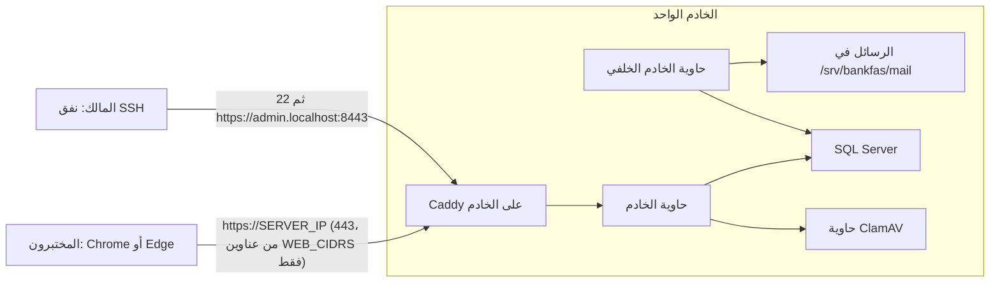

# دليل تجربة BankFas الخاصة على خادم Ubuntu بعنوان IP (الإصدار 1.0.8)

التاريخ: 2026-10-26. كتبه وكيل ذكاء اصطناعي.

## عن هذا الدليل

- **لمن:** لمن لم يتعامل مع خادم من قبل. لا يلزمك أن تعرف Linux أو SSH أو الأوامر.
- **ماذا يفعل:** يثبّت BankFas الإصدار 1.0.8 كاملًا على **خادم واحد** بنظام Ubuntu 24.04، **تجربةً خاصة ببيانات توضيحية فقط**.
- **بلا نطاق:** لا نطاق، ولا DNS، ولا Cloudflare، ولا GoDaddy، ولا شهادة عامة. تفتح النظام بعنوان الخادم مباشرة: `https://<SERVER_IP>`.
- **المصادر:** ترتيب الخطوات من `docs/54` و`docs/58`، وتحميل الصورتين من الحزمة كما في `docs/57`. وكل أمر هنا مطابق للسكربتات في الحزمة (`tools/host` و`tools/deploy`).
- **كيف تقرأ:**
  - كل أمر في مربع رمادي. **انسخه كما هو** والصقه في الطرفية، ثم اضغط `Enter`.
  - قبل كل أمر سطر يشرح ما يفعله. وبعده «ما يجب أن تراه» عند الحاجة.
  - النصوص بين `<` و`>` أماكن لقيمك أنت. **احذف العلامتين** وضع قيمتك. مثال: `<SERVER_IP>` تصير `203.0.113.25`.
  - السطر الذي يبدأ بـ «تحقّق:» نقطة لم نستطع التأكد منها إلا على خادم حقيقي. وكلها مجموعة في آخر الدليل.
  - الوسم **[تحقق MS]** على أوامر SQL Server و`mssql-conf`: يجب مطابقتها مع وثائق Microsoft الرسمية للإصدار المثبّت.

### القيم التي ستستعملها في كل الدليل

اكتبها الآن في ملف ملاحظات على جهازك («سجل التجهيز»)، وارجع إليها:

| المكان | معناه | مثال (لا تستعمله كما هو) |
|---|---|---|
| `<SERVER_IP>` | عنوان IPv4 العام لخادمك، من لوحة المزوّد | `203.0.113.25` |
| `<YOUR_USER>` | اسم حسابك الشخصي على الخادم، بحروف إنجليزية صغيرة | `opsadmin` |
| `<YOUR_IP>` | عنوان IP العام لجهازك أنت (الجزء 6 يشرح كيف تعرفه) | `198.51.100.7` |
| `<TESTER_IP>` | عنوان IP العام لجهاز كل مختبر | `192.0.2.44` |
| `<YOUR_SQL_LOGIN>` | اسم حسابك الشخصي في SQL Server | `dba_admin1` |
| `<OWNER_EMAIL>` | بريد لك أنت. يكفي أي عنوان صحيح الشكل، فالرسائل تبقى على الخادم | `owner@example.com` |
| `<WINDOWS_USER>` | اسم مستخدمك في Windows (يظهر في `C:\Users\...`) | `User1` |

وهذه قيم ثابتة في التجربة، اكتبها كما هي:

| القيمة | معناها |
|---|---|
| `trial` | رمز الشركة التجريبية الوحيدة (انظر 0.3: لماذا لا نستعمل `demo`) |
| `bankfas.internal` | اسم داخلي للمنصة. لا يحتاج DNS، ولا يُفتح من الخارج |
| `db.bankfas.internal` | اسم قاعدة البيانات، كما في شهادتها |
| `172.30.0.1` | عنوان الخادم نفسه كما تراه الحاويات |

---

## الجزء 0: التصميم بكلمات بسيطة

### 0.1 الصورة كاملة



### 0.2 ما يحدث، نقطة نقطة

- **بوابة الشركة التجريبية** هي `https://<SERVER_IP>` مباشرة. المختبرون يفتحونها في Chrome أو Edge.
- **الشهادة من الخادم نفسه.** Caddy (برنامج الواجهة على الخادم) يصدر شهاداته من «سلطة» خاصة به (`tls internal`). لذلك يحذّر المتصفح أول مرة. الحل في الجزء 13: إما `Advanced` ثم `Proceed`، وإما (وهو الأفضل) تثبيت شهادة Caddy الجذرية على الجهاز مرة واحدة.
- **لوحة المنصة (لوحة المشغّل) غير مكشوفة.** لا يصل إليها أحد من الإنترنت. أنت وحدك تفتحها عبر **نفق SSH**، على العنوان `https://admin.localhost:8443` في جهازك.
- **الجدار الناري** يسمح بـ SSH من عنوانك وحدك، وبالموقع من عناوين محددة فقط (عنوانك وعناوين المختبرين). المنفذ 80 مغلق.
- **البريد اختياري.** بلا خادم بريد، تُحفظ رسائل الدعوة وإعادة كلمة المرور على الخادم. تعرضها بأمر واحد (`show_mail.sh`)، ثم ترسل الرابط للشخص بواتساب أو ما يشبهه.
- **قاعدة البيانات** على الخادم نفسه، باتصال مشفّر. شهادتها من سلطة تجريبية يصنعها سكربت `trial_db_cert.sh`، بلا certbot.

### 0.3 لماذا رمز الشركة `trial` وليس `demo`

- القيمة الافتراضية في `site.conf.example` هي `IP_TENANT=demo`.
- لكن قاعدة البيانات **تحجز** الرمز `demo` (مع `test` و`dev` و`admin` وغيرها) في `db/seed/100_platform_global.sql`. وإنشاء مشترك به يُرفض بالرسالة `This sub-domain is not available.`
- لذلك نستعمل `trial` في كل الدليل: في `site.conf` (`IP_TENANT=trial`)، وفي لوحة المشغّل حين تنشئ المشترك.
- **القاعدة:** الرمز في `IP_TENANT` والرمز الذي تكتبه في لوحة المشغّل **يجب أن يكونا متطابقين حرفًا بحرف**. وإلا فتح `https://<SERVER_IP>` صفحة فارغة.

### 0.4 الكلمات

- **الخادم:** حاسوب في مركز بيانات، يعمل دائمًا، بلا شاشة. تتحكم فيه من جهازك عبر الإنترنت.
- **SSH:** طريقة آمنة ومشفّرة للدخول إلى الخادم وكتابة الأوامر فيه.
- **نفق SSH:** اتصال SSH يحمل معه منفذًا من جهازك إلى الخادم. تفتح في متصفحك عنوانًا على جهازك، فيصل إلى الخادم داخل النفق.
- **الطرفية (Terminal):** نافذة نصية تكتب فيها الأوامر. في Windows اسمها PowerShell أو Windows Terminal. وفي Mac اسمها Terminal.
- **المحثّ (prompt):** النص الذي يظهر قبل مكان الكتابة. على الخادم يشبه:
  ```text
  opsadmin@server:~$
  ```
  - العلامة `$` تعني أنك مستخدم عادي.
  - العلامة `#` تعني أنك **root**، أي المدير الكامل. كن حذرًا حينها.
- **root:** الحساب الذي يملك كل شيء على الخادم.
- **sudo:** كلمة تكتبها قبل الأمر لتنفيذه بصلاحية root. يسألك أول مرة عن **كلمة مرور حسابك أنت**.
- **المسار:** مكان الملف. يبدأ بـ `/`، مثل `/opt/bankfas/site.conf`. والعلامة `~` تعني مجلدك الشخصي، مثل `/home/opsadmin`.
- **الحاوية (container):** برنامج معزول يعمل داخل Docker. في النظام ثلاث: الخادم (`api`)، والخادم الخلفي (`worker`)، وفاحص الملفات (`clamav`).

### 0.5 النسخ واللصق في الطرفية

| العمل | Windows Terminal / PowerShell | Mac Terminal |
|---|---|---|
| لصق | `Ctrl+V`، أو زر الفأرة الأيمن | `Cmd+V` |
| نسخ نص محدد | حدده بالفأرة ثم `Ctrl+C` | `Cmd+C` |
| إيقاف أمر يعمل | `Ctrl+C` **بلا نص محدد** | `Ctrl+C` |

- **تنبيه:** `Ctrl+C` بلا نص محدد لا ينسخ. بل يوقف الأمر الجاري.
- **كلمات المرور لا تظهر** حين تكتبها، ولا حتى نجوم. هذا طبيعي. اكتبها واضغط `Enter`.
- إذا ألصقت أمرًا من عدة أسطر، تأكد أنه نُفّذ كله، ثم اضغط `Enter` إن بقي ينتظر.

### 0.6 تعديل ملف بالمحرر nano

| العمل | المفاتيح |
|---|---|
| التحرك | الأسهم |
| الحفظ | `Ctrl+O` ثم `Enter` |
| الخروج | `Ctrl+X` |
| البحث | `Ctrl+W` ثم الكلمة ثم `Enter` |
| حذف سطر كامل | `Ctrl+K` |
| لصق | زر الفأرة الأيمن، أو `Ctrl+V` في Windows Terminal |

- إذا خرجت بـ `Ctrl+X` قبل الحفظ، يسألك `Save modified buffer?`. اضغط `Y` ثم `Enter` للحفظ، أو `N` للخروج بلا حفظ.

---

## الجزء 1: ما تحتاجه قبل أن تبدأ

### 1.1 الخادم

اطلب من المزوّد خادمًا افتراضيًا (VPS) بهذه المواصفات:

| البند | المطلوب |
|---|---|
| النظام | **Ubuntu 24.04 LTS** جاهز. الأدوات ترفض أي إصدار آخر |
| المعالج | **4 vCPU** موصى به (2 تكفي لكن بطيئة عند طباعة PDF) |
| الذاكرة | **16 غيغابايت موصى بها**. والحد الأدنى 8، ومعها ذاكرة تبديل 4 غيغابايت (4.4) |
| القرص | **160 غيغابايت NVMe** |
| العنوان | **IPv4 عام ثابت** |
| اللقطات | **snapshots** إن أمكن، للعودة إلى حالة سابقة |
| الدخول | كلمة مرور root، أو مفتاح SSH، من المزوّد |

- **لا يلزم** نطاق، ولا DNS، ولا فتح المنفذ 587 (إلا إن أردت بريدًا حقيقيًا، 11.1).

### 1.2 قائمة التحضير

- [ ] **جهاز Windows 10 أو 11** (أو Mac)، متصل بالإنترنت، وفيه **Chrome أو Edge**.
- [ ] **الخادم** من 1.1، وعنوانه `<SERVER_IP>`.
- [ ] **حساب GitHub** له صلاحية على المستودع الخاص. صفحة الإصدار خاصة، ولا تفتح إلا بعد تسجيل الدخول:
  `https://github.com/thawrasy/smartlines/releases/tag/bankfas-v1.0.8`
- [ ] **عناوين IP العامة للمختبرين.** كل مختبر يفتح `https://api.ipify.org` ويرسل لك الرقم (الجزء 6).
- [ ] **خزنة كلمات مرور** (برنامج إدارة كلمات المرور) أو قرص USB مشفّر، **خارج الخادم**. ستحفظ فيها المفاتيح وكلمات المرور.
- [ ] **تطبيق مصادقة** على هاتفك، مثل Microsoft Authenticator أو Google Authenticator.
- [ ] اختياري: **حساب SMTP** إن أردت أن تصل الرسائل بالبريد فعلًا (11.1).

### 1.3 ملفات الإصدار

من صفحة الإصدار، في قسم `Assets`، نزّل ملفين:

- `bankfas-1.0.8-server.tar`: **الملف الواحد الذي يُرفع إلى الخادم** (نحو 300 ميغابايت).
- `bankfas-1.0.8-server.tar.sha256`: بصمته، للتحقق من سلامته.

في داخل الملف الكبير مجلد `bankfas-1.0.8/` وفيه:

| الملف | ما هو |
|---|---|
| `bankfas-images-1.0.8.tar.gz` | الصورتان معًا: `bankfas-api:1.0.8` و`bankfas-worker:1.0.8` |
| `bankfas-kit-1.0.8.tar.gz` | أدوات التثبيت: المجلد `treasury-platform` بأدواته `tools` وسكربتات القاعدة `db`، بلا وثائق |
| `INSTALL-AR.md` و`INSTALL-AR.docx` | هذا الدليل |
| `RELEASE-NOTES-AR.md` | ملاحظات الإصدار (`docs/57`) |
| `VERSION.txt` | رقم الإصدار، ورقم الحفظة، ومعرّفا الصورتين |
| `SHA256SUMS` | بصمة كل ملف |

- الوثائق كلها في ملف منفصل `bankfas-docs-1.0.8.tar.gz`. هو مذكور في `SHA256SUMS`، لكنه **لا يُرفع إلى الخادم**. احفظه على جهازك إن أردته.

### 1.4 كم يستغرق

| المرحلة | الوقت التقريبي |
|---|---|
| الأجزاء 2 إلى 7 | ساعتان |
| الجزءان 8 و9 (القاعدة) | ساعتان إلى ثلاث |
| الأجزاء 10 إلى 12 | ساعة إلى ساعتين |
| **تنزيل قائمة كلمات المرور المسرّبة** | **عدة ساعات** (نحو 30 غيغابايت). يعمل في الخلفية، ولا يبدأ التشغيل قبل اكتماله |
| الأجزاء 13 إلى 15 | ساعة |

- **رابط المشغّل الأول (9.8) صالح 48 ساعة فقط.** خطّط لإكمال الأجزاء 9 إلى 14 خلال يومين.
- **نصيحة:** ابدأ تنزيل القائمة مبكرًا، بعد الجدار مباشرة (6.4).

---

## الجزء 2: الاتصال بالخادم

### 2.1 افتح الطرفية

- **Windows:** اضغط زر Start، واكتب `Terminal` أو `PowerShell`، وافتحه. برنامج `ssh` موجود مسبقًا في Windows 10 و11.
- **Mac:** افتح `Applications` ثم `Utilities` ثم `Terminal`.

تأكد أن `ssh` موجود:

```powershell
ssh -V
```

ما يجب أن تراه: سطر يبدأ بـ `OpenSSH_`. إن ظهر «not recognized» في Windows، فافتح `Settings` ثم `Apps` ثم `Optional features`، وأضف `OpenSSH Client`.

### 2.2 الدخول أول مرة بحساب root

ادخل إلى الخادم بحساب root وعنوانه:

```powershell
ssh root@<SERVER_IP>
```

ستظهر رسالة مثل:

```text
The authenticity of host '203.0.113.25' can't be established.
ED25519 key fingerprint is SHA256:AbCdEf...
Are you sure you want to continue connecting (yes/no/[fingerprint])?
```

- هذه **بصمة الخادم**. هي هويته. انسخ سطر `SHA256:...` إلى ملاحظاتك.
- إن كانت لوحة المزوّد تعرض البصمة، فقارنها الآن. يجب أن تتطابق.
- اكتب `yes` ثم `Enter`.
- اكتب كلمة مرور root (لن تظهر) ثم `Enter`.

ما يجب أن تراه: محثّ ينتهي بـ `#`، مثل `root@server:~#`.

إذا فشل:
- `Connection timed out`: العنوان خطأ، أو جدار المزوّد يغلق المنفذ 22. افتحه من لوحة المزوّد.
- `Permission denied`: كلمة المرور خطأ. أعد المحاولة، أو أعد ضبطها من لوحة المزوّد.
- إن أعطاك المزوّد مستخدمًا آخر (مثل `ubuntu`) بدل root، فاستعمله: `ssh ubuntu@<SERVER_IP>`، واكتب `sudo` قبل أوامر هذا الجزء والجزء 3.

### 2.3 سجّل بصمة الخادم من داخله

اعرض بصمة مفتاح الخادم من داخله:

```bash
ssh-keygen -lf /etc/ssh/ssh_host_ed25519_key.pub
```

ما يجب أن تراه: `256 SHA256:... root@... (ED25519)`. يجب أن يطابق ما ظهر لك في 2.2. احفظه في سجل التجهيز.

### 2.4 غيّر كلمة مرور root

غيّر كلمة مرور root إلى كلمة قوية جديدة:

```bash
passwd
```

- اكتب الكلمة الجديدة مرتين. لن تظهر.
- ما يجب أن تراه: `passwd: password updated successfully`.
- احفظها في الخزنة. ستحتاجها فقط في طرفية الطوارئ في لوحة المزوّد.

---

## الجزء 3: حسابك الشخصي ومفتاح SSH وإغلاق دخول root

الهدف: تدخل بحسابك أنت وبمفتاح، لا بكلمة مرور، ولا يدخل أحد بحساب root.

### 3.1 أنشئ حسابك الشخصي (على الخادم، بحساب root)

أنشئ المستخدم:

```bash
adduser <YOUR_USER>
```

- يسألك كلمة مرور مرتين. اختر كلمة قوية **واحفظها**. ستحتاجها لـ `sudo`، وللدخول من طرفية المزوّد في الطوارئ.
- ثم يسأل عن الاسم والهاتف وغيرها. اضغط `Enter` لكل سؤال، ثم `Y`.

أنشئ مجموعة المسؤولين التي يسمح لها إعداد SSH بالدخول:

```bash
groupadd bankfas-admins
```

أضف حسابك إلى مجموعة المسؤولين ومجموعة `sudo`:

```bash
usermod -aG bankfas-admins,sudo <YOUR_USER>
```

تأكد من العضوية:

```bash
id <YOUR_USER>
```

ما يجب أن تراه: في آخر السطر `sudo` و`bankfas-admins`.

### 3.2 أنشئ مفتاح SSH على جهازك

افتح **نافذة طرفية جديدة على جهازك** (لا على الخادم). المفتاح يُنشأ على جهازك ويبقى فيه.

أنشئ مفتاحًا من نوع Ed25519 (الأمر نفسه في Windows وMac):

```powershell
ssh-keygen -t ed25519
```

- `Enter file in which to save the key`: اضغط `Enter` لقبول المكان الافتراضي.
- `Enter passphrase`: اكتب عبارة مرور للمفتاح. تحميه إن سُرق جهازك. اكتبها مرتين.
- ما يجب أن تراه: `Your public key has been saved in ...id_ed25519.pub`.

الملفان:
- `id_ed25519`: **المفتاح الخاص. لا تعطه لأحد أبدًا.**
- `id_ed25519.pub`: المفتاح العام. هذا الذي يوضع على الخادم.

### 3.3 انسخ المفتاح العام إلى الخادم

**في Windows (PowerShell)،** أرسل المفتاح العام إلى حسابك على الخادم:

```powershell
type $env:USERPROFILE\.ssh\id_ed25519.pub | ssh <YOUR_USER>@<SERVER_IP> "mkdir -p ~/.ssh && chmod 700 ~/.ssh && cat >> ~/.ssh/authorized_keys && chmod 600 ~/.ssh/authorized_keys"
```

**في Mac،** الأمر أبسط:

```bash
ssh-copy-id -i ~/.ssh/id_ed25519.pub <YOUR_USER>@<SERVER_IP>
```

- يسألك كلمة مرور **حسابك على الخادم** (من 3.1).
- ما يجب أن تراه: لا رسالة خطأ.

### 3.4 جرّب الدخول بالمفتاح

ادخل بحسابك الشخصي:

```powershell
ssh <YOUR_USER>@<SERVER_IP>
```

- يجب أن يسألك **عبارة مرور المفتاح** (من 3.2)، لا كلمة مرور الخادم.
- ما يجب أن تراه: محثّ مثل `opsadmin@server:~$`.

جرّب sudo:

```bash
sudo whoami
```

ما يجب أن تراه: يسألك كلمة مرور حسابك، ثم يطبع `root`.

**لا تكمل إن لم ينجح هذا.** وإن سألك كلمة مرور الخادم بدل عبارة المفتاح، فالمفتاح لم يُنسخ. أعد 3.3.

### 3.5 قاعدة sudo

اكتب قاعدة sudo في ملف مؤقت أولًا:

```bash
printf 'Defaults use_pty\nDefaults timestamp_timeout=5\n' > /tmp/60-bankfas
```

افحص صحة الملف قبل وضعه. خطأ في ملفات sudo قد يمنعك من sudo:

```bash
sudo visudo -cf /tmp/60-bankfas
```

ما يجب أن تراه: `/tmp/60-bankfas: parsed OK`.

ضعه في مكانه:

```bash
sudo install -m 440 /tmp/60-bankfas /etc/sudoers.d/60-bankfas && rm /tmp/60-bankfas
```

### 3.6 أغلق دخول root ودخول كلمات المرور

**قاعدة ذهبية:** أبقِ نافذة SSH الحالية مفتوحة طوال هذه الخطوة. لا تغلقها حتى تنجح نافذة ثانية.

اكتب إعداد SSH (أمر واحد من عدة أسطر، انسخه كله):

```bash
sudo tee /etc/ssh/sshd_config.d/10-bankfas.conf >/dev/null <<'EOF'
PasswordAuthentication no
KbdInteractiveAuthentication no
PermitRootLogin no
PubkeyAuthentication yes
AllowGroups bankfas-admins
MaxAuthTries 3
LoginGraceTime 30
ClientAliveInterval 300
ClientAliveCountMax 2
X11Forwarding no
AllowAgentForwarding no
AllowTcpForwarding local
PermitTunnel no
EOF
```

- اسم الملف يبدأ بـ `10`، فيُقرأ قبل ملف المزوّد (مثل `50-cloud-init.conf`) الذي قد يسمح بكلمات المرور.
- السطر `AllowTcpForwarding local` **يسمح بنفق SSH** الذي ستفتح به لوحة المشغّل (الجزء 13). لا تحذفه.

افحص الإعداد، ثم أعد تحميل SSH:

```bash
sudo sshd -t && sudo systemctl reload ssh
```

ما يجب أن تراه: لا شيء. لا رسالة تعني النجاح.

تأكد من القيم الفعلية:

```bash
sudo sshd -T | grep -E '^(passwordauthentication|permitrootlogin|allowgroups|allowtcpforwarding)'
```

ما يجب أن تراه (قد يختلف الترتيب):

```text
passwordauthentication no
permitrootlogin no
allowtcpforwarding local
allowgroups bankfas-admins
```

**الآن افتح نافذة طرفية ثانية على جهازك**، وادخل:

```powershell
ssh <YOUR_USER>@<SERVER_IP>
```

- إن نجح: ممتاز. يمكنك إغلاق النافذة الأولى.
- إن فشل: **لا تغلق النافذة الأولى.** منها احذف الملف وأعد التحميل، ثم راجع 3.1 إلى 3.4:

```bash
sudo rm /etc/ssh/sshd_config.d/10-bankfas.conf && sudo systemctl reload ssh
```

وتأكد أن root لا يدخل. من جهازك:

```powershell
ssh root@<SERVER_IP>
```

ما يجب أن تراه: `Permission denied`. هذا المطلوب.

- تحقّق: في Ubuntu 24.04 قد تُدار SSH عبر المقبس (`ssh.socket`). إعادة التحميل تكفي لهذه الإعدادات، ولا نغيّر المنفذ في هذا الدليل.
- إن أعطاك المزوّد مستخدمًا افتراضيًا (مثل `ubuntu`)، فاقفله بعد أن ينجح حسابك: `sudo usermod -L ubuntu`.

**من الآن، كل الدليل بحسابك الشخصي:** `ssh <YOUR_USER>@<SERVER_IP>`.

---

## الجزء 4: التحديثات والوقت وذاكرة التبديل

### 4.1 تحديث النظام

حدّث قائمة الحزم وثبّت التحديثات:

```bash
sudo apt-get update && sudo apt-get -y upgrade
```

- يستغرق دقائق. قد تظهر نافذة زرقاء تسأل عن الخدمات التي تُعاد. اضغط `Enter` لقبول الافتراضي.

افحص هل يطلب النظام إعادة التشغيل:

```bash
ls /var/run/reboot-required
```

- إن ظهر الملف: أعد التشغيل بـ `sudo reboot`، وانتظر دقيقتين، ثم ادخل من جديد.
- إن ظهر `No such file or directory`: لا حاجة.

### 4.2 التحديثات الأمنية الآلية

ثبّت أداة التحديث الآلي (غالبًا موجودة):

```bash
sudo apt-get install -y unattended-upgrades
```

اكتب إعدادها: الأمن فقط، وحزم Microsoft مستثناة، ولا إعادة تشغيل آلية:

```bash
sudo tee /etc/apt/apt.conf.d/52bankfas-unattended >/dev/null <<'EOF'
Unattended-Upgrade::Allowed-Origins { "${distro_id}:${distro_codename}-security"; };
Unattended-Upgrade::Package-Blacklist { "mssql-server"; "mssql-tools18"; "msodbcsql18"; };
Unattended-Upgrade::Automatic-Reboot "false";
Unattended-Upgrade::Remove-Unused-Kernel-Packages "true";
EOF
```

جرّبها دون تثبيت شيء:

```bash
sudo unattended-upgrade --dry-run --debug | tail -20
```

ما يجب أن تراه: أسطر بلا `ERROR`.

تأكد أنها مفعّلة:

```bash
systemctl is-enabled unattended-upgrades
```

ما يجب أن تراه: `enabled`.

### 4.3 الوقت

اضبط المنطقة الزمنية على UTC:

```bash
sudo timedatectl set-timezone Etc/UTC
```

ثبّت خدمة الوقت chrony:

```bash
sudo apt-get install -y chrony
```

افحص المزامنة:

```bash
timedatectl
```

ما يجب أن تراه: `System clock synchronized: yes` و`Time zone: Etc/UTC`. (إن ظهر `no`، فانتظر دقيقة وأعد الأمر.)

### 4.4 ذاكرة التبديل 4 غيغابايت

لماذا: SQL Server وClamAV وطابعة PDF معًا يصلون إلى نحو 8.5 غيغابايت في الذروة. ذاكرة التبديل جزء من القرص يُستعمل حين تمتلئ الذاكرة. **لازمة على خادم 8 غيغابايت، ومفيدة على خادم 16.** وفحص الجاهزية (12.3) يطلب أن تكون الذاكرة مع التبديل 11 غيغابايت على الأقل.

أنشئ ملف التبديل:

```bash
sudo fallocate -l 4G /swapfile && sudo chmod 600 /swapfile
```

فعّله:

```bash
sudo mkswap /swapfile && sudo swapon /swapfile
```

اجعله يبقى بعد إعادة التشغيل (نفّذه **مرة واحدة فقط**):

```bash
echo '/swapfile none swap sw 0 0' | sudo tee -a /etc/fstab
```

قلّل لجوء النظام إليه:

```bash
echo 'vm.swappiness=10' | sudo tee /etc/sysctl.d/61-bankfas-swap.conf && sudo sysctl --system
```

افحص:

```bash
free -h
```

ما يجب أن تراه: سطر `Swap:` فيه `4.0Gi`.

- إن نفّذت أمر `fstab` مرتين، فاحذف السطر المكرر بـ `sudo nano /etc/fstab`.

---

## الجزء 5: رفع ملف الإصدار إلى الخادم والتحقق منه

### 5.1 نزّل الملفين على جهازك

1. سجّل الدخول إلى GitHub بحساب له صلاحية على المستودع. **بدون تسجيل الدخول تظهر الصفحة «404».**
2. افتح `https://github.com/thawrasy/smartlines/releases/tag/bankfas-v1.0.8`.
3. في قسم `Assets` اضغط `bankfas-1.0.8-server.tar`، ثم `bankfas-1.0.8-server.tar.sha256`. يُحفظان غالبًا في مجلد التنزيلات.

### 5.2 تحقّق من الملف الكبير على جهازك (اختياري لكنه مفيد)

**في Windows (PowerShell)،** احسب بصمة الملف:

```powershell
Get-FileHash $env:USERPROFILE\Downloads\bankfas-1.0.8-server.tar -Algorithm SHA256
```

ثم اعرض البصمة المنشورة:

```powershell
Get-Content $env:USERPROFILE\Downloads\bankfas-1.0.8-server.tar.sha256
```

**في Mac:**

```bash
shasum -a 256 ~/Downloads/bankfas-1.0.8-server.tar && cat ~/Downloads/bankfas-1.0.8-server.tar.sha256
```

ما يجب أن تراه: الرقمان الطويلان متطابقان (Windows يكتبه بحروف كبيرة، وهذا لا يهم). إن اختلفا، فنزّل الملف من جديد.

### 5.3 ارفع الملفين إلى الخادم

**الطريقة الأولى: scp من الطرفية.**

في Windows (PowerShell على جهازك):

```powershell
scp $env:USERPROFILE\Downloads\bankfas-1.0.8-server.tar $env:USERPROFILE\Downloads\bankfas-1.0.8-server.tar.sha256 <YOUR_USER>@<SERVER_IP>:~/
```

في Mac:

```bash
scp ~/Downloads/bankfas-1.0.8-server.tar ~/Downloads/bankfas-1.0.8-server.tar.sha256 <YOUR_USER>@<SERVER_IP>:~/
```

ما يجب أن تراه: سطر لكل ملف بالنسبة المئوية حتى `100%`.

**الطريقة الثانية، برنامج بواجهة رسومية: WinSCP (Windows).**
1. نزّله من موقعه الرسمي `winscp.net` وثبّته.
2. `New Site`: `File protocol` = `SFTP`، و`Host name` = `<SERVER_IP>`، و`User name` = `<YOUR_USER>`.
3. اضغط `Advanced...` ثم `SSH` ثم `Authentication`، واختر ملف مفتاحك الخاص `C:\Users\<WINDOWS_USER>\.ssh\id_ed25519`. يعرض WinSCP تحويله إلى صيغته `.ppk`، فوافق.
4. `Login`، ثم اسحب الملفين من اليسار (جهازك) إلى اليمين (مجلدك على الخادم `/home/<YOUR_USER>`).

### 5.4 تحقّق من الملف الكبير على الخادم

ادخل إلى الخادم، ثم قارن البصمة:

```bash
cd ~ && sha256sum -c bankfas-1.0.8-server.tar.sha256
```

ما يجب أن تراه:

```text
bankfas-1.0.8-server.tar: OK
```

- إن ظهر `FAILED`: **توقف.** الملف تالف أو ناقص. ارفعه من جديد.

### 5.5 استخرج الملف وتحقق من محتواه

استخرج الملف في مجلدك:

```bash
cd ~ && tar -xf bankfas-1.0.8-server.tar
```

ادخل المجلد واعرض محتواه:

```bash
cd ~/bankfas-1.0.8 && ls -l
```

ما يجب أن تراه: `bankfas-images-1.0.8.tar.gz` و`bankfas-kit-1.0.8.tar.gz` و`INSTALL-AR.md` و`INSTALL-AR.docx` و`RELEASE-NOTES-AR.md` و`VERSION.txt` و`SHA256SUMS`.

قارن بصمة كل ملف بما في `SHA256SUMS`. الخيار `--ignore-missing` يتخطى ملف الوثائق، لأنه ليس هنا عمدًا:

```bash
sha256sum -c --ignore-missing SHA256SUMS
```

ما يجب أن تراه: كل سطر ينتهي بـ `OK`، مثل:

```text
bankfas-images-1.0.8.tar.gz: OK
bankfas-kit-1.0.8.tar.gz: OK
INSTALL-AR.docx: OK
INSTALL-AR.md: OK
RELEASE-NOTES-AR.md: OK
VERSION.txt: OK
```

- إن ظهر `FAILED` لأي ملف: **توقف.** نزّل الحزمة من جديد.

اعرض رقم الإصدار:

```bash
cat VERSION.txt
```

ما يجب أن تراه: `BankFas 1.0.8`، ثم رقم الحفظة ومعرّفا الصورتين.

### 5.6 استخرج أدوات التثبيت

استخرج حزمة الأدوات:

```bash
cd ~/bankfas-1.0.8 && tar -xzf bankfas-kit-1.0.8.tar.gz
```

ادخل مجلد الأدوات:

```bash
cd ~/bankfas-1.0.8/treasury-platform && ls
```

ما يجب أن تراه: مجلدات منها `tools` و`db`، والملف `versions.json`. (لا مجلد `docs`: الوثائق في ملف منفصل.)

- **مهم:** كل أوامر `tools/...` في هذا الدليل تُنفّذ من هذا المجلد. إن دخلت من جديد إلى الخادم، فارجع إليه أولًا:

```bash
cd ~/bankfas-1.0.8/treasury-platform
```

---

## الجزء 6: الجدار الناري، وإعدادات النواة، وبدء تنزيل القائمة المسرّبة

### 6.1 اعرف عنوانك العام وعناوين المختبرين

**عنوانك أنت:** اسأل الخادم من أين تتصل به. على الخادم:

```bash
echo $SSH_CLIENT
```

ما يجب أن تراه: ثلاث قيم، مثل `198.51.100.7 52344 22`. **الأولى هي `<YOUR_IP>`.**

**عنوان كل مختبر:** يفتح المختبر في متصفحه الموقع `https://api.ipify.org`، فيظهر رقم مثل `192.0.2.44`. يرسله لك. هذا `<TESTER_IP>`.

- تحقّق: `api.ipify.org` يعرض عنوان IPv4. نحتاج IPv4 لأن الخادم يُفتح بعنوان IPv4. إن ظهر عنوان فيه نقطتان `:` فهو IPv6، ولا يصلح هنا.
- **العناوين المنزلية تتغير أحيانًا** (بعد إعادة تشغيل الراوتر مثلًا). حين يتغير عنوان مختبر، لا يفتح له الموقع. فيرسل لك عنوانه الجديد، وتعيد 6.2 بالقائمة الجديدة.
- **إن تغيّر عنوانك أنت**، يُغلق عليك SSH. العلاج في جدول الأعطال (17). ويُفضّل عنوان ثابت أو VPN بعنوان ثابت.
- في شركة، كل الموظفين يخرجون غالبًا من عنوان واحد. عنوان واحد يكفيهم كلهم.

### 6.2 شغّل سكربت الجدار

ماذا يفعل `tools/host/ufw.sh` بالقيم التالية:
- يمنع كل دخول، إلا:
  - **SSH (22)** من العناوين في `ADMIN_CIDRS` وحدها (أنت).
  - **الموقع (443)** من العناوين في `WEB_CIDRS` وحدها (أنت والمختبرون). والمنفذ **80 يبقى مغلقًا**.
  - **1433 (SQL Server)** من شبكة الحاويات الداخلية `172.30.0.0/24` وحدها، بسبب `DB_ON_THIS_HOST=1`.
- يحدّ ping والاتصالات الكثيرة من عنوان واحد.

**تأكد من `<YOUR_IP>` مرتين قبل التشغيل.** عنوان خطأ يغلق عليك SSH.

من مجلد الأدوات:

```bash
cd ~/bankfas-1.0.8/treasury-platform
```

شغّل السكربت. ضع عنوانك في القائمتين، ثم عناوين المختبرين في `WEB_CIDRS`، مفصولة بمسافة، وبعد كل عنوان `/32`:

```bash
sudo ADMIN_CIDRS="<YOUR_IP>/32" WEB_CIDRS="<YOUR_IP>/32 <TESTER_IP>/32" DB_ON_THIS_HOST=1 bash tools/host/ufw.sh
```

ما يجب أن تراه في آخر الناتج (بعناوينك):

```text
Status: active
...
22/tcp      ALLOW IN    198.51.100.7    # SSH from the admins
443/tcp     ALLOW IN    198.51.100.7    # HTTPS from the testers (docs/62)
443/udp     ALLOW IN    198.51.100.7    # HTTP/3 from the testers (docs/62)
443/tcp     ALLOW IN    192.0.2.44      # HTTPS from the testers (docs/62)
443/udp     ALLOW IN    192.0.2.44      # HTTP/3 from the testers (docs/62)
1433/tcp    ALLOW IN    172.30.0.0/24   # SQL Server from the containers (docs/58)
```

- **لا يجب أن ترى** `80/tcp` ولا `443/tcp ALLOW IN Anywhere`.
- **احفظ الأمر الذي كتبته بالضبط في سجل التجهيز.** ستحتاجه حين تضيف مختبرًا.

**افتح نافذة ثانية وجرّب الدخول** `ssh <YOUR_USER>@<SERVER_IP>`. إن نجح، فالجدار سليم.

- إن كان للمزوّد جدار في لوحته، فافتح فيه 22 و443 فقط (من العناوين نفسها إن أمكن). **لا تفتح 80 ولا 1433 ولا 8443.**

### 6.3 إضافة مختبر لاحقًا، أو تغيير عنوان

السكربت **يمسح القواعد كلها ثم يكتبها من جديد** في كل تشغيل. لذلك أعده **بالقائمة الكاملة** كل مرة، لا بالعنوان الجديد وحده:

```bash
sudo ADMIN_CIDRS="<YOUR_IP>/32" WEB_CIDRS="<YOUR_IP>/32 <TESTER_IP>/32 <NEW_TESTER_IP>/32" DB_ON_THIS_HOST=1 bash ~/bankfas-1.0.8/treasury-platform/tools/host/ufw.sh
```

- لا تنسَ `DB_ON_THIS_HOST=1`. بدونه تنقطع الحاويات عن قاعدة البيانات.
- لحذف مختبر: أعد الأمر دون عنوانه.

**تحذير: لا تترك `WEB_CIDRS` فارغًا.** إن شغّلت السكربت بدونه، **يُفتح الموقع للإنترنت كله** (443)، ويُفتح المنفذ 80 أيضًا. هذا للمنصة العامة بنطاق، لا للتجربة الخاصة. (لوحة المشغّل تبقى مغلقة في الحالتين، لأنها على `127.0.0.1` وحده.)

### 6.4 إعدادات النواة الدفاعية

انسخ ملف إعدادات النواة، ثم حمّله:

```bash
sudo cp tools/host/sysctl-bankfas.conf /etc/sysctl.d/60-bankfas.conf && sudo sysctl --system
```

ما يجب أن تراه: قائمة إعدادات، منها `net.ipv4.tcp_syncookies = 1`.

### 6.5 ابدأ تنزيل قائمة كلمات المرور المسرّبة الآن

النظام يرفض كلمات المرور المعروفة في التسريبات. القائمة نحو 30 غيغابايت ومليون ملف، وتستغرق ساعات. والسكربت يكمل ما ينقص إن انقطع.

`tmux` يُبقي الأمر يعمل حتى لو أغلقت نافذتك. افتح جلسة باسم `breached`:

```bash
tmux new -s breached
```

ما يجب أن تراه: شريط أخضر أسفل الشاشة.

داخل الجلسة، شغّل التنزيل:

```bash
sudo bash ~/bankfas-1.0.8/treasury-platform/tools/host/download_breached.sh /srv/bankfas/breached
```

- اكتب كلمة مرورك إن طلبها.
- **اخرج من الجلسة دون إيقافها:** اضغط `Ctrl+B`، ارفع يدك، ثم اضغط `D`.

لمتابعة التقدم في أي وقت (العدد المطلوب 1048576):

```bash
sudo find /srv/bankfas/breached -maxdepth 1 -name '?????.txt' | wc -l
```

للعودة إلى الجلسة ورؤية حالتها:

```bash
tmux attach -t breached
```

- عند الاكتمال يطبع: `leaked-password list complete: 1048576 ranges in /srv/bankfas/breached`.
- إن طبع `only ... of 1048576 ranges: run it again`: أعد أمر التنزيل نفسه. يكمل الناقص فقط.
- إن أُعيد تشغيل الخادم، فالجلسة تنتهي. افتحها من جديد وأعد الأمر.

**أكمل الأجزاء التالية والتنزيل يعمل.**

---

## الجزء 7: ملف القيم site.conf

لماذا الآن، قبل SQL Server: سكربت شهادة القاعدة (8.7) يقرأ `ACCESS` و`DB_HOST` من هذا الملف، ويرفض العمل بدونه.

### 7.1 أنشئ الملف

من مجلد الأدوات، أنشئ مجلد الإعداد وانسخ المثال إليه بصلاحية 600:

```bash
cd ~/bankfas-1.0.8/treasury-platform && sudo install -d -m 700 /opt/bankfas && sudo install -m 600 tools/host/site.conf.example /opt/bankfas/site.conf
```

افتحه بالمحرر nano عبر sudoedit:

```bash
SUDO_EDITOR=nano sudoedit /opt/bankfas/site.conf
```

### 7.2 كل قيمة بكلمات بسيطة

القواعد:
- الصيغة `NAME=value`، بلا مسافات حول `=`، وبلا علامات تنصيص.
- المسموح في القيم: حروف إنجليزية وأرقام و`@ . _ : / -` فقط. السكربت يرفض غيرها.
- الأسطر التي تبدأ بـ `#` تعليقات. اتركها.
- القيمة الفارغة تُكتب هكذا: `SMTP_HOST=` (لا شيء بعد `=`).

| القيمة | ماذا تكتب | لماذا |
|---|---|---|
| `ACCESS` | `ip` | التجربة بعنوان الخادم، بلا نطاق |
| `SERVER_IP` | `<SERVER_IP>` (أربعة أرقام بينها نقاط) | البوابة تُفتح على `https://<SERVER_IP>` |
| `IP_TENANT` | `trial` | رمز الشركة التجريبية الوحيدة. **يجب أن يطابق الرمز الذي تنشئه في لوحة المشغّل** (14.2). لا تستعمل `demo` لأنه محجوز (0.3) |
| `DOMAIN` | `bankfas.internal` | اسم داخلي فقط، لا يحتاج DNS. السكربت يرفض قيمة فيها `example.com` |
| `DB_HOST` | `db.bankfas.internal` | اسم قاعدة البيانات، كما في شهادتها (8.7) |
| `DB_ADDRESS` | `172.30.0.1` | القاعدة على الخادم نفسه. هذا عنوانه كما تراه الحاويات |
| `SMTP_HOST` | **فارغ** | بلا بريد: الرسائل تُحفظ في `/srv/bankfas/mail` وتقرؤها بـ `show_mail.sh` |
| `SMTP_PORT` و`SMTP_FROM` و`SMTP_USER` | اتركها كما هي | لا تُستعمل حين يكون `SMTP_HOST` فارغًا |
| `OPS_MAILBOX` | `<OWNER_EMAIL>` | يُكتب في إعداد Caddy. أي عنوان لك |
| `SECURITY_MAILBOX` | `<OWNER_EMAIL>` | عنوان التنبيهات الأمنية. أي عنوان لك |
| `DNS_PROVIDER` | **فارغ** | لا يُستعمل مع `ACCESS=ip` |
| `DNS_TOKEN_VAR` | **فارغ** | لا يُستعمل مع `ACCESS=ip` |
| `API_IMAGE` | `bankfas-api:1.0.8` | صورة الخادم في الحزمة |
| `WORKER_IMAGE` | `bankfas-worker:1.0.8` | صورة الخادم الخلفي في الحزمة |
| `CLAMAV_VERSION` | `1.4` (اتركه) | إصدار فاحص الملفات |
| `KEY_NAME` | `2026-10` (اتركه) | اسم ملف المفتاح الرئيسي الذي يُنشأ مرة واحدة |

### 7.3 المثال

بعد التعديل يجب أن تشبه الأسطر غير المعلّقة هذا، بعنوان خادمك وبريدك:

```ini
ACCESS=ip
SERVER_IP=<SERVER_IP>
IP_TENANT=trial
DOMAIN=bankfas.internal
DB_HOST=db.bankfas.internal
DB_ADDRESS=172.30.0.1
SMTP_HOST=
SMTP_PORT=587
SMTP_FROM=no-reply@treasury.example.com
SMTP_USER=no-reply@treasury.example.com
OPS_MAILBOX=<OWNER_EMAIL>
SECURITY_MAILBOX=<OWNER_EMAIL>
DNS_PROVIDER=
DNS_TOKEN_VAR=
API_IMAGE=bankfas-api:1.0.8
WORKER_IMAGE=bankfas-worker:1.0.8
CLAMAV_VERSION=1.4
KEY_NAME=2026-10
```

احفظ واخرج (`Ctrl+O` و`Enter` و`Ctrl+X`).

تأكد من القيم ومن الصلاحية:

```bash
sudo grep -E '^[A-Z_]+=' /opt/bankfas/site.conf; sudo stat -c '%a %U' /opt/bankfas/site.conf
```

ما يجب أن تراه: قيمك، ثم `600 root`.

---

## الجزء 8: SQL Server

هذا الجزء هو الجزء B من `docs/54`، بفروق `docs/58` (خادم واحد) وفرق هذا الدليل (شهادة تجريبية بلا certbot).

- **[تحقق MS]:** أوامر تثبيت SQL Server وإعدادات `mssql-conf` يجب مطابقتها مع وثائق Microsoft الرسمية للإصدار المثبّت.

### 8.1 الإصدار المطلوب

الأدوات تقارن الخادم بملف `versions.json`. اعرض ما فيه:

```bash
cd ~/bankfas-1.0.8/treasury-platform && grep -E '"(os_release|release|update|product_version)"' versions.json
```

ما يجب أن تراه:

```text
    "os_release": "24.04",
      "release": "SQL Server 2025",
      "update": "CU9 GDR1",
      "product_version": "17.0.5015.4"
```

**يجب أن تثبّت `17.0.5015.4` بالضبط.** النشر يرفض غيره.

### 8.2 أضف مستودع Microsoft [تحقق MS]

نزّل مفتاح توقيع Microsoft:

```bash
curl -fsSL https://packages.microsoft.com/keys/microsoft.asc | sudo gpg --dearmor -o /usr/share/keyrings/microsoft-prod.gpg
```

أضف مستودع SQL Server 2025 لـ Ubuntu 24.04:

```bash
curl -fsSL https://packages.microsoft.com/config/ubuntu/24.04/mssql-server-2025.list | sudo tee /etc/apt/sources.list.d/mssql-server-2025.list
```

ما يجب أن تراه: سطر يبدأ بـ `deb`.

أضف مستودع أدوات sqlcmd:

```bash
echo "deb [arch=amd64 signed-by=/usr/share/keyrings/microsoft-prod.gpg] https://packages.microsoft.com/ubuntu/24.04/prod noble main" | sudo tee /etc/apt/sources.list.d/mssql-release.list
```

حدّث قائمة الحزم:

```bash
sudo apt-get update
```

ما يجب أن تراه: أسطر `Get:` من `packages.microsoft.com`، بلا `NO_PUBKEY`.

- تحقّق: اسم ملف المستودع `mssql-server-2025.list` يُطابَق مع وثائق Microsoft. إن أعاد `curl` خطأ 404، فخذ الرابط الصحيح من صفحة Microsoft «Install SQL Server on Ubuntu».

### 8.3 ثبّت الإصدار المسجّل بعينه

اعرض الإصدارات المتاحة:

```bash
apt-cache policy mssql-server
```

ما يجب أن تراه: قائمة `Version table:`. **ابحث عن سطر يبدأ بـ `17.0.5015.4`**، مثل `17.0.5015.4-1`. انسخ القيمة كاملة. سنسميها `<MSSQL_PKG_VERSION>`.

- إن لم تجد سطرًا يبدأ بـ `17.0.5015.4`: **توقف.** لا تثبّت غيره. راجع المستودع.

ثبّت هذا الإصدار بالضبط:

```bash
sudo apt-get install -y mssql-server=<MSSQL_PKG_VERSION>
```

جمّده حتى لا يُرقّى وحده:

```bash
sudo apt-mark hold mssql-server
```

ما يجب أن تراه: `mssql-server set on hold.`

### 8.4 الإعداد الأول: إصدار Developer [تحقق MS]

ولّد كلمة مرور عشوائية لحساب `sa`. ستستعملها مرتين فقط ثم يُعطَّل الحساب:

```bash
openssl rand -base64 24
```

انسخ الناتج إلى الخزنة مؤقتًا، باسم «sa مؤقت».

شغّل الإعداد:

```bash
sudo /opt/mssql/bin/mssql-conf setup
```

- `Choose an edition of SQL Server`: اختر رقم **Developer**. وإن ظهر خياران `Enterprise Developer` و`Standard Developer` فاختر `Enterprise Developer`.
- اقبل شروط الترخيص بكتابة `Yes`.
- `Enter the SQL Server system administrator password`: الصق كلمة `sa` المولّدة، ثم أكّدها.
- ما يجب أن تراه في الآخر: `Setup has completed successfully. SQL Server is now starting.`

- **إصدار Developer مجاني وكامل المزايا، لكن ترخيصه للتطوير والتجربة فقط.** لا تضع فيه بيانات حقيقية.
- تحقّق: أسماء الإصدارات وأرقامها في قائمة SQL Server 2025 [تحقق MS]. اقرأ القائمة على الشاشة واختر ما فيه كلمة Developer.

تأكد أن الخدمة تعمل ومفعّلة عند الإقلاع:

```bash
systemctl status mssql-server --no-pager
```

ما يجب أن تراه: `Active: active (running)` و`enabled`.

ثبّت أدوات sqlcmd:

```bash
sudo ACCEPT_EULA=Y apt-get install -y mssql-tools18 unixodbc-dev
```

تأكد من وجودها:

```bash
/opt/mssql-tools18/bin/sqlcmd -?
```

ما يجب أن تراه: قائمة خيارات sqlcmd.

### 8.5 المجلدات

قرص واحد، فتُنشأ المجلدات الأربعة عليه بملكية المستخدم `mssql` (أنشأه التثبيت):

```bash
sudo install -d -o mssql -g mssql -m 0750 /var/opt/mssql/{data,tlog,backup,audit}
```

افحص:

```bash
ls -ld /var/opt/mssql/{data,tlog,backup,audit}
```

ما يجب أن تراه: أربعة أسطر، في كل منها `mssql mssql`.

- لأن النسخ الاحتياطية على القرص نفسه، **يجب أن تنسخها خارج الخادم** (9.9 و16.4).

### 8.6 إعدادات mssql-conf والذاكرة [تحقق MS]

مسار ملفات البيانات:

```bash
sudo /opt/mssql/bin/mssql-conf set filelocation.defaultdatadir /var/opt/mssql/data
```

مسار سجل المعاملات:

```bash
sudo /opt/mssql/bin/mssql-conf set filelocation.defaultlogdir /var/opt/mssql/tlog
```

مسار النسخ الاحتياطية:

```bash
sudo /opt/mssql/bin/mssql-conf set filelocation.defaultbackupdir /var/opt/mssql/backup
```

سقف ذاكرة SQL Server. **على خادم 8 غيغابايت** اكتب 3072 (كما في `docs/58`):

```bash
sudo /opt/mssql/bin/mssql-conf set memory.memorylimitmb 3072
```

- **على خادم 16 غيغابايت** يمكنك أن تعطيه أكثر: اكتب `6144` بدل `3072`. تحقّق: هذا الرقم تقديرنا من ميزانية الذاكرة في `docs/58`، لا من أداة.

اختياري: إيقاف إرسال بيانات الاستعمال إلى Microsoft:

```bash
sudo /opt/mssql/bin/mssql-conf set telemetry.customerfeedback false
```

أعد تشغيل الخدمة:

```bash
sudo systemctl restart mssql-server
```

- **فرض التشفير** (`network.forceencryption`) لا نضبطه هنا. يضبطه سكربت الشهادة في الخطوة التالية مع الشهادة نفسها.
- إن رفض `mssql-conf` أي إعداد بخطأ «not supported»، فاكتب الخطأ وراجع وثائق Microsoft [تحقق MS].

### 8.7 شهادة القاعدة التجريبية: trial_db_cert.sh

لماذا: القاعدة تفرض التشفير، والأدوات والحاويات **تتحقق** من الشهادة واسمها (لا شيء يقبل أي شهادة). ولا نطاق لنأخذ شهادة عامة. فيصنع السكربت سلطة شهادات للتجربة، ويوقّع بها شهادة للاسم `db.bankfas.internal`.

ماذا يفعل `tools/host/trial_db_cert.sh`:
- يقرأ `ACCESS` و`DB_HOST` من `/opt/bankfas/site.conf`. ويرفض إن لم يكن `ACCESS=ip`.
- يصنع **سلطة التجربة** مرة واحدة في `/opt/bankfas/trial-ca` (لـ root وحده)، صالحة 5 سنوات.
- يوقّع شهادة لـ `db.bankfas.internal` صالحة 825 يومًا، ويضعها في `/var/opt/mssql/certs/db.pem` ومفتاحها في `db.key` (ملك `mssql`، بصلاحية 600).
- يضيف السلطة إلى السلطات الموثوقة على الخادم (`/etc/ssl/certs/ca-certificates.crt`)، والحاويتان تقرآن هذا الملف نفسه.
- يضبط `network.tlscert` و`network.tlskey` و`network.forceencryption` في `mssql-conf`، ثم يعيد تشغيل SQL Server.
- إعادة تشغيله آمنة: يبقي السلطة، ويجدد الشهادة فقط إن بقي لها أقل من 30 يومًا، أو مع `--renew`.

تأكد أن `openssl` موجود (يكون عادة):

```bash
openssl version
```

ما يجب أن تراه: `OpenSSL 3...`. إن لم يوجد: `sudo apt-get install -y openssl`.

من مجلد الأدوات، شغّل السكربت:

```bash
cd ~/bankfas-1.0.8/treasury-platform && sudo tools/host/trial_db_cert.sh
```

ما يجب أن تراه (مختصرًا):

```text
== the trial's certificate authority
   created /opt/bankfas/trial-ca/ca.crt (5 years)
   fingerprint: AB:CD:...
== the certificate of db.bankfas.internal
   signed for 825 days: /var/opt/mssql/certs/db.pem and db.key (mssql's, the key mode 600)
== this host and the containers trust the authority
   in /etc/ssl/certs/ca-certificates.crt (restart the containers after a change)
== SQL Server
   network.tlscert, network.tlskey and network.forceencryption set; mssql-server restarted
   note: db.bankfas.internal is not yet 127.0.0.1 in /etc/hosts (provision_app_host.sh adds it with DB_ADDRESS)
done
```

- انسخ سطر `fingerprint` إلى سجل التجهيز.
- إن ظهر `ACCESS is not ip in /opt/bankfas/site.conf`: صحّح `ACCESS=ip` في الجزء 7.
- إن ظهر `no /opt/bankfas/site.conf`: الجزء 7 لم يكتمل.
- إن ظهر `skipped: set it yourself with mssql-conf ...`: SQL Server غير مثبّت في `/opt/mssql`. راجع 8.3.

### 8.8 اربط اسم القاعدة بالخادم نفسه، الآن

السطر الأخير في الناتج يقول إن `db.bankfas.internal` ليس بعد في `/etc/hosts`. سكربت التجهيز (11.3) يضيفه لاحقًا. لكن **أدوات القاعدة تحتاجه الآن**، من الخطوة 8.9 فصاعدًا. فأضفه بيدك:

```bash
echo "127.0.0.1 db.bankfas.internal" | sudo tee -a /etc/hosts
```

ما يجب أن تراه: السطر نفسه مطبوعًا.

- نفّذه **مرة واحدة فقط**. سكربت التجهيز يجد السطر ولا يكرره.

تأكد أن الاسم يشير إلى الخادم:

```bash
getent hosts db.bankfas.internal
```

ما يجب أن تراه: `127.0.0.1       db.bankfas.internal`.

### 8.9 تسجيلات الدخول: حسابك الشخصي ثم تعطيل sa

جرّب الاتصال المشفّر باسم الشهادة، بحساب `sa` المؤقت (يسألك كلمته):

```bash
/opt/mssql-tools18/bin/sqlcmd -S db.bankfas.internal,1433 -U sa
```

ما يجب أن تراه: المحثّ `1>`. أي أن الاتصال المشفّر نجح والشهادة موثوقة.

- إن ظهر `certificate verify failed` أو `SSL Provider`: الشهادة غير موثوقة. أعد 8.7، وتأكد أن سطر `in /etc/ssl/certs/ca-certificates.crt` ظهر.
- إن ظهر `Login timeout expired`: سطر `/etc/hosts` ناقص (8.8)، أو الخدمة متوقفة.

ولّد كلمة لحسابك الشخصي **في نافذة ثانية** (أو على جهازك)، واحفظها في الخزنة. لا تستعمل فيها العلامة `'`:

```bash
openssl rand -base64 24
```

داخل `sqlcmd` (بعد `1>`)، اكتب هذه الأسطر، ثم `GO`:

```sql
CREATE LOGIN [<YOUR_SQL_LOGIN>] WITH PASSWORD = N'<YOUR_SQL_PASSWORD>', CHECK_POLICY = ON;
ALTER SERVER ROLE sysadmin ADD MEMBER [<YOUR_SQL_LOGIN>];
GO
```

ما يجب أن تراه: المحثّ `1>` من جديد بلا خطأ. ثم اخرج:

```sql
EXIT
```

ادخل بحسابك الشخصي (يسألك كلمته):

```bash
/opt/mssql-tools18/bin/sqlcmd -S db.bankfas.internal,1433 -U <YOUR_SQL_LOGIN>
```

أنشئ حساب الطوارئ `breakglass` معطّلًا. ولّد له كلمة أخرى بـ `openssl rand -base64 24` واحفظها في الخزنة باسم «breakglass». ثم في `sqlcmd`:

```sql
CREATE LOGIN [breakglass] WITH PASSWORD = N'<BREAKGLASS_PASSWORD>', CHECK_POLICY = ON;
ALTER SERVER ROLE sysadmin ADD MEMBER [breakglass];
ALTER LOGIN [breakglass] DISABLE;
GO
```

عطّل `sa` وأعد تسميته:

```sql
ALTER LOGIN [sa] DISABLE;
ALTER LOGIN [sa] WITH NAME = [sa_disabled];
GO
```

افحص الحسابات:

```sql
SELECT name, is_disabled FROM sys.server_principals WHERE type = 'S' AND name NOT LIKE '##%';
GO
```

ما يجب أن تراه: `sa_disabled` و`breakglass` بقيمة `1` (معطّل)، وحسابك بقيمة `0`. ثم `EXIT`.

- احذف «sa مؤقت» من الخزنة، فلم يعد له استعمال.
- تحقّق: أوامر T-SQL هذه صياغتنا لما تصفه DOC-S08 [تحقق MS].

اختياري: النسخ الاحتياطية بمجموع تحقق وضغط افتراضيًا. ادخل بحسابك واكتب:

```sql
EXEC sp_configure 'backup checksum default', 1;
EXEC sp_configure 'backup compression default', 1;
RECONFIGURE;
GO
```

### 8.10 متغيرات الأدوات (نافذة root)

أدوات `tools/deploy` تقرأ إعداداتها من متغيرات. وكل سكربت يشترط أن تكون ملفات الأسرار ملك من يشغّله، ومجلد الأسرار تحت `/root`. لذلك **نشغّل بقية الجزء 8 والجزء 9 كله من نافذة root** تفتحها بحسابك.

افتح نافذة root:

```bash
sudo -i
```

ما يجب أن تراه: المحثّ ينتهي بـ `#`.

ادخل مجلد الأدوات:

```bash
cd /home/<YOUR_USER>/bankfas-1.0.8/treasury-platform
```

عنوان القاعدة باسم الشهادة:

```bash
export SQL_SERVER=db.bankfas.internal,1433
```

حسابك الشخصي في SQL Server، لا sa:

```bash
export SQL_USER=<YOUR_SQL_LOGIN>
```

كلمة مرور حسابك. اكتب الأمر ثم `Enter`، ثم الصق كلمتك ثم `Enter`. لن يظهر شيء:

```bash
read -rs SQLCMDPASSWORD; export SQLCMDPASSWORD
```

مسار sqlcmd:

```bash
export SQLCMD=/opt/mssql-tools18/bin/sqlcmd
```

رقم التغيير في سجل النشر (حروف وأرقام و`-` فقط):

```bash
export BANKFAS_CHANGE_REF=TRIAL-001
```

مجلد أسرار تسجيلات الدخول:

```bash
export BANKFAS_SECRETS_DIR=/root/bankfas-db-secrets
```

أنشئه بصلاحية 700:

```bash
install -d -m 700 "$BANKFAS_SECRETS_DIR"
```

- **هذه المتغيرات تعيش في هذه النافذة فقط.** إن انقطع الاتصال، فأعد `sudo -i` وكل أوامر هذه الخطوة (عدا `install`).
- لا تضف `-C` إلى أي أمر، ولا `TrustServerCertificate`. الأدوات ترفضهما، والشهادة موثوقة أصلًا.

### 8.11 التدقيق

طبّق تدقيق الخادم:

```bash
tools/deploy/server_audit.sh apply
```

ما يجب أن تراه: لا خطأ.

افحصه:

```bash
tools/deploy/server_audit.sh check; echo "exit=$?"
```

ما يجب أن تراه: `exit=0`.

- تحقّق: قبل نشر القاعدة قد لا تكون «مواصفة القاعدة» موجودة بعد، فيشكو `check` منها. فإن فشل لهذا السبب وحده، فهو متوقع الآن، ويُعاد في 9.3.

### 8.12 مفاتيح TDE في master

TDE يشفّر ملفات القاعدة على القرص. الشهادة هي مفتاحها. **إن ضاعت مع الخادم، لا تُفتح أي نسخة احتياطية أبدًا.**

ولّد أربع كلمات مرور، كل واحدة بـ `openssl rand -base64 24`، واحفظها في الخزنة بهذه الأسماء:
- «TDE: كلمة master key»
- «TDE: كلمة ملف الشهادة»
- «TDE: كلمة نسخة service master key»
- «TDE: كلمة نسخة master key»

أنشئ مجلدًا مؤقتًا لتصدير الملفات، يملكه `mssql` وحده:

```bash
install -d -o mssql -g mssql -m 0700 /var/opt/mssql/keyexport
```

ادخل إلى sqlcmd بحسابك:

```bash
"$SQLCMD" -S "$SQL_SERVER" -U "$SQL_USER"
```

اكتب الخطوات الأربع، بكلماتك، ثم `GO` [تحقق MS]:

```sql
USE master;
CREATE MASTER KEY ENCRYPTION BY PASSWORD = N'<DMK_PASSWORD>';
CREATE CERTIFICATE BankFas_TDE_2026 WITH SUBJECT = N'BankFas TDE 2026';
BACKUP CERTIFICATE BankFas_TDE_2026 TO FILE = N'/var/opt/mssql/keyexport/BankFas_TDE_2026.cer'
  WITH PRIVATE KEY (FILE = N'/var/opt/mssql/keyexport/BankFas_TDE_2026.pvk', ENCRYPTION BY PASSWORD = N'<CERT_FILE_PASSWORD>');
BACKUP SERVICE MASTER KEY TO FILE = N'/var/opt/mssql/keyexport/service_master_key.bak' ENCRYPTION BY PASSWORD = N'<SMK_FILE_PASSWORD>';
BACKUP MASTER KEY TO FILE = N'/var/opt/mssql/keyexport/master_db_master_key.bak' ENCRYPTION BY PASSWORD = N'<DMK_FILE_PASSWORD>';
GO
EXIT
```

ما يجب أن تراه: لا خطأ.

انقل الملفات إلى مجلد حسابك لتنزيلها:

```bash
install -d -m 700 /home/<YOUR_USER>/keys-out && cp /var/opt/mssql/keyexport/* /home/<YOUR_USER>/keys-out/ && chown -R <YOUR_USER>: /home/<YOUR_USER>/keys-out
```

اعرض بصماتها، وانسخ الناتج إلى ملاحظاتك:

```bash
sha256sum /home/<YOUR_USER>/keys-out/*
```

**على جهازك** (نافذة جديدة)، نزّل المجلد:

```powershell
scp -r <YOUR_USER>@<SERVER_IP>:~/keys-out .\bankfas-tde-keys
```

- ضع المجلد `bankfas-tde-keys` في الخزنة أو على قرص USB مشفّر. **ليس مع النسخ الاحتياطية.**
- قارن البصمات: في PowerShell `Get-FileHash .\bankfas-tde-keys\*`، وفي Mac `shasum -a 256 bankfas-tde-keys/*`.

بعد التأكد فقط، احذف الملفات من الخادم. في نافذة root:

```bash
shred -u /var/opt/mssql/keyexport/* /home/<YOUR_USER>/keys-out/*
```

### 8.13 القاعدة الفارغة وحساب النشر

أنشئ قاعدة `BankFas` الفارغة وحساب النشر `bankfas_migrator` (معطّلًا) وسرّه:

```bash
BANKFAS_DATA_DIR=/var/opt/mssql/data BANKFAS_LOG_DIR=/var/opt/mssql/tlog tools/deploy/prepare_database.sh prepare --generate
```

ما يجب أن تراه: لا خطأ.

تأكد من السر:

```bash
ls -l "$BANKFAS_SECRETS_DIR"
```

ما يجب أن تراه: `bankfas_migrator.secret` بصلاحية `-rw-------`.

تأكد من ترتيب القاعدة:

```bash
"$SQLCMD" -S "$SQL_SERVER" -U "$SQL_USER" -Q "SELECT DATABASEPROPERTYEX(N'BankFas','Collation');"
```

ما يجب أن تراه: `Arabic_100_CI_AS_SC`.

### 8.14 فحص جاهزية خادم القاعدة

فحص للقراءة فقط: النظام والإصدار والتشفير والشهادة والمجلدات والجدار وSSH:

```bash
tools/deploy/check_db_host.sh; echo "exit=$?"
```

ما يجب أن تراه: أسطر `PASS`، وفي الآخر `== 0 failed, ...` ثم `exit=0`. احفظ الناتج.

| إن ظهر FAIL | العلاج |
|---|---|
| `mssql-server ..., the register says 17.0.5015.4` | ثبّت الإصدار الصحيح (8.3) |
| `mssql-server is not held` | `apt-mark hold mssql-server` |
| `network.forceencryption is not 1` أو `network.tlscert is not set` | أعد 8.7 |
| `the TLS key ... expected 600 mssql` | `sudo tools/host/trial_db_cert.sh --renew` |
| `1433 is open to Anywhere` | أعد 6.2 بـ `DB_ON_THIS_HOST=1` |
| `SSH accepts passwords` أو `SSH accepts root` | 3.6 |

- `WARN` (تحذير) لا يمنع التقدم، لكن اقرأه.

---

## الجزء 9: نشر قاعدة البيانات (الجزء D من docs/54)

ابقَ في **نافذة root** نفسها، بمتغيرات 8.10، وفي مجلد الأدوات. إن انقطعت، فأعد 8.10.

سجّل وقت بدء النافذة بتوقيت UTC، لمراجعة التنبيهات في آخرها:

```bash
export WINDOW_START="$(date -u +%Y-%m-%dT%H:%M:%S)"; echo "$WINDOW_START"
```

### 9.1 فتح نافذة النشر (D-01)

يتحقق أن التدقيق يعمل وأن لا خدمة متصلة، ثم يفعّل حساب النشر:

```bash
tools/deploy/prepare_database.sh open
```

ما يجب أن تراه: `deployment window open: bankfas_migrator enabled`.

- إن ظهر `50151`: التدقيق لا يعمل. أعد 8.11.

### 9.2 النشر بحساب النشر (D-02)

انشر مخطط القاعدة كاملًا:

```bash
SQL_USER=bankfas_migrator SQLCMDPASSWORD="$(cat $BANKFAS_SECRETS_DIR/bankfas_migrator.secret)" tools/deploy/deploy.sh
```

- يستغرق دقائق، ويطبع كثيرًا. انتظر حتى يعود المحثّ.
- ما يجب أن تراه في الآخر: `deployment finished`.

| إن ظهر | المعنى |
|---|---|
| `50143` | إصدار SQL Server أو Ubuntu يختلف عن `versions.json` (8.3) |
| `50142` | القاعدة ليست فارغة: نشر سابق ناقص. انظر DOC-S11 §9 |
| `50140` | الحساب sa أو sysadmin: تأكد أنك كتبت `SQL_USER=bankfas_migrator` |

### 9.3 مواصفة التدقيق للقاعدة الجديدة (D-03)

```bash
tools/deploy/server_audit.sh apply
```

ثم افحص:

```bash
tools/deploy/server_audit.sh check; echo "exit=$?"
```

ما يجب أن تراه الآن: `exit=0`.

### 9.4 تسجيلات دخول الخدمات الأربعة (D-04)

ينشئ حسابات التطبيق والمهام والمنصة والدعم، ويولّد أسرارها:

```bash
tools/deploy/provision_logins.sh --generate
```

ما يجب أن تراه: `service logins of set a provisioned`.

افحص الأسرار:

```bash
ls "$BANKFAS_SECRETS_DIR"
```

ما يجب أن تراه: `bankfas_app_a.secret` و`bankfas_jobs_a.secret` و`bankfas_platform_a.secret` و`bankfas_support_a.secret` و`bankfas_migrator.secret`.

### 9.5 تسجيل دخول المراقبة (D-05)

```bash
tools/deploy/provision_monitor.sh --generate
```

ما يجب أن تراه: لا خطأ، وملف `bankfas_monitor.secret` في المجلد.

### 9.6 نموذج الاسترداد واللقطات (D-07)

نموذج الاسترداد الكامل:

```bash
"$SQLCMD" -S "$SQL_SERVER" -U "$SQL_USER" -b -Q "ALTER DATABASE BankFas SET RECOVERY FULL;"
```

القراءة باللقطات:

```bash
"$SQLCMD" -S "$SQL_SERVER" -U "$SQL_USER" -b -Q "ALTER DATABASE BankFas SET READ_COMMITTED_SNAPSHOT ON WITH ROLLBACK IMMEDIATE;"
```

### 9.7 تفعيل TDE (D-08) [تحقق MS]

أنشئ مفتاح تشفير القاعدة بشهادة 8.12:

```bash
"$SQLCMD" -S "$SQL_SERVER" -U "$SQL_USER" -b -d BankFas -Q "CREATE DATABASE ENCRYPTION KEY WITH ALGORITHM = AES_256 ENCRYPTION BY SERVER CERTIFICATE BankFas_TDE_2026;"
```

فعّل التشفير:

```bash
"$SQLCMD" -S "$SQL_SERVER" -U "$SQL_USER" -b -Q "ALTER DATABASE BankFas SET ENCRYPTION ON;"
```

تابع الحالة حتى تصير `3`:

```bash
"$SQLCMD" -S "$SQL_SERVER" -U "$SQL_USER" -Q "SELECT DB_NAME(database_id) AS db, encryption_state, percent_complete FROM sys.dm_database_encryption_keys;"
```

ما يجب أن تراه: سطر `BankFas` بقيمة `encryption_state` = `3` (مشفّرة). إن كانت `2` فالتشفير جارٍ. أعد الأمر بعد دقيقة. (قد يظهر `tempdb` بقيمة 3، وهذا طبيعي.)

### 9.8 دعوة المشغّل الأول (D-10)

في التجربة، لوحة المشغّل على `https://admin.localhost:8443` (عبر النفق). لذلك نعطي السكربت العنوان في `BANKFAS_PANEL_URL`، فيطبع الرابط الصحيح. والرابط يظهر **مرة واحدة فقط**:

```bash
SQL_USER=bankfas_migrator SQLCMDPASSWORD="$(cat $BANKFAS_SECRETS_DIR/bankfas_migrator.secret)" BANKFAS_DOMAIN=bankfas.internal BANKFAS_PANEL_URL=https://admin.localhost:8443 tools/deploy/bootstrap_operator.sh <OWNER_EMAIL> "<الاسم الظاهر بالإنجليزية>"
```

ما يجب أن تراه:

```text
The first operator administrator is invited (<OWNER_EMAIL>). Their link, valid for 48 hours, shown this once:
  https://admin.localhost:8443/setup#token=...
```

- **انسخ الرابط كاملًا إلى الخزنة الآن.** هو مفتاح دخول المنصة كلها. ستفتحه في 14.1 عبر النفق.
- **لا تحفظه في ملف على الخادم، ولا ترسله بالبريد.**
- صالح **48 ساعة**. فأكمل الأجزاء 10 إلى 14 خلالها.
- السكربت يرفض التشغيل مرة ثانية (`an operator already exists`).
- **إن ضاع الرابط أو انتهت مدته قبل الإعداد**، فأصدر رابطًا جديدًا بحسابك الشخصي في SQL Server (8.9). الأداة تلغي الروابط غير المستعملة، وتكتب الحدث `OPERATOR_INVITATION_REISSUED` في سجل التدقيق، وترفض العمل بعد أن يكمل أي مشغّل إعداده:

  ```bash
  cd ~/bankfas-<VERSION>/treasury-platform && tools/deploy/reissue_operator_invite.sh <YOUR_SQL_LOGIN>
  ```

  تسألك كلمة حسابك، ثم تطبع الرابط الجديد مرة واحدة.

### 9.9 أول نسخة احتياطية كاملة مشفّرة (D-09) [تحقق MS]

خذ نسخة كاملة مشفّرة بشهادة TDE، بمجموع تحقق وضغط:

```bash
"$SQLCMD" -S "$SQL_SERVER" -U "$SQL_USER" -b -Q "BACKUP DATABASE BankFas TO DISK = N'/var/opt/mssql/backup/BankFas_full_first.bak' WITH CHECKSUM, COMPRESSION, ENCRYPTION (ALGORITHM = AES_256, SERVER CERTIFICATE = BankFas_TDE_2026);"
```

ما يجب أن تراه: `BACKUP DATABASE successfully processed ...`.

افحص النسخة:

```bash
"$SQLCMD" -S "$SQL_SERVER" -U "$SQL_USER" -b -Q "RESTORE VERIFYONLY FROM DISK = N'/var/opt/mssql/backup/BankFas_full_first.bak' WITH CHECKSUM;"
```

ما يجب أن تراه: `The backup set on file 1 is valid.`

انسخ قاعدتي النظام master وmsdb أيضًا:

```bash
"$SQLCMD" -S "$SQL_SERVER" -U "$SQL_USER" -b -Q "BACKUP DATABASE master TO DISK = N'/var/opt/mssql/backup/master_first.bak' WITH CHECKSUM, COMPRESSION, ENCRYPTION (ALGORITHM = AES_256, SERVER CERTIFICATE = BankFas_TDE_2026); BACKUP DATABASE msdb TO DISK = N'/var/opt/mssql/backup/msdb_first.bak' WITH CHECKSUM, COMPRESSION, ENCRYPTION (ALGORITHM = AES_256, SERVER CERTIFICATE = BankFas_TDE_2026);"
```

انقلها إلى مجلد حسابك لتنزيلها:

```bash
install -d -m 700 /home/<YOUR_USER>/backups-out && cp /var/opt/mssql/backup/*_first.bak /home/<YOUR_USER>/backups-out/ && chown -R <YOUR_USER>: /home/<YOUR_USER>/backups-out
```

**على جهازك،** نزّلها إلى مكان خارج الخادم (غير مكان مفاتيح TDE):

```powershell
scp -r <YOUR_USER>@<SERVER_IP>:~/backups-out .\bankfas-backups
```

ثم احذف النسخة المؤقتة من مجلد حسابك (تبقى الأصلية في `/var/opt/mssql/backup`):

```bash
rm -rf /home/<YOUR_USER>/backups-out
```

### 9.10 إغلاق النافذة (D-11)

يعطّل حساب النشر:

```bash
tools/deploy/prepare_database.sh close
```

ما يجب أن تراه: `deployment window closed: bankfas_migrator disabled`.

### 9.11 فحوص ما بعد النشر (D-06)

تُشغَّل **بعد** الإغلاق، لأنها تتحقق أن حساب النشر معطّل. شغّلها بحساب المراقبة:

```bash
SQL_USER=bankfas_monitor SQLCMDPASSWORD="$(cat $BANKFAS_SECRETS_DIR/bankfas_monitor.secret)" python3 tools/dbgen/check_deployed.py --sqlcmd "$SQLCMD" --server "$SQL_SERVER" --database BankFas; echo "exit=$?"
```

ما يجب أن تراه: كل سطر يبدأ بـ `ok`، و`exit=0`. سطر يبدأ بـ `DIFF` يعني مشكلة. توقف واحفظ الناتج.

### 9.12 مراجعة التنبيهات (D-12)

```bash
tools/deploy/server_audit.sh alerts "$WINDOW_START"; echo "exit=$?"
```

ما يجب أن تراه: `AL-18 alerts since ...: 0` و`exit=0`.

- إن ظهرت تنبيهات (`exit=3`): اقرأ الأسطر. كل تغيير تم خارج النافذة يظهر هنا. في التجربة، نسخك أنت في 9.9 هي غالبًا السبب. احفظ الناتج.

### 9.13 أسرار القاعدة إلى إعداد التطبيق

اجمع أسرار الخدمات الأربعة في ملف مؤقت. سكربت التجهيز (11.3) يأخذها منه ثم يحذفه:

```bash
( umask 077; tar -C "$BANKFAS_SECRETS_DIR" -cf /tmp/db-secrets.tar bankfas_app_a.secret bankfas_jobs_a.secret bankfas_platform_a.secret bankfas_support_a.secret )
```

تأكد:

```bash
ls -l /tmp/db-secrets.tar
```

ما يجب أن تراه: الملف بصلاحية `-rw-------` وملك `root`.

**انسخ سر حساب النشر وسر المراقبة إلى الخزنة** أيضًا، تحسبًا لإعادة بناء الخادم:

```bash
cat "$BANKFAS_SECRETS_DIR/bankfas_migrator.secret"; echo; cat "$BANKFAS_SECRETS_DIR/bankfas_monitor.secret"; echo
```

امسح الشاشة، ثم اخرج من نافذة root:

```bash
clear; exit
```

ما يجب أن تراه: المحثّ يعود إلى `$`.

---

## الجزء 10: Docker

### 10.1 ثبّت Docker من مستودعه الرسمي

الأوامر من صفحة Docker الرسمية لـ Ubuntu (`docs.docker.com/engine/install/ubuntu`).

ثبّت الحزم المساعدة:

```bash
sudo apt-get install -y ca-certificates curl
```

أنشئ مجلد مفاتيح apt:

```bash
sudo install -m 0755 -d /etc/apt/keyrings
```

نزّل مفتاح Docker:

```bash
sudo curl -fsSL https://download.docker.com/linux/ubuntu/gpg -o /etc/apt/keyrings/docker.asc
```

اجعله مقروءًا:

```bash
sudo chmod a+r /etc/apt/keyrings/docker.asc
```

أضف مستودع Docker (أمر واحد طويل):

```bash
echo "deb [arch=$(dpkg --print-architecture) signed-by=/etc/apt/keyrings/docker.asc] https://download.docker.com/linux/ubuntu $(. /etc/os-release && echo "${UBUNTU_CODENAME:-$VERSION_CODENAME}") stable" | sudo tee /etc/apt/sources.list.d/docker.list > /dev/null
```

حدّث القائمة:

```bash
sudo apt-get update
```

ثبّت Docker والإضافات:

```bash
sudo apt-get install -y docker-ce docker-ce-cli containerd.io docker-buildx-plugin docker-compose-plugin
```

جرّبه:

```bash
sudo docker run --rm hello-world
```

ما يجب أن تراه: `Hello from Docker!`.

### 10.2 إعدادات Docker

من مجلد الأدوات، انسخ إعدادات Docker (تدوير السجلات، ولا صلاحيات جديدة، وعزل الحاويات)، ثم أعد تشغيله:

```bash
cd ~/bankfas-1.0.8/treasury-platform && sudo cp tools/host/docker-daemon.json /etc/docker/daemon.json && sudo systemctl restart docker
```

تأكد أنه يعمل:

```bash
sudo docker info --format '{{.LoggingDriver}}'
```

ما يجب أن تراه: `json-file`.

- **تنبيه:** المنافذ التي تنشرها الحاويات تتجاوز الجدار الناري. ملف `compose.yml` الجاهز ينشر منفذ التطبيق على `127.0.0.1` وحده. **لا تغيّر فيه `ports`.**

---

## الجزء 11: Caddy، والتجهيز، والمفتاح الرئيسي، والسجلات

### 11.1 اختياري: بريد حقيقي بدل حفظ الرسائل

إن كان لديك حساب SMTP وأردت أن تصل الدعوات بالبريد، فاملأ في `site.conf` (الجزء 7): `SMTP_HOST` و`SMTP_PORT` (غالبًا `587`) و`SMTP_FROM` و`SMTP_USER`. وسكربت التجهيز يسألك كلمة المرور في 11.3.

- يلزمها أن يكون المنفذ 587 للخروج مفتوحًا عند المزوّد. افحصه: `nc -zv -w 5 <SMTP_HOST> 587` (المطلوب `succeeded`).
- **في بقية الدليل نفترض `SMTP_HOST` فارغًا.** إن ملأته، فالرسائل تصل بالبريد، ولا تحتاج `show_mail.sh`.

### 11.2 ثبّت Caddy من مستودعه الرسمي

Caddy العادي يكفي. **لا يلزم xcaddy ولا وحدة DNS**، لأن الشهادات من سلطته الخاصة.

لماذا الآن: سكربت التجهيز يكتب `/etc/caddy/Caddyfile`. وإن ثُبّتت الحزمة بعده، فقد تسأل عن استبدال الملف.

- تحقّق: الأوامر التالية من صفحة Caddy الرسمية لـ Ubuntu (`caddyserver.com/docs/install`، مستودع cloudsmith). طابق الروابط معها قبل التنفيذ.

ثبّت الحزم المساعدة:

```bash
sudo apt-get install -y debian-keyring debian-archive-keyring apt-transport-https curl
```

نزّل مفتاح Caddy:

```bash
curl -1sLf 'https://dl.cloudsmith.io/public/caddy/stable/gpg.key' | sudo gpg --dearmor -o /usr/share/keyrings/caddy-stable-archive-keyring.gpg
```

أضف مستودعه:

```bash
curl -1sLf 'https://dl.cloudsmith.io/public/caddy/stable/debian.deb.txt' | sudo tee /etc/apt/sources.list.d/caddy-stable.list
```

اجعل الملفين مقروءين:

```bash
sudo chmod o+r /usr/share/keyrings/caddy-stable-archive-keyring.gpg /etc/apt/sources.list.d/caddy-stable.list
```

ثبّت Caddy:

```bash
sudo apt-get update && sudo apt-get install -y caddy
```

تأكد:

```bash
caddy version
```

ما يجب أن تراه: رقم إصدار يبدأ بـ `v2.`.

### 11.3 التجهيز من ملف القيم: provision_app_host.sh

ماذا يفعل السكربت مع `ACCESS=ip`:
- ينشئ المجلدات بصلاحياتها، ومنها `/srv/bankfas/mail` للرسائل حين لا يوجد SMTP.
- ينشئ **المفتاح الرئيسي** مرة واحدة، ولا يستبدله أبدًا.
- يكتب `api.env` و`worker.env` و`compose.yml` من `site.conf`، ويضيف إليها:
  - `Portal__Address=<SERVER_IP>` و`Portal__AddressTenant=trial`: العنوان يخدم الشركة `trial`، وروابط رسائلها تشير إلى `https://<SERVER_IP>`.
  - `Hosts__Operator=admin.localhost`: لوحة المشغّل.
  - `Mail__DropDirectory=/srv/bankfas/mail`: الرسائل تُحفظ ولا تُرسل.
  - ملف السلطات الموثوقة للخادم داخل الحاويتين، فتثقان بشهادة القاعدة (8.7).
  - اسم القاعدة `db.bankfas.internal` على `172.30.0.1` داخل الحاويتين.
- يكتب `/etc/caddy/Caddyfile` من `tools/host/Caddyfile.ip`.
- يأخذ أسرار القاعدة من `/tmp/db-secrets.tar` ثم يحذف الملف.
- لا يسأل عن كلمة SMTP ولا رمز DNS (غير لازمين). ولا يشغّل شيئًا. وإعادة تشغيله آمنة.

من مجلد الأدوات:

```bash
cd ~/bankfas-1.0.8/treasury-platform && sudo tools/host/provision_app_host.sh --db-secrets /tmp/db-secrets.tar
```

ما يجب أن تراه (مختصرًا):

```text
== folders
== master key
   created /opt/bankfas/secrets/master-keys/2026-10.key
   COPY IT OFF THIS HOST NOW (docs/54 A-06): without it nothing encrypted opens again.
   fingerprint (compare with the offline copy): 1a2b3c4d5e6f7a8b
== settings
   wrote /opt/bankfas/api.env
   wrote /opt/bankfas/worker.env
   wrote /opt/bankfas/compose.yml
   compose.yml: db.bankfas.internal is 172.30.0.1 in the api and worker containers
   the trial by address: https://<SERVER_IP> is the tenant trial; the operator panel is https://admin.localhost:8443 (SSH tunnel)
   no SMTP: the mail is kept in /srv/bankfas/mail (tools/host/show_mail.sh)
   wrote /etc/caddy/Caddyfile
== database login secrets
   taken from the archive, which is deleted
   bankfas_app_a: in place
   bankfas_jobs_a: in place
   bankfas_platform_a: in place
   bankfas_support_a: in place
== SMTP password
   not needed: the mail is kept on this host
== DNS token of Caddy
   not needed: the certificates come from Caddy's own authority
done: now tools/host/check_ready.sh
```

- لا يظهر سطر `/etc/hosts: ...`، لأنك أضفته في 8.8. هذا صحيح.
- انسخ سطر `fingerprint` إلى ملاحظاتك.

| إن ظهر | العلاج |
|---|---|
| `... is empty in /opt/bankfas/site.conf` | القيمة ناقصة في الجزء 7 (مثل `SERVER_IP`) |
| `has a character outside [A-Za-z0-9@._:/-]` | حرف غير مسموح، أو مسافة، في قيمة |
| `DOMAIN is still the example` | غيّر `DOMAIN` إلى `bankfas.internal` |
| `SERVER_IP is the server's IPv4 address` | اكتب العنوان بأرقامه الأربعة فقط، بلا `https://` |
| `IP_TENANT is a tenant code: ...` | حروف إنجليزية صغيرة وأرقام و`-`، من 2 إلى 30 |
| `/opt/bankfas/site.conf must have mode 600` | `sudo chmod 600 /opt/bankfas/site.conf` |
| `bankfas_..._a: MISSING` | أعد 9.13 (في نافذة root بمتغيرات 8.10)، ثم هذا الأمر |

### 11.4 انسخ المفتاح الرئيسي خارج الخادم، الآن

**لماذا:** هذا المفتاح يفتح كل ما يشفّره التطبيق: أرقام الحسابات، وأسرار الدخول بخطوتين، والمستندات المرفوعة. إن ضاع الخادم وليس معك نسخة، **ضاعت هذه البيانات نهائيًا**.

اعرض المفتاح. هو سطر واحد نحو 44 حرفًا:

```bash
sudo cat /opt/bankfas/secrets/master-keys/2026-10.key
```

- انسخ السطر إلى الخزنة باسم «BankFas master key 2026-10»، ومعه سطر البصمة من 11.3.
- **لا تلصقه في بريد أو محادثة أو ملف على الخادم.**
- امسح الشاشة بعدها:

```bash
clear
```

### 11.5 السجلات والتدقيق والحظر

**السجل الدائم (journald).** أنشئ مجلده:

```bash
sudo install -d /etc/systemd/journald.conf.d
```

انسخ الإعداد وأعد تشغيل الخدمة:

```bash
sudo cp tools/host/journald-bankfas.conf /etc/systemd/journald.conf.d/60-bankfas.conf && sudo systemctl restart systemd-journald
```

**التدقيق (auditd).** ثبّته:

```bash
sudo apt-get install -y auditd
```

انسخ القواعد وحمّلها:

```bash
sudo cp tools/host/auditd-bankfas.rules /etc/audit/rules.d/60-bankfas.rules && sudo augenrules --load
```

ما يجب أن تراه: لا خطأ. وللتأكد: `sudo auditctl -l | head` يعرض القواعد.

**الحظر الآلي (fail2ban).** ثبّته مع وحدة قراءة سجل النظام:

```bash
sudo apt-get install -y fail2ban python3-systemd
```

انسخ ملف الإعداد:

```bash
sudo cp tools/host/fail2ban/jail.local /etc/fail2ban/jail.local
```

ضع عنوانك بدل `<ADMIN_CIDRS>` حتى لا يُحظر عنوانك أبدًا:

```bash
sudo sed -i 's|<ADMIN_CIDRS>|<YOUR_IP>/32|' /etc/fail2ban/jail.local
```

انسخ مرشّح سجل Caddy:

```bash
sudo cp tools/host/fail2ban/filter.d/bankfas-caddy.conf /etc/fail2ban/filter.d/bankfas-caddy.conf
```

- نشغّل fail2ban بعد تشغيل Caddy (11.6)، لأنه يقرأ ملف سجل Caddy.

### 11.6 شغّل Caddy بالإعداد الجديد

اعرض ما كتبه التجهيز. يجب أن ترى موقعين:

```bash
grep -E '^https://' /etc/caddy/Caddyfile
```

ما يجب أن تراه:

```text
https://<SERVER_IP> {
https://admin.localhost:8443 {
```

افحص ملف الإعداد:

```bash
sudo -u caddy caddy validate --config /etc/caddy/Caddyfile
```

ما يجب أن تراه في الآخر: `Valid configuration`.

- الفحص يعمل بحساب `caddy` لا root، لأنه يفتح ملف السجل `/var/log/caddy/access.log`. فلو شُغّل بـ root لصار الملف ملك root، ولرفض Caddy العمل (`permission denied`). وإن حدث ذلك: `sudo chown -R caddy:caddy /var/log/caddy`.

أعد تشغيل Caddy:

```bash
sudo systemctl restart caddy
```

افحص حالته:

```bash
systemctl status caddy --no-pager
```

ما يجب أن تراه: `active (running)`.

تأكد أن Caddy صنع سلطته الخاصة. هذا الملف هو **الشهادة الجذرية** التي يثبّتها المختبرون (الجزء 13):

```bash
sudo ls -l /var/lib/caddy/.local/share/caddy/pki/authorities/local/
```

ما يجب أن تراه: `root.crt` و`root.key` و`intermediate.crt` و`intermediate.key`.

- «تحقّق:» المسار `/var/lib/caddy/.local/share/caddy/pki/authorities/local/root.crt` هو مجلد بيانات Caddy حين يعمل خدمةً من حزمة apt (مستخدم `caddy`، ومجلده `/var/lib/caddy`). إن لم تجده، فابحث عنه: `sudo find / -name root.crt -path '*pki/authorities/local*' 2>/dev/null`.
- الملف `root.key` سرّي. **لا تنسخه أبدًا.** المختبرون يحتاجون `root.crt` وحده.

تأكد أن Caddy يستمع على المنفذين الصحيحين:

```bash
sudo ss -tlnp | grep caddy
```

ما يجب أن تراه: سطر فيه `:443`، وسطر فيه `127.0.0.1:8443` (لوحة المشغّل على الخادم وحده). وقد ترى `:80` أيضًا: الجدار يغلقه.

شغّل fail2ban الآن:

```bash
sudo systemctl enable --now fail2ban && sudo systemctl restart fail2ban
```

افحصه:

```bash
sudo fail2ban-client status
```

ما يجب أن تراه: `Jail list: bankfas-caddy, sshd`.

- تحقّق: إن لم يبدأ fail2ban، فاعرض السبب بـ `sudo journalctl -u fail2ban --no-pager | tail -20`. وغالبًا السبب ملف سجل Caddy غير موجود بعد. يظهر بعد أول زيارة للموقع، فأعد الأمر بعد 12.5.

### 11.7 مراقبة المضيف كل 5 دقائق

انسخ سكربت الفحص إلى مكانه:

```bash
sudo install -m 700 tools/host/check_host.sh /opt/bankfas/check_host.sh
```

اكتب وحدة الخدمة:

```bash
sudo tee /etc/systemd/system/bankfas-check.service >/dev/null <<'EOF'
[Service]
Type=oneshot
ExecStart=/opt/bankfas/check_host.sh
EOF
```

اكتب المؤقّت:

```bash
sudo tee /etc/systemd/system/bankfas-check.timer >/dev/null <<'EOF'
[Timer]
OnBootSec=2min
OnUnitActiveSec=5min
[Install]
WantedBy=timers.target
EOF
```

فعّل المؤقّت:

```bash
sudo systemctl daemon-reload && sudo systemctl enable --now bankfas-check.timer
```

تأكد:

```bash
systemctl list-timers bankfas-check.timer --no-pager
```

ما يجب أن تراه: سطر فيه `bankfas-check.timer` ووقت التشغيل التالي.

- التنبيهات تُكتب في السجل بالوسم `bankfas-alert`. اعرضها بـ `sudo journalctl -t bankfas-alert --no-pager`. (بلا بريد في التجربة، فلا نضبط `ALERT_MAIL`.)

---

## الجزء 12: تحميل الصورتين والتشغيل

### 12.1 حمّل الصورتين من الملف الواحد

الملف `bankfas-images-1.0.8.tar.gz` فيه الصورتان معًا:

```bash
sudo docker load -i ~/bankfas-1.0.8/bankfas-images-1.0.8.tar.gz
```

ما يجب أن تراه في الآخر:

```text
Loaded image: bankfas-api:1.0.8
Loaded image: bankfas-worker:1.0.8
```

اعرضهما:

```bash
sudo docker image ls | grep bankfas
```

ما يجب أن تراه: `bankfas-api` و`bankfas-worker`، وبجانب كل منهما `1.0.8`.

### 12.2 راجع compose.yml

سكربت التجهيز كتبه من `site.conf`. تأكد من الصورتين والإضافات:

```bash
sudo grep -E 'image:|extra_hosts|ca-certificates|/srv/bankfas/mail' /opt/bankfas/compose.yml
```

ما يجب أن تراه (مرتين لكل من `api` و`worker`):

```text
    image: bankfas-api:1.0.8
    extra_hosts: ["db.bankfas.internal:172.30.0.1"]   # the database on this host (docs/58)
      - /etc/ssl/certs/ca-certificates.crt:/etc/ssl/certs/ca-certificates.crt:ro   # the host's authorities (docs/62)
      - /srv/bankfas/mail:/srv/bankfas/mail   # the mail kept on this host (docs/62)
    image: bankfas-worker:1.0.8
    ...
    image: clamav/clamav:1.4
```

- إن كان اسما الصورتين مختلفين، فصحّحهما في `site.conf` (الجزء 7)، وأعد `sudo tools/host/provision_app_host.sh` (بلا `--db-secrets`؛ الأسرار في مكانها).

### 12.3 فحص الجاهزية

يجب أن يخرج بصفر قبل أول تشغيل. يقرأ فقط ولا يغيّر شيئًا:

```bash
cd ~/bankfas-1.0.8/treasury-platform && sudo tools/host/check_ready.sh; echo "exit=$?"
```

ما يجب أن تراه: أسطر `PASS`، ومنها:

```text
PASS  the mail kept on this host (no SMTP)
PASS  the trial by address: https://<SERVER_IP> serves the tenant trial
PASS  the trial's certificate authority is trusted on this host
PASS  Caddy needs no DNS module: its own authority signs the certificates (docs/62)
PASS  no domain to resolve: the trial is reached on <SERVER_IP> (docs/62)
PASS  the database server answers on db.bankfas.internal:1433
PASS  no mail relay: the mail is kept in /srv/bankfas/mail
== 0 failed, ... warnings
exit=0
```

احفظ الناتج في سجل التجهيز.

| إن ظهر FAIL | العلاج |
|---|---|
| `the leaked-password list has N of 1048576 ranges` | التنزيل لم يكتمل (6.5). انتظر وأعد الفحص |
| `image ... is not on this host` | 12.1 |
| `caddy validate fails` | `sudo -u caddy caddy validate --config /etc/caddy/Caddyfile` يعرض السبب |
| `api.env does not name SERVER_IP and IP_TENANT` | أعد 11.3 بعد تصحيح `ACCESS=ip` و`SERVER_IP` و`IP_TENANT` |
| `the trial's certificate authority is not installed` | 8.7 |
| `no answer from db.bankfas.internal:1433` | SQL Server متوقف (`sudo systemctl start mssql-server`)، أو سطر `/etc/hosts` ناقص (8.8) |
| `the firewall does not let 172.30.0.0/24 reach 1433` | 6.2 بـ `DB_ON_THIS_HOST=1` |
| `the database secret of bankfas_..._a` | 9.13 ثم 11.3 |
| `the firewall is not active` | 6.2 |

- `WARN` عن الذاكرة: يجب أن يظهر `PASS memory and swap: 11 GB` أو أكثر. وإلا راجع 4.4.

### 12.4 التشغيل

المجلد `/opt/bankfas` لـ root وحده. لذلك نعطي Docker مسار الملف بـ `-f`:

```bash
sudo docker compose -f /opt/bankfas/compose.yml up -d
```

- أول مرة ينزّل صورة ClamAV من الإنترنت. انتظر.
- ما يجب أن تراه: `Started` لكل من `clamav-1` و`api-1` و`worker-1`.

اعرض الحالة:

```bash
sudo docker compose -f /opt/bankfas/compose.yml ps
```

ما يجب أن تراه: ثلاث حاويات `api` و`worker` و`clamav`، كلها `Up` (أو `running`).

### 12.5 فحص التشغيل

آخر 50 سطرًا من سجل الحاويتين:

```bash
sudo docker compose -f /opt/bankfas/compose.yml logs --tail 50 api worker
```

ما يجب أن تراه: لا `fail` ولا `Exception` متكرر. ووجود `Now listening on: http://0.0.0.0:8080` في `api` علامة جيدة.

- إن ظهر خطأ فيه `SSL` أو `certificate` أو `The remote certificate is invalid`: الحاويتان لا تثقان بشهادة القاعدة. تأكد أن 8.7 نُفّذ **قبل** التشغيل، ثم أعد تشغيلهما: `sudo docker compose -f /opt/bankfas/compose.yml restart api worker`.

تأكد من البوابة عبر HTTPS، من الخادم نفسه. الخادم لا يثق بسلطة Caddy تلقائيًا، فنعطي `curl` شهادتها:

```bash
sudo curl -s -o /dev/null -w '%{http_code}\n' --cacert /var/lib/caddy/.local/share/caddy/pki/authorities/local/root.crt https://<SERVER_IP>/
```

ما يجب أن تراه: `200`. (لا تستعمل `curl -I`: يطلب HEAD، والصفحة الأولى تُجاب للطلب العادي GET فقط، فيظهر 404.)

وتأكد من لوحة المشغّل على الخادم نفسه:

```bash
sudo curl -s -o /dev/null -w '%{http_code}\n' --cacert /var/lib/caddy/.local/share/caddy/pki/authorities/local/root.crt --resolve admin.localhost:8443:127.0.0.1 https://admin.localhost:8443/
```

ما يجب أن تراه: `200`.

| إن ظهر | المعنى |
|---|---|
| `502` | حاوية `api` لا تعمل. راجع سجلها أعلاه |
| `SSL certificate problem` | مسار `root.crt` خطأ، أو Caddy لم يُعَد تشغيله بعد التجهيز (11.6) |
| `Connection refused` | Caddy متوقف: `systemctl status caddy` |
| `Could not resolve host: admin.localhost` | تحقّق: نسخة curl لا تحلّ `*.localhost`. أضف `--resolve admin.localhost:8443:127.0.0.1` إلى الأمر |

- **ClamAV** يحمّل تواقيعه أول مرة في 5 إلى 10 دقائق. قبل ذلك قد يفشل رفع الملفات. تابعه بـ `sudo docker compose -f /opt/bankfas/compose.yml logs --tail 20 clamav`.

---

## الجزء 13: المتصفح: الشهادة، والنفق

### 13.1 لماذا يحذّر المتصفح

- شهادة `https://<SERVER_IP>` من **سلطة Caddy الخاصة** على خادمك، لا من جهة عامة يعرفها المتصفح.
- الاتصال **مشفّر** فعلًا. لكن المتصفح لا يعرف من وقّع الشهادة، فيعرض `Your connection is not private` (Chrome) أو `Your connection isn't private` (Edge).
- لك طريقتان. **الثانية هي الموصى بها.**

### 13.2 الطريقة السريعة: Advanced ثم Proceed

1. افتح `https://<SERVER_IP>` في Chrome أو Edge. **اكتب `https://` في أوله.** المنفذ 80 مغلق، فبدونها لا يفتح.
2. تظهر صفحة التحذير. اضغط `Advanced` (في Edge: `Advanced`).
3. اضغط `Proceed to <SERVER_IP> (unsafe)` (في Edge: `Continue to <SERVER_IP> (unsafe)`).
4. تظهر صفحة الدخول.

- عيبها: يتكرر التحذير أحيانًا، ويبقى في شريط العنوان `Not secure`.
- تحقّق: نصوص أزرار التحذير تختلف قليلًا بين إصدارات المتصفح ولغته.

### 13.3 الطريقة الموصى بها: ثبّت شهادة Caddy الجذرية

تثبّتها مرة واحدة على كل جهاز، فيثق المتصفح بالموقع بلا تحذير.

**أولًا: على الخادم،** انسخ الشهادة الجذرية إلى مجلدك (هي ملك Caddy، فلا تُنزّل من مكانها مباشرة):

```bash
sudo install -m 644 -o <YOUR_USER> -g <YOUR_USER> /var/lib/caddy/.local/share/caddy/pki/authorities/local/root.crt ~/root.crt
```

- «تحقّق:» المسار يعتمد على مجلد بيانات Caddy (11.6).

اعرض بصمة الملف. أرسلها للمختبرين مع الملف ليقارنوها:

```bash
sha256sum ~/root.crt
```

**ثانيًا: على جهازك،** نزّل الملف:

```powershell
scp <YOUR_USER>@<SERVER_IP>:~/root.crt .
```

- هذه **شهادة عامة، لا سر فيها**. يمكنك إرسالها للمختبرين بواتساب أو بالبريد، **كملف (مستند)**، لا كصورة.
- **لا ترسل أبدًا `root.key`**، ولا أي ملف من `/opt/bankfas`.

**ثالثًا: في Windows،** افتح PowerShell في المجلد الذي فيه `root.crt`. قارن البصمة أولًا:

```powershell
Get-FileHash .\root.crt
```

ما يجب أن تراه: الرقم نفسه الذي طبعه `sha256sum` على الخادم (بحروف كبيرة).

ثبّتها في «جهات الإصدار الجذرية الموثوقة» (Trusted Root Certification Authorities) للمستخدم الحالي:

```powershell
Import-Certificate -FilePath .\root.crt -CertStoreLocation Cert:\CurrentUser\Root
```

- تظهر نافذة `Security Warning` تسأل هل تثبّت شهادة من جهة إصدار. اضغط `Yes`.
- ما يجب أن تراه: سطر فيه `Thumbprint` و`Subject` يبدأ بـ `CN=Caddy Local Authority`.
- **بديل بالفأرة:** انقر الملف مرتين، ثم `Install Certificate...`، ثم `Current User`، ثم `Place all certificates in the following store`، ثم `Browse...` واختر `Trusted Root Certification Authorities`، ثم `Next` و`Finish` و`Yes`.
- **أغلق المتصفح كله وافتحه من جديد.**

**في Mac،** بالطرفية (يسألك كلمة مرور جهازك):

```bash
sudo security add-trusted-cert -d -r trustRoot -k /Library/Keychains/System.keychain ~/Downloads/root.crt
```

- **بديل بالفأرة:** افتح `Keychain Access`، واسحب `root.crt` إلى `System`. انقره مرتين، وافتح `Trust`، واختر `When using this certificate: Always Trust`، ثم أغلق النافذة وأدخل كلمة المرور.
- في Mac استعمل **Chrome أو Edge**، لا Safari (انظر 13.4).
- تحقّق: الأمر والخطوات من المعرفة العامة لـ macOS، ولم نجرّبها.

**Firefox** لا يقرأ مخزن Windows افتراضيًا. استعمل Chrome أو Edge، أو استورد الشهادة في Firefox: `Settings` ثم `Privacy & Security` ثم `View Certificates...` ثم `Authorities` ثم `Import...`.

**بعد التثبيت:** افتح `https://<SERVER_IP>`. ما يجب أن تراه: صفحة الدخول، بلا تحذير، وبقفل في شريط العنوان.

- Caddy يجدد شهادة الموقع وحده كل بضع ساعات. لا تحتاج تثبيتًا جديدًا ما دامت السلطة نفسها.
- **إن حُذف مجلد بيانات Caddy**، تتغير السلطة. فيلزم تثبيت `root.crt` الجديد على كل جهاز (17).

**بعد انتهاء التجربة،** يحذف كل مختبر الشهادة من Windows:

```powershell
Get-ChildItem Cert:\CurrentUser\Root | Where-Object Subject -like "*Caddy Local Authority*" | Remove-Item
```

- تحقّق: اسم السلطة `Caddy Local Authority` من سلوك Caddy المعروف. تأكد منه في ناتج `Import-Certificate`.

### 13.4 نفق SSH إلى لوحة المشغّل (أنت وحدك)

لوحة المشغّل تعمل على الخادم على `127.0.0.1:8443` وحده. النفق ينقل المنفذ 8443 من جهازك إلى الخادم.

**على جهازك،** افتح نافذة PowerShell (أو Terminal في Mac) **جديدة**، واكتب:

```powershell
ssh -L 8443:127.0.0.1:8443 <YOUR_USER>@<SERVER_IP>
```

- يسألك عبارة مرور مفتاحك. ثم يظهر محثّ الخادم كالعادة.
- **أبقِ هذه النافذة مفتوحة** ما دمت تستعمل اللوحة. إن أغلقتها، أو نام الجهاز، انقطع النفق. يمكنك تصغيرها.

**في Chrome أو Edge على الجهاز نفسه،** افتح:

```text
https://admin.localhost:8443
```

- Chrome وEdge يعرفان أن أي اسم ينتهي بـ `.localhost` هو الجهاز نفسه. فيدخل الطلب النفق، ويصل إلى Caddy على الخادم.
- إن ثبّت الشهادة الجذرية (13.3)، تظهر الصفحة بلا تحذير. وإلا فاستعمل `Advanced` ثم `Proceed` (13.2).
- تحقّق: Safari قد لا يعامل `*.localhost` كالجهاز نفسه. استعمل Chrome أو Edge.

| إن ظهر | العلاج |
|---|---|
| في نافذة النفق: `bind [127.0.0.1]:8443: Address already in use` | برنامج آخر على جهازك يستعمل 8443. أغلقه، أو أعد تشغيل الجهاز، ثم أعد الأمر |
| في نافذة النفق: `channel 2: open failed: administratively prohibited` | SSH على الخادم يمنع الأنفاق. تأكد من `AllowTcpForwarding local` (3.6) |
| المتصفح: `This site can't be reached` | النفق مغلق. افحص النافذة، وأعد الأمر |
| المتصفح: `502` | الحاويات متوقفة: 16.1 |

---

## الجزء 14: أول استعمال

أسماء الأزرار والحقول هنا من اختبار المتصفح الآلي للنظام (`app/web/e2e/s0.spec.ts`) ومن شاشات الواجهة. والواجهة بالإنجليزية افتراضيًا. زر `العربية` أعلى الصفحة يحوّلها.

### 14.1 المشغّل الأول (أنت، عبر النفق)

1. افتح النفق (13.4).
2. في Chrome على جهازك، الصق رابط الدعوة من 9.8 كاملًا: `https://admin.localhost:8443/setup#token=...`.
3. تظهر صفحة `Set up your operator account`.
4. افتح تطبيق المصادقة على هاتفك، واختر إضافة حساب، وامسح رمز QR الظاهر. أو أدخل المفتاح النصي الظاهر تحته.
5. في `Password (at least 14 ...)` اكتب كلمة مرور طويلة، واحفظها في الخزنة.
   - كلمة معروفة في التسريبات تُرفض. اختر عبارة طويلة غير شائعة.
6. في `6-digit code` اكتب الرقم من التطبيق.
7. اضغط `Finish set-up`.

ثم ادخل:
1. افتح `https://admin.localhost:8443`.
2. `E-mail`: بريدك. `Password`: كلمتك. ثم `Sign in`.
3. `Code from your authenticator`: الرقم من التطبيق. ثم `Verify`.
4. ما يجب أن تراه: صفحة `Tenants` (المشتركون).

### 14.2 أنشئ الشركة التجريبية برمز trial

في صفحة `Tenants`، املأ نموذج مشترك جديد:

| الحقل | ماذا تكتب |
|---|---|
| `Sub-domain` | **`trial`** بالضبط. هو `IP_TENANT` في `site.conf` |
| `Name (English)` | اسم توضيحي، مثل `Trial Trading` |
| `Name (Arabic)` | الاسم بالعربية، مثل `شركة التجربة` |
| `First administrator's e-mail` | بريد لمدير الشركة الأول (أنت أو مختبر). يكفي عنوان صحيح الشكل |
| `First administrator's name` | اسم توضيحي |

1. اضغط `Create tenant`.
2. يظهر مربع يقول `Creating a tenant needs a fresh code.` ويطلب `6-digit code`. اكتب الرقم من التطبيق، ثم `Confirm`.
3. ما يجب أن تراه: `trial` في القائمة.
4. **الخادم الخلفي يُعدّ المشترك خلال دقائق، ثم يكتب رسالة الدعوة** لمديره الأول.

- إن ظهر `This sub-domain is not available.`: الرمز محجوز (مثل `demo`) أو مستعمل. **لا تختر رمزًا آخر** إلا إن غيّرت `IP_TENANT` في `site.conf` إليه، ثم أعدت `sudo tools/host/provision_app_host.sh` و`sudo docker compose -f /opt/bankfas/compose.yml up -d`.
- اختياري: من بطاقة المشترك يمكنك جعل الدخول بخطوتين إلزاميًا: `Two-step verification for this tenant` = `REQUIRED` ثم `Save` والرمز.

### 14.3 اقرأ رسالة الدعوة على الخادم: show_mail.sh

لا بريد في التجربة. الرسائل في `/srv/bankfas/mail`. السكربت يعرض أحدثها، مع المستلم والعنوان والوقت والروابط.

انتظر دقيقتين إلى خمس بعد إنشاء المشترك، ثم على الخادم:

```bash
cd ~/bankfas-1.0.8/treasury-platform && sudo tools/host/show_mail.sh
```

ما يجب أن تراه:

```text
------------------------------------------------------------
file:    20261026T101500123-....eml   (2026-10-26 10:15 UTC)
To: <first admin e-mail>
Subject: ...
link:    https://<SERVER_IP>/invitation#token=...
```

- لعرض عدد آخر من الرسائل: `sudo tools/host/show_mail.sh 10`.
- لعرض رسائل شخص واحد: `sudo tools/host/show_mail.sh 5 <e-mail>`.
- إن ظهر `no message yet in /srv/bankfas/mail`: انتظر دقائق أخرى. وإن طال، فافحص سجل الخادم الخلفي: `sudo docker compose -f /opt/bankfas/compose.yml logs --tail 100 worker`.
- إن ظهر `no /srv/bankfas/mail`: `SMTP_HOST` ليس فارغًا، أو لم يُنفّذ التجهيز (11.3).
- **أرسل الرابط للشخص برسالة مباشرة** (واتساب أو ما يشبهه). الرابط شخصي: من يفتحه يضع كلمة المرور للحساب.

### 14.4 المدير الأول يدخل

على جهاز عنوانه في `WEB_CIDRS` (6.2):

1. يفتح الرابط `https://<SERVER_IP>/invitation#token=...` في Chrome أو Edge.
2. `New password` و`Repeat the password`: كلمة مرور طويلة جديدة. ثم `Save password`.
   - إن ظهر `This password is on a list of leaked passwords. Choose another.` فليختر غيرها.
3. يدخل بالبريد وكلمة المرور، ثم `Sign in`.
4. تظهر `Set up your authenticator`: يمسح الرمز بالتطبيق، ويكتب `6-digit code`، ثم `Confirm`.
5. تظهر `Keep your recovery codes`: **يحفظ رموز الاسترداد** في مكان آمن، ثم `I have saved them`.
6. ما يجب أن يراه: `Welcome, ...`.

- إن لم تفتح الصفحة أبدًا (`This site can't be reached` أو انتظار طويل): عنوان الجهاز ليس في `WEB_CIDRS`. انظر 17.

### 14.5 ادعُ المختبرين

المدير الأول، في البوابة:

1. من القائمة الجانبية افتح المجموعة `Employees and access`، ثم `Users`.
2. املأ `E-mail` و`Name (English)` للمختبر.
3. اختر دوره بعلامة في مربع أحد الأدوار (مثل `FA · ...` للمحلل المالي).
4. اضغط `Send the invitation`.
5. ما يجب أن تراه: `The invitation is on its way.`

ثم أنت، على الخادم، اعرض دعوة هذا المختبر:

```bash
sudo ~/bankfas-1.0.8/treasury-platform/tools/host/show_mail.sh 5 <TESTER_EMAIL>
```

أرسل له الرابط، ومعه الشهادة الجذرية (13.3)، وتذكيرًا بأن عنوانه يجب أن يكون في `WEB_CIDRS`. وهو يكمل كما في 14.4.

- **إعادة كلمة المرور** تعمل بالطريقة نفسها: الرسالة تُحفظ على الخادم، وتعرضها بـ `show_mail.sh`، وترسل الرابط.
- تحقّق: أسماء الأدوار في القائمة تعتمد على الأدوار المزروعة للمشترك.

### 14.6 جولة تجريبية قصيرة

**شركة توضيحية:** المجموعة `Companies and parties`، ثم `Companies`. املأ `Company code` (مثل `C1`)، و`Name (Arabic)`، و`Name (English)`، و`Country` (رمز من حرفين، مثل `SA`)، و`Fiscal year ends in month` (مثل `12`)، ثم `Create`.

**رفع ملف:** المجموعة `Companies and parties`، ثم `Company documents`. في النموذج `Upload a document`: اختر `Document type`، واكتب `Title`، واختر الملف في `File`، ثم `Upload`.
- استعمل ملف PDF صغيرًا **لا يحتوي بيانات حقيقية**.
- ما يجب أن تراه: `Uploaded.`، والملف في القائمة وبجانبه `Download`. إن ظهر `The file is held in quarantine.` أو حالة الفحص بدل `Download`، فانتظر جاهزية ClamAV (12.5) وجرّب ملفًا آخر.
- تحقّق: إن لم يظهر الحقل `Company` في نموذج الرفع، فارفع من بطاقة الشركة نفسها (قسم `Documents`).

**طباعة PDF:** جرّب أحد هذه:
- طلب خزينة: المجموعة `Treasury requests`، ثم `Requests`، وافتح طلبًا، ثم `Print the request`.
- شروط اعتماد مستندي: في الطلب، `Print the terms`.
- تقرير التقييم الائتماني الذاتي: المجموعة `Credit and risk`، ثم `Credit self-assessments`، وافتح تقييمًا، ثم `Print the report` أو `Download PDF`.
- ما يجب أن تراه: ملف PDF بهوية النظام. قد تأخذ الطباعة ثوانيَ.
- تحقّق: هذه الشاشات تحتاج بيانات قبلها (طلب، أو قوائم مالية وتقييم). خطوات إنشائها خارج هذا الدليل.

**الشاشة الجديدة في 1.0.8: أنواع الطلبات ودورات العمل:** المجموعة `Settings`، ثم `Request types and workflows` (بالعربية: «أنواع الطلبات ودورات العمل»).
1. تظهر الأنواع مجمّعة حسب الشاشة (مثل `Import letters of credit` و`General requests`).
2. في النموذج `New request type`: `Code` (حروف كبيرة وأرقام و`_`، مثل `TRIAL_REQUEST`)، و`Name (English)`، و`Name (Arabic)`، و`Screen`، و`Number prefix` (من 2 إلى 6 حروف كبيرة، مثل `TRL`). ثم `Create the type`.
3. في صفحة النوع: حدّد `Who may raise it` (الأدوار أو الأقسام)، ثم `Save the audience`.
4. في `A new workflow version`: أضف موافقة بـ `Add an approval`، ثم `Save as a draft`.
5. **النشر يكون من مستخدم آخر** (`Publish`). فليجرّبه مختبر ثانٍ بدور المدير. ثم `Activate`.
- تحقّق: ترتيب الأزرار وما يظهر لكل دور لم نجرّبه على خادم حقيقي.

### 14.7 قبول حالة المراقبة

بعد أن يعمل كل شيء، سجّل الوضع الحالي حالةً مقبولة، فلا ينبّه المراقب عليه:

```bash
sudo /opt/bankfas/check_host.sh accept
```

ما يجب أن تراه: `accepted`.

**مبروك. التجربة تعمل.**

---

## الجزء 15: المختبرون وملاحظاتهم

### 15.1 ما ترسله لكل مختبر

1. الرابط `https://<SERVER_IP>` (بـ `https://`).
2. ملف `root.crt` وبصمته، وخطوات 13.3 (أو 13.2 إن لم يرد التثبيت).
3. رابط دعوته من `show_mail.sh` (14.5)، **برسالة شخصية**.
4. تذكير: «إن تغيّر عنوانك (`https://api.ipify.org`)، أرسل لي الجديد.»
5. تذكير: «بيانات توضيحية فقط. لا تكتب بيانات حقيقية.»

### 15.2 كيف يكتب المختبر ملاحظة مفيدة

اقترح عليهم هذا القالب لكل ملاحظة، في ملف مشترك أو جدول أو محادثة:

| الحقل | مثال |
|---|---|
| الرقم والتاريخ | `N-07`، 2026-10-28 |
| المختبر | الاسم الأول فقط |
| الشاشة | `Companies` > بطاقة الشركة |
| الخطوات | 1. فتحت الشركة. 2. ضغطت `Upload`. 3. ... |
| المتوقع | أن يظهر الملف في القائمة |
| ما حدث فعلًا | ظهرت رسالة خطأ ... |
| اللغة | الإنجليزية أو العربية |
| لقطة شاشة | مرفقة (في Windows: `Win+Shift+S`، وفي Mac: `Cmd+Shift+4`) |
| الأهمية | عائق، أو مزعج، أو اقتراح |

- إن ظهرت رسالة خطأ، فلينسخ نصها كما هو. وإن ظهر رقم مرجعي، فليكتبه.
- أنت تجد الطلب في سجل الخادم بالوقت: `sudo docker compose -f /opt/bankfas/compose.yml logs --since 30m api`.

---

## الجزء 16: التشغيل اليومي

### 16.1 هل النظام يعمل؟

حالة الحاويات:

```bash
sudo docker compose -f /opt/bankfas/compose.yml ps
```

حالة الخدمات على الخادم:

```bash
systemctl is-active mssql-server caddy docker fail2ban auditd
```

ما يجب أن تراه: `active` خمس مرات.

الذاكرة والقرص:

```bash
free -h && df -h /
```

آخر تنبيهات المراقبة:

```bash
sudo journalctl -t bankfas-alert --since "24 hours ago" --no-pager
```

أحدث الرسائل المحفوظة (دعوات، وإعادة كلمات مرور):

```bash
sudo ~/bankfas-1.0.8/treasury-platform/tools/host/show_mail.sh
```

### 16.2 إعادة التشغيل

إعادة تشغيل حاويتي التطبيق:

```bash
sudo docker compose -f /opt/bankfas/compose.yml restart api worker
```

إيقاف التطبيق كله:

```bash
sudo docker compose -f /opt/bankfas/compose.yml stop
```

تشغيله من جديد:

```bash
sudo docker compose -f /opt/bankfas/compose.yml up -d
```

إعادة تشغيل الخادم كله (بعد تحديث يطلبها، أي إن وُجد `/var/run/reboot-required`):

```bash
sudo reboot
```

- بعد الإقلاع، كل شيء يعود وحده: SQL Server وCaddy وDocker مفعّلة، والحاويات `unless-stopped`. انتظر 3 دقائق ثم افحص 16.1.
- **النفق لا يعود وحده.** افتحه من جديد (13.4).

### 16.3 السجلات

سجل التطبيق مباشرة (`Ctrl+C` للخروج):

```bash
sudo docker compose -f /opt/bankfas/compose.yml logs -f --tail 100 api
```

سجل Caddy:

```bash
sudo journalctl -u caddy --since "1 hour ago" --no-pager
```

سجل SQL Server:

```bash
sudo journalctl -u mssql-server --since "1 hour ago" --no-pager
```

العناوين المحظورة:

```bash
sudo fail2ban-client status bankfas-caddy
```

### 16.4 النسخ الاحتياطية خارج الخادم

كرّر هذا **يوميًا أو أسبوعيًا على الأقل** في التجربة. افتح نافذة root (`sudo -i`)، ثم أعد متغيرات 8.10 (`cd` و`SQL_SERVER` و`SQL_USER` و`SQLCMDPASSWORD` و`SQLCMD`).

نسخة كاملة باسم فيه التاريخ:

```bash
D=$(date -u +%Y%m%d); "$SQLCMD" -S "$SQL_SERVER" -U "$SQL_USER" -b -Q "BACKUP DATABASE BankFas TO DISK = N'/var/opt/mssql/backup/BankFas_full_$D.bak' WITH CHECKSUM, COMPRESSION, ENCRYPTION (ALGORITHM = AES_256, SERVER CERTIFICATE = BankFas_TDE_2026);"
```

افحصها:

```bash
"$SQLCMD" -S "$SQL_SERVER" -U "$SQL_USER" -b -Q "RESTORE VERIFYONLY FROM DISK = N'/var/opt/mssql/backup/BankFas_full_$D.bak' WITH CHECKSUM;"
```

انسخ المستندات المرفوعة أيضًا (مشفّرة أصلًا بمفاتيح المشتركين):

```bash
tar -C /srv/bankfas -czf /var/opt/mssql/backup/files_$D.tar.gz files
```

جهّزهما للتنزيل:

```bash
install -d -m 700 /home/<YOUR_USER>/backups-out && cp /var/opt/mssql/backup/*_$D.* /home/<YOUR_USER>/backups-out/ && chown -R <YOUR_USER>: /home/<YOUR_USER>/backups-out
```

**على جهازك**، نزّلهما:

```powershell
scp -r <YOUR_USER>@<SERVER_IP>:~/backups-out .\bankfas-backups
```

ثم على الخادم احذف النسخة المؤقتة. واحذف النسخ القديمة جدًا من `/var/opt/mssql/backup` حين يمتلئ القرص، بعد التأكد أنها على جهازك:

```bash
rm -rf /home/<YOUR_USER>/backups-out
```

- **لقطات المزوّد (snapshots)** مفيدة أيضًا، قبل كل ترقية خاصة.
- **ما تحتاجه الاستعادة كاملة:** النسخة، وملفات شهادة TDE وكلمتها (8.12)، والمفتاح الرئيسي (11.4)، وأسرار تسجيلات الدخول. كلها خارج الخادم، والمفاتيح في مكان غير مكان النسخ.
- تحقّق: لا أداة جدولة للنسخ في المستودع. في التجربة كرّرها يدويًا.

### 16.5 إضافة مختبر أو تغيير عنوان

1. خذ عنوانه الجديد (6.1).
2. أعد 6.3 **بالقائمة الكاملة**.
3. إن كان جديدًا: ادعه (14.5) وأرسل له 15.1.

### 16.6 شهادة القاعدة

شهادة `db.bankfas.internal` صالحة 825 يومًا، أطول من أي تجربة. لعرض تاريخ انتهائها:

```bash
sudo openssl x509 -enddate -noout -in /var/opt/mssql/certs/db.pem
```

لتجديدها قبل ذلك (يعيد تشغيل SQL Server، فيتوقف التطبيق ثواني):

```bash
cd ~/bankfas-1.0.8/treasury-platform && sudo tools/host/trial_db_cert.sh --renew
```

### 16.7 الترقية إلى إصدار لاحق (docs/57)

اقرأ أولًا ملاحظات الإصدار الجديد (`RELEASE-NOTES-AR.md` فيه). فإن قالت «لا تغيير في قاعدة البيانات»:

1. خذ لقطة للخادم من لوحة المزوّد، أو نسخة احتياطية (16.4).
2. نزّل ملف الخادم الجديد وارفعه واستخرجه وتحقق منه، كما في الجزء 5، بالرقم الجديد `<NEW>`. واستخرج حزمة أدواته.
3. حمّل الصورتين الجديدتين:

```bash
sudo docker load -i ~/bankfas-<NEW>/bankfas-images-<NEW>.tar.gz
```

4. غيّر `API_IMAGE` و`WORKER_IMAGE` في `site.conf` إلى الرقم الجديد:

```bash
SUDO_EDITOR=nano sudoedit /opt/bankfas/site.conf
```

5. أعد التجهيز **من أدوات الإصدار الجديد**. يعيد كتابة `compose.yml` و`api.env` و`worker.env` و`Caddyfile`، ويبقي المفتاح الرئيسي والأسرار:

```bash
cd ~/bankfas-<NEW>/treasury-platform && sudo tools/host/provision_app_host.sh
```

6. أعد تحميل Caddy (إن تغيّر ملفه):

```bash
sudo systemctl reload caddy
```

7. افحص الجاهزية:

```bash
sudo tools/host/check_ready.sh; echo "exit=$?"
```

8. شغّل الحاويتين الجديدتين:

```bash
sudo docker compose -f /opt/bankfas/compose.yml up -d
```

9. افحص 12.5. وإن فشل شيء، فأرجع الرقم القديم في `site.conf`، وأعد الخطوتين 5 و8. الصورتان القديمتان ما زالتا على الخادم.

**إن كان في الإصدار تغيير في قاعدة البيانات**، فيلزم قبل الخطوة 8 (`docs/54` الجزء O، و`docs/58` §5):
- إيقاف التطبيق: `sudo docker compose -f /opt/bankfas/compose.yml stop api worker`.
- نسخة كاملة حديثة (16.4). فالنافذة لا تُفتح بدونها.
- من نافذة root، بمتغيرات 8.10 مع مرجع تغيير جديد (مثل `export BANKFAS_CHANGE_REF=TRIAL-002`)، ومن مجلد أدوات **الإصدار الجديد**: `tools/deploy/prepare_database.sh open`، ثم `SQL_USER=bankfas_migrator SQLCMDPASSWORD="$(cat $BANKFAS_SECRETS_DIR/bankfas_migrator.secret)" tools/deploy/migrate.sh status`، ثم الأمر نفسه بـ `apply`، ثم `tools/deploy/prepare_database.sh close`.
- اتبع ملاحظات ذلك الإصدار إن ذكرت غير ذلك. والإصدار 1.0.8 فيه تغيير في القاعدة (ثلاثة ترحيلات)، فمن ثبّت 1.0.7 يمرّ بهذه الخطوات.

---

## الجزء 17: جدول الأعطال

| المشكلة | السبب المحتمل | العلاج |
|---|---|---|
| **المتصفح:** `Your connection is not private` | الشهادة من سلطة Caddy الخاصة | طبيعي. 13.2 (`Advanced` ثم `Proceed`)، أو الأفضل 13.3 (تثبيت `root.crt`) |
| **المتصفح:** التحذير بلا زر `Proceed`، بعد أن كان يعمل | تغيّرت سلطة Caddy (حُذف مجلد بياناته)، والمتصفح يتذكر أن الموقع آمن (HSTS) | انسخ `root.crt` الجديد وثبّته على كل جهاز (13.3). واحذف القديم |
| **الموقع لا يفتح عند مختبر** (`This site can't be reached`، أو `ERR_CONNECTION_TIMED_OUT`) | عنوانه ليس في `WEB_CIDRS`، أو تغيّر | يفتح `https://api.ipify.org` ويرسل لك العنوان. ثم 6.3 بالقائمة الكاملة. افحص بـ `sudo ufw status` |
| **الموقع لا يفتح عند أحد** | Caddy أو الحاويات متوقفة، أو جدار المزوّد يغلق 443 | `systemctl status caddy`، ثم 16.1، ثم 12.5 (`curl`). وافحص جدار لوحة المزوّد |
| **الموقع يفتح بـ `http://` ولا يعمل** | المنفذ 80 مغلق عمدًا | اكتب `https://` في أول العنوان |
| **البوابة تفتح فارغة، أو `Not found`** | الرمز في لوحة المشغّل يختلف عن `IP_TENANT` | قارن: `sudo grep IP_TENANT /opt/bankfas/site.conf` مع الرمز في صفحة `Tenants`. يجب أن يتطابقا (14.2) |
| **النفق لا يعمل** | نافذة النفق مغلقة، أو المنفذ 8443 مشغول على جهازك، أو المتصفح Safari | جدول 13.4. استعمل Chrome أو Edge |
| **`https://admin.localhost:8443` يعطي `502`** | حاوية `api` متوقفة | 16.1، ثم `sudo docker compose -f /opt/bankfas/compose.yml logs --tail 100 api` |
| **الرسالة لم تصل** | لا بريد في التجربة: الرسائل محفوظة على الخادم | `sudo ~/bankfas-1.0.8/treasury-platform/tools/host/show_mail.sh 10`. وإن لم تظهر، فسجل `worker` |
| **مختبر محظور** بعد محاولات كثيرة | fail2ban (سجل Caddy) | `sudo fail2ban-client set bankfas-caddy unbanip <TESTER_IP>` |
| **SSH:** `Connection timed out` | عنوانك تغيّر، فالجدار لا يسمح به | ادخل من **طرفية الطوارئ في لوحة المزوّد** (Console) بحسابك وكلمة مروره، ثم أعد 6.3 بعنوانك الجديد في `ADMIN_CIDRS` و`WEB_CIDRS`. وأضفه إلى `ignoreip` في `/etc/fail2ban/jail.local` |
| **SSH:** `Permission denied (publickey)` | جهاز آخر بلا مفتاحك، أو حسابك ليس في `bankfas-admins` | استعمل الجهاز الذي فيه المفتاح. ومن طرفية المزوّد: `id <YOUR_USER>` |
| **SSH:** `REMOTE HOST IDENTIFICATION HAS CHANGED` | أُعيد بناء الخادم، أو هجوم | إن كنت أعدت بناءه: `ssh-keygen -R <SERVER_IP>`. وإلا لا تتصل، وتواصل مع المزوّد |
| **SSH:** حُظرت بعد محاولات فاشلة | fail2ban | انتظر ساعة، أو من طرفية المزوّد: `sudo fail2ban-client set sshd unbanip <YOUR_IP>` |
| **التطبيق لا يتصل بالقاعدة** (في السجل `SSL` أو `certificate`) | 8.7 نُفّذ بعد تشغيل الحاويات، أو الشهادة جُدّدت | `sudo docker compose -f /opt/bankfas/compose.yml restart api worker`. وتاريخ الشهادة في 16.6 |
| **التطبيق لا يتصل بالقاعدة** (`Login failed` أو `timeout`) | SQL Server متوقف | `sudo systemctl status mssql-server`، ثم `sudo systemctl start mssql-server` |
| **نفاد الذاكرة** (بطء شديد، أو حاوية تُقتل) | الذروة فوق ذاكرة الخادم | `free -h` يجب أن يُظهر التبديل 4 غيغابايت (4.4). وسقف SQL Server: `sudo /opt/mssql/bin/mssql-conf list \| grep memorylimit`. ولخادم 8 غيغابايت، فكّر في 16 |
| **القرص ممتلئ** | النسخ الاحتياطية القديمة، أو السجلات، أو الصور القديمة | `df -h /`، ثم `sudo du -sh /var/opt/mssql/backup /srv/bankfas/* /var/lib/docker`. احذف النسخ القديمة بعد التأكد أنها على جهازك. والصور القديمة بعد ترقية ناجحة: `sudo docker image prune` |
| **رفع الملف لا يكتمل** | ClamAV لم يحمّل تواقيعه بعد | انتظر 10 دقائق بعد التشغيل (12.5) |
| **`check_ready.sh` يفشل في القائمة المسرّبة** | التنزيل ناقص | أعد أمر 6.5 |
| **نسيت كلمة مرور حسابك على الخادم** | — | من لوحة المزوّد: طرفية الطوارئ بحساب root وكلمته (2.4)، ثم `passwd <YOUR_USER>` |

---

## الجزء 18: تذكيرات أمنية

- **بيانات توضيحية فقط.** لا تضع على هذا الخادم بيانات شركات أو بنوك حقيقية.
- **إصدار Developer من SQL Server ليس للإنتاج** بحكم ترخيصه. **لا تنقل قاعدة التجربة إلى الإنتاج.**
- **لا تفتح `WEB_CIDRS` للجميع.** أبقِه قائمة عناوين محددة. التجربة خاصة، وشهادتها ليست عامة.
- **لا تفتح المنفذ 8443 ولا 1433** في أي جدار. لوحة المشغّل عبر النفق وحده.
- **نسخة المفتاح الرئيسي خارج الخادم** (11.4)، ومعها ملفات شهادة TDE وكلماتها، ورابط المشغّل، ورموز الاسترداد. لا ترسلها بالبريد، ولا تضعها في المستودع، ولا في ملف على الخادم.
- **ما يُرسل للمختبرين:** الرابط، ودعوة كل واحد له وحده، و`root.crt`. **لا شيء غيرها.** لا `root.key`، ولا ملف من `/opt/bankfas`.
- **سلطة التجربة** (`/opt/bankfas/trial-ca`) وسلطة Caddy خاصتان بهذا الخادم. لا تستعملهما لغيره.
- **كل شيء على جهاز واحد:** إن سقط الخادم سقط النظام كله. لذلك النسخ ونسخة المفتاح خارجه.
- **اللقطات (snapshots)** تحمل البيانات ومفاتيح فتحها معًا. فاحمِ حساب لوحة المزوّد بمصادقة متعددة، ولا تشارك اللقطات.
- **حساب لوحة المزوّد** أقوى من كل ما في هذا الدليل. فعّل فيه المصادقة المتعددة.
- **الانتقال إلى الإنتاج لاحقًا** لا يكون بتعديل هذه التجربة. يبدأ بخادمين ونطاق وشهادات عامة وإصدار مرخّص من SQL Server، كما في `docs/54` و`docs/61`، بقاعدة جديدة.
- **عند الشك في اختراق:** لا تحذف ولا تعِد تشغيل شيئًا. اجمع الأدلة أولًا:

```bash
sudo ~/bankfas-1.0.8/treasury-platform/tools/host/collect_evidence.sh
```

ثم انسخ المجلد الذي يطبعه (تحت `/var/tmp`) خارج الخادم، واتبع DOC-S15.

---

## نقاط تحتاج تحققًا على الخادم الحقيقي

هذه النقاط لم نستطع التأكد منها من السكربتات والوثائق وحدها:

1. **الرمز `demo` محجوز** في `db/seed/100_platform_global.sql`، و`plat.usp_CreateTenant` يرفضه (50025). لذلك يستعمل الدليل `trial`. والمثال `site.conf.example` يقترح `IP_TENANT=trial` (0.3 و7.2).
2. **مسار شهادة Caddy الجذرية** `/var/lib/caddy/.local/share/caddy/pki/authorities/local/root.crt`: يعتمد على مجلد بيانات Caddy حين يعمل من حزمة apt، وعلى أن الملف لا يقرؤه غير `caddy` (لذلك نسخناه بـ `sudo install`) (11.6 و13.3).
3. **روابط مستودع Caddy** (`dl.cloudsmith.io/public/caddy/stable/...`) من صفحة Caddy الرسمية كما نعرفها (11.2).
4. **ثقة المتصفح:** أمر `Import-Certificate` وناتجه، واسم السلطة `Caddy Local Authority`، وأمر Mac `security add-trusted-cert`، ونصوص أزرار تحذير Chrome وEdge (13.2 و13.3).
5. **`*.localhost` في Safari** وفي `curl` على Ubuntu 24.04: Chrome وEdge يحلّانه إلى الجهاز نفسه، ولم نتأكد من Safari ومن نسخة curl (12.5 و13.4).
6. **HSTS:** التطبيق يرسل `Strict-Transport-Security`. بعد تثبيت الشهادة يتذكره المتصفح لـ `admin.localhost`، فإن تغيّرت سلطة Caddy لاحقًا لا يظهر زر `Proceed` (17).
7. **ثقة ODBC وsqlcmd والحاويتين بسلطة التجربة** عبر `/etc/ssl/certs/ca-certificates.crt` وحده، بلا `-C` ولا `TrustServerCertificate` (8.9 و12.5).
8. **`api.ipify.org`** يعرض IPv4. والمختبر الذي يتصل بـ IPv6 فقط لا يصل إلى عنوان IPv4 أصلًا (6.1).
9. **`ufw.sh` يعيد ضبط الجدار كله** في كل تشغيل (`ufw --force reset`). لم نتأكد أن ذلك لا يقطع جلسة SSH الحالية، ولا أن قواعد `before.rules` تبقى صحيحة بعد عدة تشغيلات (6.3).
10. **مستودع SQL Server 2025** (`mssql-server-2025.list`) وصيغة رقم الحزمة (`17.0.5015.4-...`)، ووجود البناء `17.0.5015.4` في المستودع [تحقق MS] (8.2 و8.3).
11. **قائمة الإصدارات في `mssql-conf setup`** واسم خيار Developer فيها [تحقق MS] (8.4).
12. **إعدادات `mssql-conf`** كلها، ومنها `telemetry.customerfeedback`، وقبول SQL Server لشهادة RSA 2048 مع سلسلتها في `db.pem` [تحقق MS] (8.6 و8.7).
13. **سقف ذاكرة SQL Server 6144** لخادم 16 غيغابايت: تقديرنا، لا من أداة (8.6).
14. **أوامر T-SQL** لتسجيل الدخول الشخصي و`breakglass` وتعطيل `sa`، ولمفاتيح TDE وتفعيله، وللنسخ: صياغتنا لما تصفه DOC-S08 وDOC-S02 وDOC-S09 [تحقق MS] (8.9 و8.12 و9.7 و9.9).
15. **`server_audit.sh check` قبل نشر القاعدة** قد يشكو من غياب مواصفة القاعدة (8.11).
16. **إعادة إصدار دعوة المشغّل الأول** إن انتهت مدتها (48 ساعة): لم نجد لها طريقًا في الوثائق (9.8).
17. **جدولة النسخ الاحتياطية** ودفعها إلى موقع منفصل: لا أداة في المستودع (16.4).
18. **تثبيت حزمة Caddy قبل التجهيز** لتجنب سؤال ملف `Caddyfile`، خلافًا لترتيب `docs/54` (11.2).
19. **fail2ban على Ubuntu 24.04** مع `python3-systemd`، وبدؤه قبل وجود سجل Caddy (11.5 و11.6).
20. **ناتج `show_mail.sh`:** الروابط تُستخرج بنمط `https://...` من نص الرسالة. لم نر رسالة دعوة حقيقية لنتأكد أن الرابط لا تلتصق به علامة ترقيم (14.3).
21. **دعوات مشغّلين إضافيين** من لوحة المشغّل: لم نتأكد بأي عنوان تُكتب روابطها في الرسائل المحفوظة، لأن `worker.env` لا يحمل `Hosts__Operator`.
22. **أسماء الأدوار** في شاشة `Users`، وأزرار شاشة `Request types and workflows` بعد الإنشاء (`Save the audience` و`Save as a draft` و`Publish` و`Activate`)، وأزرار الطباعة والرفع: من الشيفرة، لا من تجربة على خادم (14.5 و14.6).
23. **سطر هذا الدليل في `SHA256SUMS`:** `make_release.sh` ينسخ الدليل قبل صنع الملف، فله سطر فيه. ويلزمه أيضًا `docs/62-PRIVATE-TRIAL-BY-IP.docx`، وهو غير موجود بعد (5.5).
24. **حد الذاكرة في `check_ready.sh`** (11 غيغابايت مع التبديل): الحساب بأعداد صحيحة، فخادم 8 غيغابايت بذاكرة فعلية أقل قليلًا قد يقع على الحد (12.3).
25. **`curl` من الخادم إلى عنوانه العام** `https://<SERVER_IP>`: يمر عادة دون الجدار، ولم نتأكد على كل مزوّد (12.5).
